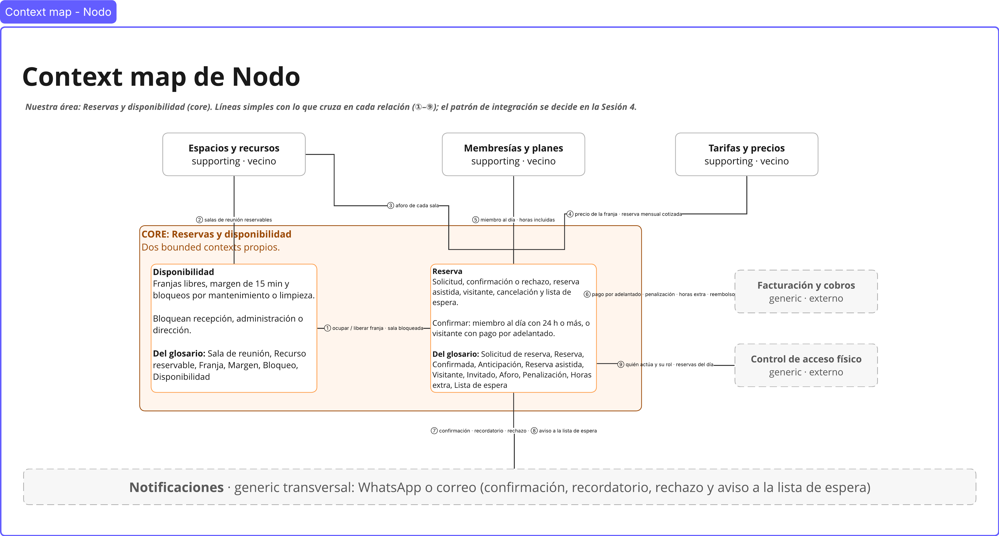

# Nodo · Reservas y disponibilidad

> **Curso:** Fundamentos de Domain-Driven Design · **Caso:** Nodo (coworking y eventos)
> **Área del grupo:** Reservas y disponibilidad (core)
> **Estado:** diseño estratégico — táctico pendiente, Sesiones 5–6

---

## Integrantes y roles

| Integrante | Rol |
|---|---|
| Integrante 1 | Subdominios y glosario |
| Integrante 2 | EventStorming y domain stories |
| Integrante 3 | Context map, reglas e invariantes y decisiones |

---

## 1. Qué es Nodo y cuál es nuestra área

**Nodo** es un espacio de coworking en una ciudad mediana. Ocupa dos plantas: una sala diáfana con escritorios (flexibles y fijos), varias salas de reunión cerradas de distintos tamaños y un salón grande para charlas y eventos. Vive de tres fuentes de ingreso: las membresías, el alquiler puntual de salas por horas y el alquiler del salón para eventos.

**Nuestra área, Reservas y disponibilidad,** decide qué sala de reunión está libre y quién se queda con ella. Es el **subdominio core**:

> Los clientes eligen Nodo porque **siempre encuentran un espacio disponible y reservarlo es rápido, sin solapes, sin sobrecupo y sin sorpresas**.

| Subdominio | Tipo |
|---|---|
| **Reservas y disponibilidad** | Core |
| Membresías y planes · Tarifas y precios · Agenda de eventos · Espacios y recursos | Supporting |
| Facturación y cobros · Control de acceso físico · Notificaciones (transversal) | Generic |

Detalle: [docs/01-subdominios.md](docs/01-subdominios.md) · Decisión: [decisiones/0002-clasificacion-del-area.md](decisiones/0002-clasificacion-del-area.md)

---

## 2. Bounded contexts identificados y por qué

El área se divide en **dos bounded contexts**, los dos core:

| Bounded context | Qué modela | Pregunta que responde |
|---|---|---|
| **Disponibilidad** | Franjas libres de cada sala de reunión, margen de 15 min y bloqueos por mantenimiento o limpieza | «¿Está libre la Sala B el jueves de 10:00 a 11:00?» |
| **Reserva** | El ciclo de vida de lo que pide una persona (miembro o visitante): solicitud, confirmación o rechazo, reserva asistida, cancelación, penalización, horas extra y lista de espera | «¿Puede Ana quedarse con esa franja, y qué pasa si cancela?» |

**Señales que justifican la frontera:**

1. **Polisemia:** *bloquear* (Nodo saca una franja, sin titular ni cobro) no es *cancelar* (el titular anula su reserva, con posible cobro).
2. **Reglas que cambian por su cuenta:** el margen y los bloqueos responden a la operación; la anticipación, la penalización y el pago del visitante, a la política comercial.
3. **Actores distintos:** bloquean recepción, administración o dirección; reservan el miembro, el visitante y recepción.
4. **Preguntas distintas:** «¿qué está libre?» frente a «¿esta persona puede quedarse con la franja?».

Detalle: [decisiones/0001-por-que-esta-frontera.md](decisiones/0001-por-que-esta-frontera.md)

---

## 3. Glosario del lenguaje ubicuo

| Contexto | Términos principales |
|---|---|
| **Disponibilidad** | Sala de reunión, Recurso reservable, Franja, Margen, Bloqueo, Disponibilidad |
| **Reserva** | Solicitud de reserva, Reserva, Confirmada, Anticipación, Reserva asistida, Miembro al día, Visitante, Invitado, Aforo, Cancelación, Cancelación tardía, Penalización, Horas extra, Lista de espera |

**Polisemias principales:**

| Palabra | En nuestra área | En otro contexto |
|---|---|---|
| **Reserva** | Franja de una sala de reunión asignada a una persona | Agenda de eventos: alquiler del salón · Facturación y cobros: cargo por cobrar |
| **Confirmar** | Franja disponible y miembro al día (o visitante con pago adelantado) | Agenda de eventos: depósito y aprobación de la dirección u operaciones |
| **Cliente** | Ocupante de la franja | Facturación y cobros: pagador · Control de acceso físico: persona identificada en la cerradura |

Detalle: [docs/02-glosario.md](docs/02-glosario.md)

---

## 4. Context map del área y sus vecinos



| # | Relación | Qué cruza |
|---|---|---|
| ① | Disponibilidad ↔ Reserva | Ocupar o liberar la franja · Sala bloqueada |
| ② | Espacios y recursos ↔ Disponibilidad | Salas de reunión reservables |
| ③ | Espacios y recursos ↔ Reserva | Aforo de cada sala |
| ④ | Tarifas y precios ↔ Reserva | Precio vigente de la franja · reserva mensual cotizada |
| ⑤ | Membresías y planes ↔ Reserva | Miembro al día · horas incluidas · horas consumidas |
| ⑥ | Reserva ↔ Facturación y cobros | Pago por adelantado · penalización · horas extra · reembolso |
| ⑦ ⑧ | Reserva ↔ Notificaciones | Confirmación, recordatorio y rechazo · aviso a la lista de espera |
| ⑨ | Control de acceso físico ↔ Reserva | Quién actúa y su rol · reservas del día |

Detalle: [docs/05-context-map.md](docs/05-context-map.md)

---

## 5. Reglas e invariantes candidatas

**Disponibilidad** (aggregate candidato: *Agenda del recurso*)

- **INV-D1** · Nunca dos ocupaciones se solapan en la misma sala.
- **INV-D2** · Siempre quedan 15 minutos de margen, también frente a un bloqueo.
- **INV-D3** · Una franja bloqueada no admite nuevas ocupaciones.
- **INV-D4** · Solo se libera una franja ocupada, y una sola vez.
- **INV-D5** · El exceso de tiempo nunca invade una reserva confirmada.

**Reserva** (aggregate candidato: *Reserva*; *Lista de espera* aparte)

- **INV-R1** · Toda reserva confirmada tiene su franja ocupada en Disponibilidad (cruza contextos).
- **INV-R2** · Una reserva solo pasa por estados válidos.
- **INV-R3** · La confirmación automática exige miembro al día y 24 h o más de anticipación.
- **INV-R4** · Ninguna reserva se registra con menos de 3 h de anticipación.
- **INV-R5** · Los asistentes nunca superan el aforo.
- **INV-R6** · Ninguna reserva de visitante se confirma sin pago por adelantado.
- **INV-R7** · Toda cancelación tardía genera exactamente una penalización (la franja completa).
- **INV-R8** · Toda reserva asistida registra quién la hizo y a nombre de quién.
- **INV-R9** · Una persona no está dos veces en la lista de espera de la misma franja.

Las **políticas** P-01 a P-11 («cuando… entonces…») reaccionan a eventos y no son invariantes.

Detalle: [docs/06-reglas-invariantes.md](docs/06-reglas-invariantes.md) · Origen de las reglas: [docs/03-eventstorming.md](docs/03-eventstorming.md) y [docs/04-domain-stories.md](docs/04-domain-stories.md)

---

## 6. Estado del proyecto

**Diseño estratégico — táctico pendiente, Sesiones 5–6.**

| Artefacto | Documento | Estado |
|---|---|---|
| Mapa de subdominios | [docs/01-subdominios.md](docs/01-subdominios.md) | Terminado |
| Glosario del lenguaje ubicuo | [docs/02-glosario.md](docs/02-glosario.md) | Terminado |
| EventStorming | [docs/03-eventstorming.md](docs/03-eventstorming.md) | Terminado |
| Domain stories (as-is / to-be) | [docs/04-domain-stories.md](docs/04-domain-stories.md) | Terminado |
| Context map | [docs/05-context-map.md](docs/05-context-map.md) | Terminado |
| Reglas e invariantes candidatas | [docs/06-reglas-invariantes.md](docs/06-reglas-invariantes.md) | Terminado |
| Decisiones (ADR) | [decisiones/](decisiones/) | Terminado |
| Esqueleto por bounded context | `src/` | Pendiente |
| Aggregates, servicios y prototipo | — | Pendiente |

Los artefactos visuales están en el tablero de Miro del proyecto; cada documento muestra la imagen exportada del frame correspondiente.

---

## Estructura del repositorio

```text
nodo-reservas-y-disponibilidad/
├── README.md
├── docs/
│   ├── 01-subdominios.md
│   ├── 02-glosario.md
│   ├── 03-eventstorming.md
│   ├── 04-domain-stories.md
│   ├── 05-context-map.md
│   ├── 06-reglas-invariantes.md
│   └── img/
├── decisiones/
│   ├── 0001-por-que-esta-frontera.md
│   └── 0002-clasificacion-del-area.md
└── src/
```
