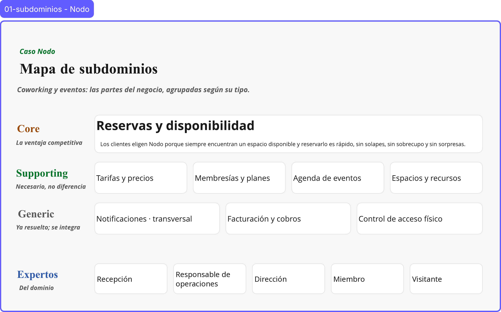

# 01 · Mapa de subdominios: Nodo

> **Proyecto:** Nodo (coworking y eventos) · **Área:** Reservas y disponibilidad (core)

---

## Vista general

---

## 1. Nodo y dónde está nuestra área

Nodo es un espacio de coworking en una ciudad mediana. Ocupa dos plantas: una sala diáfana con escritorios (flexibles y fijos), varias salas de reunión cerradas de distinto aforo y un salón grande que se transforma para charlas y eventos.

Vive de tres fuentes de ingreso:

1. Las **membresías** de quienes trabajan allí a diario.
2. El **alquiler puntual de salas** por horas.
3. El **alquiler del salón** para eventos de empresas y particulares.

El equipo es pequeño (recepción, un responsable de operaciones y la dirección) y hoy gestiona todo con una hoja de cálculo, un calendario compartido y grupos de WhatsApp. Quieren un sistema que sostenga la operación actual y que pueda crecer cuando abran una segunda sede.

**Nuestra área, Reservas y disponibilidad,** decide qué espacio está libre y quién se queda con él. Cubre las **salas que se reservan por franja horaria** (segunda fuente de ingreso): hoy, dos salas de reunión (de 8 y 16 personas) y la sala de capacitación (40 personas), según el experto. Cubre también el **equipo portátil** que se pide junto con una sala (proyector, televisores): hay pocas unidades y no se pueden asignar dos veces a la vez. Quedan fuera los escritorios, que no se reservan: el flexible se usa según el plan de membresía y el fijo se asigna a un miembro. También queda fuera el salón, que pertenece a Agenda de eventos.

Las demás áreas la rodean: Espacios y recursos define qué recursos existen, Membresías y planes dice quién puede reservar, Tarifas y precios fija cuánto cuesta, Facturación y cobros cobra y Notificaciones avisa.

---

## 2. ¿Por qué nos eligen?

Los clientes eligen Nodo porque **siempre encuentran un espacio disponible y reservarlo es rápido, sin solapes, sin sobrecupo y sin sorpresas**. Esa promesa define el core.

---

## 3. Clasificación

| Subdominio | Tipo | Justificación | Construir / integrar |
|---|---|---|---|
| **Reservas y disponibilidad** | Core | Es la promesa de valor: disponibilidad confiable, sin solapes ni sobrecupo, y una reserva sin fricción. Si falla, Nodo pierde frente a otro coworking. | Construir (desarrollo propio, máxima inversión) |
| Membresías y planes | Supporting | Define quién puede reservar (miembro al día) y cuántas horas de sala incluye cada plan: pase por día, mensual flexible, escritorio dedicado y plan de equipo. Todo coworking tiene planes: son necesarios, pero no diferencian. | Construir simple |
| Tarifas y precios | Supporting | El precio depende del tipo de recurso, de la franja, del plan del miembro y, en los eventos, del aforo y de los servicios extra. La dirección ajusta las tarifas por temporada u hora pico. Son reglas propias de Nodo, pero no son la razón por la que lo eligen. | Construir simple |
| Agenda de eventos | Supporting | Usa el salón con otro ciclo: depósito por adelantado, aforo máximo, servicios extra (equipo audiovisual propio y catering subcontratado) y aprobación de la dirección u operaciones en todo evento. Tiene otro proceso y otro lenguaje: «confirmar» un evento no es lo mismo que confirmar una sala. | Construir simple |
| Espacios y recursos | Supporting | Catálogo de salas de reunión, escritorios flexibles, escritorios fijos y salón de eventos, con su aforo. Es el dato maestro que consume nuestra área. | Construir simple (catálogo) |
| Facturación y cobros | Generic | Cada mes se factura la cuota de la membresía más los consumos. Se cobra con tarjeta, transferencia, código QR o efectivo en recepción. Facturar y cobrar funciona igual en cualquier negocio. | Integrar un software de facturación y una pasarela de pago |
| Control de acceso físico | Generic | La puerta se abre con una cerradura electrónica que reconoce un PIN, un código QR o la huella dactilar. Depende del hardware de la cerradura. | Integrar la solución de control de acceso de la cerradura electrónica |
| Notificaciones | Generic · transversal | Confirmaciones de reserva, recordatorios del día anterior, avisos de vencimiento de pago y avisos de sala liberada, por correo y WhatsApp. Casi todas las áreas la disparan, y enviar mensajes es un problema ya resuelto. | Integrar un servicio de envío de correo y mensajería |

---

## 4. Casos límite de la clasificación

- **¿El core es Reservas y disponibilidad o Membresías y planes?** Es Reservas y disponibilidad. La membresía es un modelo comercial que cualquier coworking replica; lo que el cliente percibe es encontrar sala y reservarla sin solapes. Membresías y planes solo aporta dos datos a nuestra área: si el miembro está al día y cuántas horas incluidas tiene.
- **¿Agenda de eventos es core?** No. Comparte el espacio físico, pero su «confirmar» exige depósito y aprobación de la dirección u operaciones. Tiene otro proceso y otro lenguaje, así que es un subdominio supporting aparte.
- **¿Notificaciones es un área como las demás?** No. Casi todas las áreas la disparan, por eso es transversal: nuestra área publica lo que ocurrió y Notificaciones se encarga del envío.

La decisión de clasificación y sus hotspots están en [decisiones/0002-clasificacion-del-area.md](../decisiones/0002-clasificacion-del-area.md). La división del área en bounded contexts está en [decisiones/0001-por-que-esta-frontera.md](../decisiones/0001-por-que-esta-frontera.md).

---

## 5. Expertos del dominio

| Experto | Qué conoce |
|---|---|
| Recepción | Gestiona hoy las reservas en el calendario compartido, registra reservas a nombre de otra persona, envía a mano los avisos por WhatsApp y abre la puerta a los visitantes. |
| Responsable de operaciones | Es quien relata la entrevista: reglas de reserva, margen de 15 min, cancelación y cuándo una reserva está confirmada. Junto con la dirección, aprueba los eventos. |
| Dirección | Fija y ajusta las tarifas, y aprueba los eventos antes de confirmarlos. |
| Miembro | Usuario diario: sabe cómo pide hoy una sala, qué información necesita ver para elegirla y qué le molesta del proceso actual (depender de recepción, avisos que no llegan). |
| Visitante | Usuario sin membresía: aporta el caso de quien reserva y paga por su cuenta, sin plan ni horas incluidas. |

Los usuarios también son expertos del dominio: viven el proceso real y aportan los casos que el equipo de Nodo no siempre ve (sesión 1).
