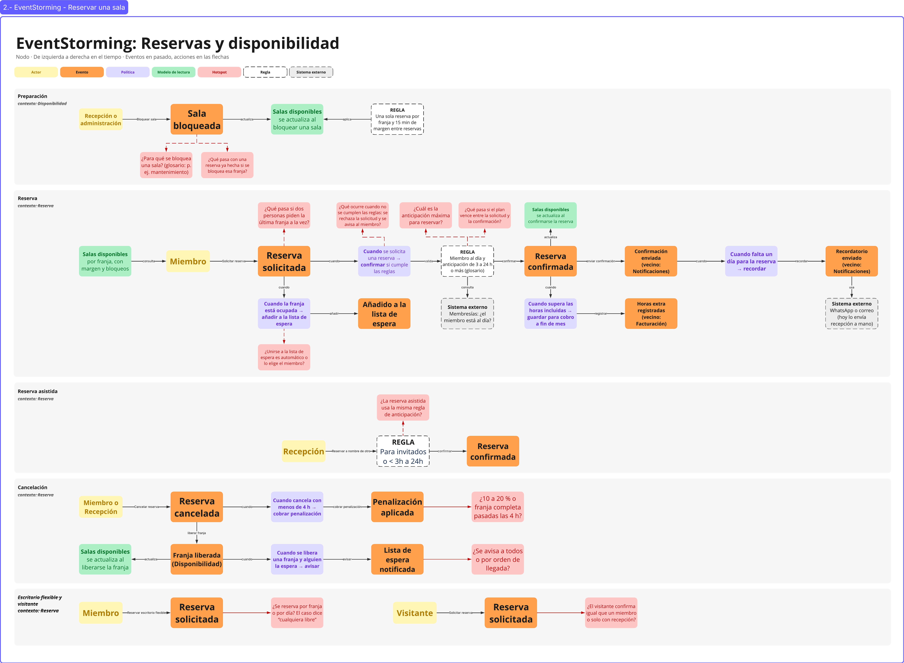

# 03 · EventStorming: Reservas y disponibilidad

> **Proyecto:** Nodo (coworking y eventos) · **Área:** Reservas y disponibilidad (core)
---

## Vista general del muro

---

## 1. Propósito

El EventStorming se hizo para:

- **Descubrir el proceso preguntando**: cada respuesta del experto se convierte en una nota con su tipo (evento, comando, regla, política…).
- **Dejar a la vista las dudas** como preguntas concretas, en lugar de taparlas.
- **Mostrar las reglas, las políticas y el modelo de lectura** que el proceso necesita para funcionar.

---

## 2. Alcance y suposiciones

### 2.1 Qué cubre el muro

| Línea | Qué pregunta responde | Por qué está |
|---|---|---|
| Preparación | ¿Cómo se sabe qué sala está libre y quién puede quitarla de la oferta? | Disponibilidad es la mitad del core y alimenta todo lo demás |
| Reserva | ¿Cómo pasa una solicitud a reserva confirmada? | Es el flujo principal y donde vive la «regla sagrada» de no solapar |
| Reserva asistida | ¿Qué cambia cuando recepción coordina la reserva? | El experto la describe como un camino distinto de confirmación |
| Cancelación | ¿Qué ocurre cuando una reserva se cae? | Concentra más reglas: cancelación sin costo, penalización, liberación de la franja y lista de espera |
| Escritorio flexible y visitante | ¿Qué cambia si reserva otro recurso u otro actor? | El caso dice que reservan miembros y visitantes, y que hay escritorios flexibles reservables |

### 2.2 Qué queda fuera

Escritorios fijos (se asignan a un miembro, no se reservan por franja), el salón de eventos (lo gestiona Eventos), la cotización que se convierte en reserva mensual, y el cálculo de horas extra, la facturación y el envío de avisos (pertenecen a otras áreas).

### 2.3 Suposiciones de trabajo

- Las horas extra y los avisos aparecen en el muro porque forman parte del flujo, pero con la etiqueta «(vecino: …)»: Reserva solo los usa o los dispara.
- La anticipación sigue el glosario: confirmación automática «de 3 a 24 h o más».
- La cancelación sin costo llega hasta 4 h antes (entrevista y caso).
- «Visitante» se interpreta como persona sin membresía.

---

## 3. Elementos del muro y notación

| Elemento | Forma | Qué es | Pregunta que lo hace aparecer |
|---|---|---|---|
| Actor | Amarillo | Quién ejecuta un comando | ¿Quién la hizo? |
| Evento | Naranja | Algo que ya ocurrió, en pasado | ¿Qué acaba de pasar? |
| Política | Lila | «Cuando… → …»: reacción automática a un evento | ¿Qué ocurre automáticamente después? |
| Modelo de lectura | Verde | Lo que se consulta para decidir | ¿Qué miró para decidir? |
| Regla | Blanco, borde punteado | Condición que debe cumplirse | ¿Qué debía cumplirse para que pasara? |
| Sistema externo | Gris, borde punteado | Algo fuera de la frontera del área | ¿Quién de afuera participa? |
| Hotspot | Rosa | Una duda abierta | ¿Qué no está claro? |
| Flecha negra | Línea sólida | Comando de una persona o acción automática | ¿Qué acción lo provocó? |
| Línea roja punteada | Línea punteada | Une un hotspot con la nota que cuestiona | |

Cada línea indica debajo de su título su **contexto**, Disponibilidad o Reserva. Las notas de otra área llevan la etiqueta «(vecino: …)».

**Códigos.** Las notas del muro no llevan código; aquí cada una lo lleva para poder citarla: **R-xx** para reglas, **P-xx** para políticas y **H-xx** para hotspots.

---

## 4. Catálogo de piezas

### 4.1 Reglas

Se distingue entre **invariante candidata** (algo que el sistema debe garantizar siempre) y **política** (una reacción, ver 4.2).

| ID | Regla | Línea | Tipo | Por qué está así |
|---|---|---|---|---|
| R-01 | Una sola reserva por franja y 15 min de margen entre reservas | Preparación | Invariante candidata | Define cuándo una franja está libre. Es la «regla sagrada» del experto y vive en Disponibilidad |
| R-02 | Miembro al día y anticipación de 3 a 24 h o más (glosario) | Reserva | Invariante candidata | Son las condiciones de la confirmación automática. Se separó de R-01 porque cambia por otros motivos: el estado del miembro y la política de anticipación |
| R-03 | Para invitados o < 3h a 24h | Reserva asistida | Por validar | Es la regla que el grupo recogió para la reserva asistida; su relación con la anticipación del glosario es una pregunta abierta (hotspot de la reserva asistida, ver 4.5) |

### 4.2 Políticas

Una política es una reacción automática, sin una persona que la ordene. No es una invariante.

| ID | Política | Dispara | Resultado | Por qué existe |
|---|---|---|---|---|
| P-01 | Cuando se solicita una reserva → confirmar si cumple las reglas | Reserva solicitada | Reserva confirmada | Para una sala queda confirmada apenas hay disponibilidad y el miembro está al día, sin pago previo |
| P-02 | Cuando la franja está ocupada → añadir a la lista de espera | Reserva solicitada | Añadido a la lista de espera | El caso menciona a quienes esperan un horario |
| P-03 | Cuando falta un día para la reserva → recordar | Confirmación enviada | Recordatorio enviado | El experto lista el recordatorio del día antes |
| P-04 | Cuando supera las horas incluidas → guardar para cobro a fin de mes | Reserva confirmada | Horas extra registradas | Las horas sobre las incluidas se cobran a fin de mes |
| P-05 | Cuando cancela con menos de 4 h → cobrar penalización | Reserva cancelada | Penalización aplicada | Sin cobro hasta 4 h antes; pasado ese punto se cobra la franja |
| P-06 | Cuando se libera una franja y alguien la espera → avisar | Franja liberada | Lista de espera notificada | El sistema debería avisar a quienes esperaban; hoy se hace a mano por WhatsApp |

### 4.3 Modelo de lectura

**Salas disponibles, por franja, con margen y bloqueos.** Es lo que el miembro mira para decidir si solicita. Aparece **cuatro veces** en el muro, una por cada momento en que se consulta o cambia, para no cruzar el muro con flechas largas:

| Aparición | Qué ocurre |
|---|---|
| Línea Reserva, al inicio | El miembro lo **consulta** antes de solicitar |
| Línea Preparación | Se **actualiza** al bloquear una sala |
| Línea Reserva, tras confirmar | Se **actualiza** al confirmarse la reserva |
| Línea Cancelación | Se **actualiza** al liberarse la franja |

### 4.4 Sistemas externos

- **Membresías:** el estado «al día» de un miembro lo determina otra área.
- **WhatsApp o correo:** canal de los avisos; hoy los envía la recepcionista a mano.

### 4.5 Hotspots

Un hotspot se deja como pregunta cuando los textos del caso y del experto no permiten responderla, en lugar de inventar una regla. Cada uno está unido a la nota que cuestiona.

| ID | Pregunta | Nota asociada | Por qué importa | Qué se asume mientras tanto |
|---|---|---|---|---|
| H-01 | ¿Para qué se bloquea una sala? (glosario: p. ej. mantenimiento) | Sala bloqueada | Define quién usa los bloqueos | Mantenimiento y usos internos de Nodo |
| H-02 | ¿Qué pasa con una reserva ya hecha si se bloquea esa franja? | Sala bloqueada | Choca con R-01 | Nada: no se inventa |
| H-03 | ¿Qué pasa si dos personas piden la última franja a la vez? | Reserva solicitada | Es R-01 sometida a concurrencia: define si el core está bien hecho | Solo una se queda con ella (caso) |
| H-04 | ¿Cuál es la anticipación máxima para reservar? | R-02 | El glosario no la fija | Sin límite máximo |
| H-05 | ¿Qué pasa si el plan vence entre la solicitud y la confirmación? | R-02 | La regla «al día» en el tiempo | Nada |
| H-06 | ¿Unirse a la lista de espera es automático o lo elige el miembro? | P-02 | Cambia el comando y el actor | Automático, como está en el muro |
| H-07 | ¿Se avisa a todos o por orden de llegada? | Lista de espera notificada | Define la política P-06 | Nada |
| H-08 | ¿10 a 20 % o franja completa pasadas las 4 h? | Penalización aplicada | La entrevista y el caso dicen franja completa; el cuestionario, 10 a 20 % | Franja completa |
| H-09 | ¿La reserva asistida usa la misma regla de anticipación? | R-03 | El experto dijo 24 h preferible y 3 h en coordinación con recepción; el glosario dice «3 a 24 h o más» | Se mantiene lo del glosario |
| H-10 | ¿Se reserva por franja o por día? El caso dice «cualquiera libre» | Reserva solicitada (escritorio flexible) | Cambia la definición de franja | Nada |
| H-11 | ¿El visitante confirma igual que un miembro o solo con recepción? | Reserva solicitada (visitante) | Sustituye a la regla «miembro al día» | Nada |
| H-12 | ¿Qué ocurre cuando no se cumplen las reglas: se rechaza la solicitud y se avisa al miembro? | P-01 | El muro solo muestra el camino feliz | Nada: no se crea un evento de rechazo |

---

## 5. Procesos

Notación: actor — comando → evento; {política}; [modelo de lectura]; ⟨regla⟩.

**5.1 Preparación · Disponibilidad**
Recepción o administración — Bloquear sala → **Sala bloqueada** → [Salas disponibles]. Regla R-01 sobre el modelo de lectura. Hotspots: H-01, H-02.

**5.2 Reserva · Reserva**
[Salas disponibles] ← Miembro — Solicitar reserva → **Reserva solicitada** → {P-01} → ⟨R-02⟩ → **Reserva confirmada** → [Salas disponibles]

| Desde | Resultado |
|---|---|
| Reserva solicitada, si la franja está ocupada (P-02) | **Añadido a la lista de espera** |
| Reserva confirmada, si supera las horas incluidas (P-04) | **Horas extra registradas** (vecino: Facturación) |
| Reserva confirmada, acción de enviar la confirmación | **Confirmación enviada** (vecino: Notificaciones) |
| Confirmación enviada, un día antes (P-03) | **Recordatorio enviado** (vecino: Notificaciones), por WhatsApp o correo |

R-02 consulta al sistema externo Membresías. Hotspots: H-03, H-04, H-05, H-06, H-12.

**5.3 Reserva asistida · Reserva**
Recepción — Reservar a nombre de otro → ⟨R-03⟩ → **Reserva confirmada**. Hotspot: H-09.

**5.4 Cancelación · Reserva**
Miembro o Recepción — Cancelar reserva → **Reserva cancelada** → {P-05} → **Penalización aplicada**
**Reserva cancelada** → (liberar franja) → **Franja liberada** (Disponibilidad) → [Salas disponibles] → {P-06} → **Lista de espera notificada**
Hotspots: H-07, H-08.

**5.5 Escritorio flexible y visitante · Reserva**
Miembro — Reservar escritorio flexible → **Reserva solicitada** (H-10). Visitante — Solicitar reserva → **Reserva solicitada** (H-11).

---

## 6. Decisiones de diseño del muro

| Decisión | Alternativa descartada | Por qué |
|---|---|---|
| El modelo de lectura se repite en cuatro lugares | Una sola nota con flechas largas | Cada actualización queda junto al evento que la causa y el muro se lee sin cruces |
| Cada hotspot se une con línea roja punteada a su nota | Una línea aparte de preguntas, con números | La duda se lee donde surge |
| Horas extra y avisos llevan la etiqueta de vecino | Sacarlos del muro | Se ve dónde termina la responsabilidad de Reserva sin ocultar el flujo |
| «Franja liberada» es un evento de Disponibilidad | Dejarlo dentro de Reserva | Es lo que cambia lo que se puede reservar. Cancelar es una acción sobre la reserva; liberar le ocurre a la franja |
| Margen y anticipación son reglas separadas | Una sola regla | Cambian por motivos distintos y pertenecen a contextos distintos |
| La lista de espera es una rama de la reserva | Una línea propia | Es consecuencia de una solicitud sobre una franja ocupada |
| El rechazo es un hotspot, no un evento | Crear «Reserva rechazada» | Los textos no dicen qué ocurre; un evento inventado se leería como un hecho |
| La anticipación sigue el glosario | Usar la cifra de la entrevista | Mantiene un único valor mientras se valida con el experto |

---

## 7. Casos límite

| ¿Qué pasa si…? | Cobertura en el muro | Estado |
|---|---|---|
| El miembro cancela 2 o 3 h antes | P-05 y P-06 | Cubierto: se cobra y se avisa a la lista de espera |
| Cancela justo a las 4 h | La entrevista dice «hasta cuatro horas antes» sin cobro | El límite es inclusivo; no está escrito en el muro |
| Dos personas piden la última franja a la vez | H-03 | Abierto: el caso dice que solo una debe quedarse con ella |
| Recepción bloquea una franja ya reservada | H-02 | Abierto |
| El plan vence entre la solicitud y la confirmación | H-05 | Abierto |
| Un miembro con deuda solicita una reserva | R-02 y H-12 | La regla existe; el rechazo queda como pregunta |
| Un visitante reserva | H-11 | Abierto |
| Se libera una franja y varios esperan | H-07 | Abierto |
| Recepción cancela en nombre del miembro: ¿quién paga la penalización? | No está en el muro | Candidato a un nuevo hotspot |

---

## 8. De las notas al diseño

Cada tipo de nota apunta a una pieza del diseño posterior:

- **H-03 y R-01:** la concurrencia sobre la última franja se convierte en una invariante: nunca dos reservas en la misma franja.
- **P-05 y P-06:** la penalización y el aviso a la lista de espera cruzan hacia otras áreas, así que se convierten en eventos que esas áreas escuchan.
- **«Salas disponibles»:** el modelo de lectura se convierte en una vista que se actualiza con los eventos de bloqueo, confirmación y liberación.
