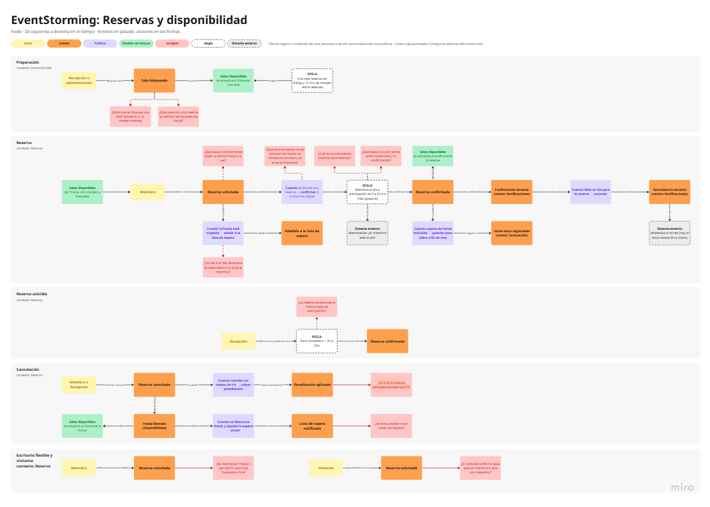

# 03 · EventStorming: Reservas y disponibilidad

> **Proyecto:** Nodo (coworking y eventos) · **Área:** Reservas y disponibilidad (core)
> **Estado:** diseño estratégico, versión 1 (borrador)
---

## Vista general del muro

---

## 1. Alcance y suposiciones

**Cubre cinco líneas de proceso:** Preparación (bloqueo de salas, contexto Disponibilidad), Reserva, Reserva asistida, Cancelación, y Escritorio flexible y visitante (estas cuatro, contexto Reserva).

**Queda fuera:** escritorios fijos (se asignan a un miembro), salón de eventos (lo gestiona Eventos), cotización aceptada que se convierte en reserva mensual, y el cálculo de horas extra, la facturación y el envío de avisos (pertenecen a otras áreas).

**Suposiciones de trabajo**

- Horas extra y avisos aparecen en el muro con la etiqueta «(vecino: …)», porque Reserva solo los usa o los dispara.
- La anticipación sigue el glosario: «automática de 3 a 24 h o más».
- La cancelación sin costo llega hasta 4 h antes (entrevista y caso).
- «Visitante» significa persona sin membresía (inferencia; validar con el experto).
- Si alguna cambia, el impacto está en pocas notas del muro.

---

## 2. Cómo leer el muro

| Elemento | Forma | Significado |
|---|---|---|
| Actor | Amarillo | Quién ejecuta un comando |
| Evento | Naranja | Algo que ya ocurrió, en pasado |
| Política | Lila | «Cuando… → …»: reacciona a un evento |
| Modelo de lectura | Verde | Lo que se consulta para decidir |
| Regla | Blanco, borde punteado | Condición que debe cumplirse |
| Sistema externo | Gris, borde punteado | Algo fuera de la frontera |
| Hotspot | Rosa | Duda abierta |
| Flecha negra | Línea sólida | Comando de una persona o acción automática de una política |
| Línea roja punteada | Línea punteada | Une un hotspot con la nota que cuestiona |

Cada línea indica debajo del título su **contexto**. Las notas de otros contextos llevan la etiqueta «(vecino: …)».

---

## 3. Procesos

Notación: actor — comando → evento; {política}; [modelo de lectura]; ⟨regla⟩.

### 3.1 Preparación · Disponibilidad

> Recepción o administración — Bloquear sala → **Sala bloqueada** → [Salas disponibles]

La regla R-01 se aplica al modelo de lectura. Hotspots: H-01 y H-02.

### 3.2 Reserva · Reserva

> [Salas disponibles] ← Miembro — Solicitar reserva → **Reserva solicitada** → {P-01} → ⟨R-02⟩ → **Reserva confirmada** → [Salas disponibles]

| Desde | Resultado |
|---|---|
| Reserva solicitada, si la franja está ocupada (P-02) | **Añadido a la lista de espera** |
| Reserva confirmada, si supera las horas incluidas (P-04) | **Horas extra registradas** (vecino: Facturación) |
| Reserva confirmada, acción de enviar confirmación | **Confirmación enviada** (vecino: Notificaciones) |
| Confirmación enviada, un día antes (P-03) | **Recordatorio enviado** (vecino: Notificaciones), por WhatsApp o correo |

La regla R-02 consulta al sistema externo **Membresías** («¿el miembro está al día?»). Hotspots: H-03, H-04, H-05, H-06 y H-12.

### 3.3 Reserva asistida · Reserva

> Recepción — Reservar a nombre de otro → ⟨R-03⟩ → **Reserva confirmada**

R-03 no coincide con el glosario y está por validar (H-09). Falta mostrar la solicitud y quién aprueba o anula.

### 3.4 Cancelación · Reserva

> Miembro o Recepción — Cancelar reserva → **Reserva cancelada**
> → {P-05} → **Penalización aplicada**
> → (liberar franja) → **Franja liberada** (Disponibilidad) → [Salas disponibles]
> → {P-06} → **Lista de espera notificada**

Hotspots: H-07 y H-08.

### 3.5 Escritorio flexible y visitante · Reserva

> Miembro — Reservar escritorio flexible → **Reserva solicitada** → (H-10)
> Visitante — Solicitar reserva → **Reserva solicitada** → (H-11)

Sin reglas propias todavía: dependen de las respuestas a H-10 y H-11.

---

## 4. Políticas, modelo de lectura y sistemas externos

### Políticas

| ID | Política | Dispara | Resultado |
|---|---|---|---|
| P-01 | Cuando se solicita una reserva → confirmar si cumple las reglas | Reserva solicitada | Reserva confirmada |
| P-02 | Cuando la franja está ocupada → añadir a la lista de espera | Reserva solicitada | Añadido a la lista de espera |
| P-03 | Cuando falta un día para la reserva → recordar | Confirmación enviada | Recordatorio enviado |
| P-04 | Cuando supera las horas incluidas → guardar para cobro a fin de mes | Reserva confirmada | Horas extra registradas |
| P-05 | Cuando cancela con menos de 4 h → cobrar penalización | Reserva cancelada | Penalización aplicada |
| P-06 | Cuando se libera una franja y alguien la espera → avisar | Franja liberada | Lista de espera notificada |

### Modelo de lectura

**Salas disponibles, por franja, con margen y bloqueos.** Aparece cuatro veces en el muro:

| Aparición | Qué ocurre |
|---|---|
| Línea Reserva, inicio | El miembro lo **consulta** antes de solicitar |
| Línea Preparación | Se **actualiza** al bloquear una sala |
| Línea Reserva, tras confirmar | Se **actualiza** al confirmarse la reserva |
| Línea Cancelación | Se **actualiza** al liberarse la franja |

### Sistemas externos

- **Membresías:** responde si el miembro está al día.
- **WhatsApp o correo:** canal de avisos; hoy los envía la recepcionista a mano.

---

## 5. Reglas del muro e invariantes candidatas

**Reglas anotadas en el muro**

| ID | Regla | Línea |
|---|---|---|
| R-01 | Una sola reserva por franja y 15 min de margen entre reservas | Preparación |
| R-02 | Miembro al día y anticipación de 3 a 24 h o más (glosario) | Reserva |
| R-03 | Para invitados o < 3h a 24h | Reserva asistida (a validar, H-09) |

**Invariantes candidatas** (siempre ciertas; el detalle irá en `06-reglas-invariantes.md`)

| ID | Invariante candidata | Fuente | ¿Corazón del aggregate (S5)? |
|---|---|---|---|
| INV-01 | Dos reservas no pueden ocupar la misma franja del mismo recurso | Entrevista («regla sagrada») | **Sí**, ligada a H-03 |
| INV-02 | Entre dos reservas de la misma sala deben quedar 15 min | Entrevista, glosario | Sí |
| INV-03 | Una franja bloqueada no puede reservarse | Glosario | Sí |
| INV-04 | Solo un miembro al día puede confirmar una reserva | Entrevista, glosario | Parcial: depende de un dato importado |
| INV-05 | La confirmación automática exige la anticipación del glosario | Glosario | A validar (H-04, H-09) |
| INV-06 | Solo recepción o administración puede bloquear una sala | Glosario | Permiso, no estado |
| INV-07 | Una reserva confirmada conserva su precio aunque cambie la tarifa | Caso | A definir con Tarificación |

**Son políticas, no invariantes:** cancelación sin costo hasta 4 h y penalización después (P-05), aviso a la lista de espera (P-06), confirmación automática (P-01) y recordatorio (P-03).

---

## 6. Casos límite

| ¿Qué pasa si…? | Cobertura en el muro | Estado |
|---|---|---|
| El miembro cancela 2 o 3 h antes | P-05 y P-06 | Cubierto: se cobra y se avisa a la lista de espera |
| Cancela justo a las 4 h | La entrevista dice «hasta cuatro horas antes» sin cobro; no está anotado | Pendiente: dejar escrito que el límite es inclusivo |
| Dos personas piden la última franja a la vez | H-03 | Abierto. El caso dice que solo una debe quedarse con ella |
| Recepción bloquea una franja ya reservada | H-02 | Abierto |
| El plan vence entre la solicitud y la confirmación | H-05 | Abierto |
| Un miembro con deuda solicita una reserva | INV-04 y H-12 | Parcial: la regla existe, falta el camino de rechazo |
| Un visitante reserva | H-11 | Abierto |
| Se libera una franja y nadie espera | P-06 («si alguien la espera») | Cubierto |
| Se libera una franja y varios esperan | H-07 | Abierto |
| Recepción cancela en nombre del miembro: ¿quién paga la penalización? | No está en el muro | Candidato a nuevo hotspot |

---

## 7. Hotspots

| ID | Pregunta (como está en el muro) | Nota asociada | Por qué importa | Suposición mientras tanto |
|---|---|---|---|---|
| H-01 | ¿Para qué se bloquea una sala? (glosario: p. ej. mantenimiento) | Sala bloqueada | Define quién usa los bloqueos | Mantenimiento y usos internos de Nodo |
| H-02 | ¿Qué pasa con una reserva ya hecha si se bloquea esa franja? | Sala bloqueada | Choca con INV-01 e INV-03 | Ninguna: no se inventa |
| H-03 | ¿Qué pasa si dos personas piden la última franja a la vez? | Reserva solicitada | Es la invariante que define si el core está bien hecho | Solo una se queda con ella (caso) |
| H-04 | ¿Cuál es la anticipación máxima para reservar? | R-02 | El glosario no la fija | Sin límite máximo |
| H-05 | ¿Qué pasa si el plan vence entre la solicitud y la confirmación? | R-02 | La regla «al día» en el tiempo | Ninguna |
| H-06 | ¿Unirse a la lista de espera es automático o lo elige el miembro? | P-02 | Cambia el comando y el actor | Automático (como está en el muro) |
| H-07 | ¿Se avisa a todos o por orden de llegada? | Lista de espera notificada | Define la política P-06 | Ninguna |
| H-08 | ¿10 a 20 % o franja completa pasadas las 4 h? | Penalización aplicada | La entrevista y el caso dicen franja completa; el cuestionario, 10 a 20 % | Franja completa |
| H-09 | ¿La reserva asistida usa la misma regla de anticipación? | R-03 | El experto dijo 24 h preferible y 3 h con recepción; el glosario dice «3 a 24 h o más» | Se mantiene lo del glosario |
| H-10 | ¿Se reserva por franja o por día? El caso dice «cualquiera libre» | Reserva solicitada (escritorio) | Cambia la definición de franja | Ninguna |
| H-11 | ¿El visitante confirma igual que un miembro o solo con recepción? | Reserva solicitada (visitante) | Sustituye a la regla «miembro al día» | Ninguna |
| H-12 | ¿Qué ocurre cuando no se cumplen las reglas: se rechaza la solicitud y se avisa al miembro? | P-01 | Falta el camino de rechazo | Ninguna |

Los doce hotspots están abiertos y asociados a una nota. Ninguno está resuelto todavía.

---

## 8. Lectura en voz alta

Que alguien del grupo haga de experto y lea cada línea:

1. «Recepción bloquea una sala; la sala queda bloqueada y la vista de salas disponibles se actualiza.»
2. «El miembro consulta las salas disponibles y solicita una reserva. Cuando se solicita, se confirma si cumple las reglas: miembro al día y la anticipación del glosario. La reserva queda confirmada.»
3. «Cuando la franja está ocupada, se añade a la lista de espera.»
4. «El miembro o recepción cancela una reserva. Cuando cancela con menos de 4 horas, se cobra la penalización. La franja se libera y, si alguien la espera, se le avisa.»

**Nombres a revisar al leerlos:**

- «Reservar a nombre de otro» debería llamarse como el término del glosario, **reserva asistida**.
- La regla R-03 dice «invitados»; el término acordado es **visitante**.
- P-03 se activa después de «Confirmación enviada»; lo natural es que dependa de «Reserva confirmada» y de la fecha.

**Resultado:** pendiente de realizar con el grupo.

---

## 9. Autoevaluación y pendientes

| Criterio de la guía (artefacto 4) | Estado |
|---|---|
| **Medio:** línea de eventos en pasado y ordenada | Cumplido |
| **Medio:** comandos, actores y algún sistema externo | Cumplido (los comandos van como etiquetas de flecha) |
| **Medio:** hotspots anotados | Cumplido: 12 |
| **Alto:** gramática completa, con modelo de lectura y políticas «cuando → entonces» | Cumplido |
| **Alto:** procesos encadenados | Parcial: faltan el rechazo y la solicitud de la reserva asistida |
| **Alto:** hotspots resueltos o convertidos en pregunta clara | Convertidos en pregunta clara; ninguno resuelto |
| **Alto:** cada regla anotada como invariante candidata | Cumplido (sección 5) |
| Casos límite explícitos | Cumplido (sección 6) |

**Nivel estimado:** medio completo, con varios elementos del alto.

**Pendientes**

- [ ] Renombrar el frame y el título interno del muro.
- [ ] Exportar el muro como imagen e insertarla (`docs/img/03-eventstorming.png`).
- [ ] Alinear R-03 con el glosario y cambiar «invitados» por «visitantes».
- [ ] Agregar la solicitud y la aprobación en la reserva asistida.
- [ ] Agregar el camino de rechazo cuando se defina qué ocurre (H-12).
- [ ] Anotar que el límite de 4 h es inclusivo.
- [ ] Llevar los hotspots al experto o al facilitador.
- [ ] Hacer la lectura en voz alta con el grupo.

## Historial

| Fecha | Cambio |
|---|---|
| 2026-10-18 | Versión 1: muro rediseñado con hotspots conectados y documento inicial |
