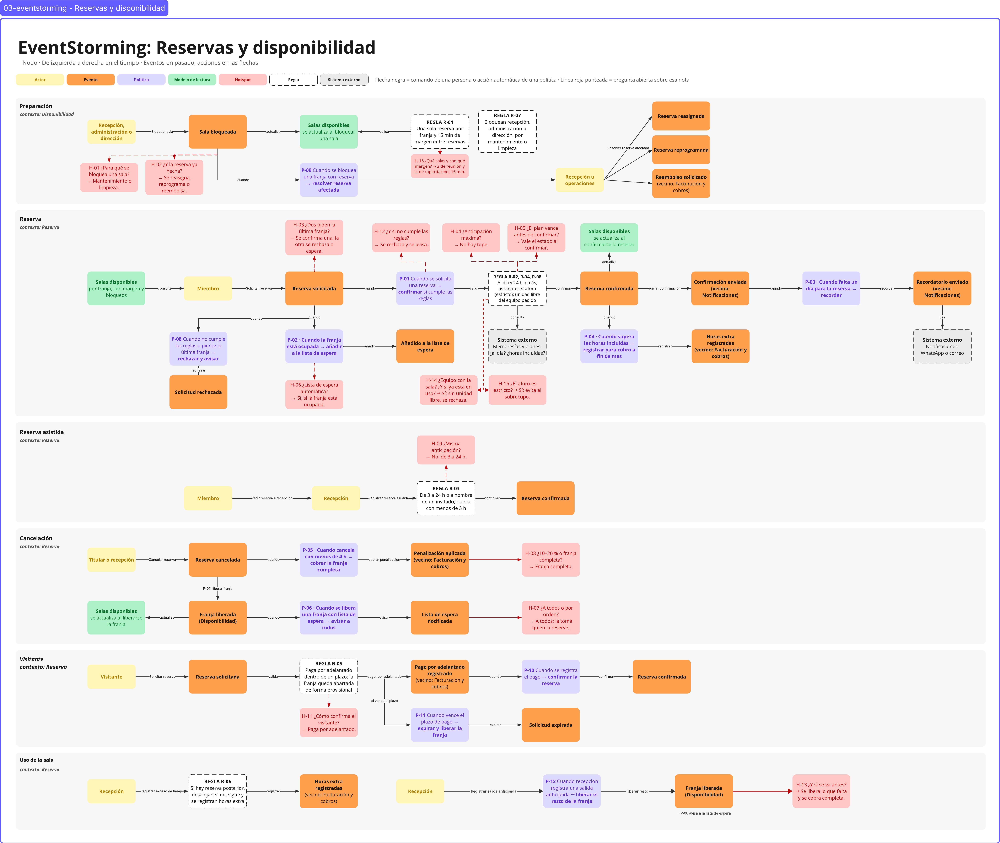

# 03 · EventStorming: Reservas y disponibilidad

> **Proyecto:** Nodo (coworking y eventos) · **Área:** Reservas y disponibilidad (core)

---

## Vista general del muro

---

## 1. Propósito

El EventStorming se hizo para:

- **Descubrir el proceso preguntando**: cada respuesta del experto se convierte en una nota con su tipo (evento, comando, regla, política…).
- **Resolver las dudas** como preguntas concretas (hotspots) y dejar escrita la respuesta del experto.
- **Mostrar las reglas, las políticas y el modelo de lectura** que el proceso necesita para funcionar.

Los términos del muro son los de [02-glosario.md](02-glosario.md).

---

## 2. Alcance

### 2.1 Qué cubre el muro

| Línea | Contexto | Qué pregunta responde |
|---|---|---|
| Preparación | Disponibilidad | ¿Cómo se sabe qué sala de reunión está libre, quién la saca de la oferta y qué pasa si ya tenía una reserva? |
| Reserva | Reserva | ¿Cómo pasa la solicitud de un miembro a reserva confirmada o rechazada? |
| Reserva asistida | Reserva | ¿Qué cambia cuando recepción registra la reserva (anticipación de 3 a 24 h o a nombre de un invitado)? |
| Cancelación | Reserva | ¿Qué ocurre cuando una reserva se cancela: cobro, liberación de la franja y aviso a la lista de espera? |
| Visitante | Reserva | ¿Cómo confirma su reserva una persona sin membresía? |
| Uso de la sala | Reserva | ¿Qué pasa si alguien se queda más tiempo del reservado, o se va antes? |

### 2.2 Qué queda fuera

- **Escritorios:** no se reservan. El flexible se usa según el plan de membresía y el fijo se asigna a un miembro.
- **Salón:** pertenece a Agenda de eventos.
- **Catálogo de equipos y su precio:** qué equipos existen lo dice Espacios y recursos y cuánto cuestan, Tarifas y precios. Nuestra área solo decide **si una unidad está libre en una franja** y la asigna (R-08). El equipo fijo de una sala no se reserva aparte.
- **Cotizaciones** de eventos o de reservas mensuales: vencen a los 4 días y no bloquean el recurso; pertenecen a Tarifas y precios y a Agenda de eventos.
- **Cobro, cálculo de montos y envío de avisos:** pertenecen a Facturación y cobros y a Notificaciones. En el muro aparecen con la etiqueta «(vecino: …)», porque Reserva solo los dispara.

---

## 3. Elementos del muro y notación

| Elemento | Forma | Qué es | Pregunta que lo hace aparecer |
|---|---|---|---|
| Actor | Amarillo | Quién ejecuta un comando | ¿Quién lo hizo? |
| Evento | Naranja | Algo que ya ocurrió, en pasado | ¿Qué acaba de pasar? |
| Política | Lila | «Cuando… → …»: reacción automática a un evento | ¿Qué ocurre automáticamente después? |
| Modelo de lectura | Verde | Lo que se consulta para decidir | ¿Qué miró para decidir? |
| Regla | Blanco, borde punteado | Condición que debe cumplirse | ¿Qué debía cumplirse para que pasara? |
| Sistema externo | Gris, borde punteado | Algo fuera de la frontera del área | ¿Quién de afuera participa? |
| Hotspot | Rosa | Una duda, con su respuesta | ¿Qué no estaba claro? |
| Flecha negra | Línea sólida | Comando de una persona o acción automática | ¿Qué acción lo provocó? |
| Línea roja punteada | Línea punteada | Une un hotspot con la nota que cuestiona | |

**Códigos.** Las notas del muro no llevan código; aquí cada una lo lleva para poder citarla desde los otros documentos: **R-xx** para reglas, **P-xx** para políticas y **H-xx** para hotspots.

---

## 4. Catálogo de piezas

### 4.1 Reglas

| ID | Regla | Línea | Invariante candidata |
|---|---|---|---|
| R-01 | Una sola reserva por franja en cada sala de reunión, con 15 min de margen entre reservas | Preparación | Nunca dos reservas de la misma sala se solapan, y entre ellas siempre quedan 15 min |
| R-02 | Confirmación automática: miembro al día **al momento de confirmar** y anticipación de 24 h o más | Reserva | Una reserva se confirma sola solo si, al confirmar, el miembro está al día y faltan 24 h o más |
| R-03 | Reserva asistida: anticipación de 3 a 24 h o a nombre de un invitado; nunca con menos de 3 h | Reserva asistida | Ninguna reserva se registra con menos de 3 h de anticipación |
| R-04 | Los asistentes de una reserva no superan el aforo de la sala | Reserva | Nunca hay sobrecupo |
| R-05 | El visitante paga por adelantado dentro de un plazo límite; mientras tanto, la franja queda apartada de forma provisional | Visitante | Ninguna reserva de visitante se confirma sin pago por adelantado |
| R-06 | Si hay una reserva posterior confirmada, quien se excede debe desalojar; si no la hay, puede seguir y se registran horas extra | Uso de la sala | El exceso de tiempo nunca invade una reserva confirmada |
| R-07 | Solo recepción, administración o dirección bloquean una sala, por mantenimiento o limpieza | Preparación | Una franja bloqueada no se puede reservar |
| R-08 | El equipo portátil pedido con la reserva (proyector, televisor) debe tener una unidad libre en toda la franja; una unidad no se asigna dos veces a la vez, ni siquiera entre una sala y el salón | Reserva | Una unidad de equipo nunca está en dos ocupaciones que se solapan |

### 4.2 Políticas

Una política es una reacción a un evento: «cuando… → …».

| ID | Política | Dispara | Resultado |
|---|---|---|---|
| P-01 | Cuando se solicita una reserva → confirmarla si cumple R-01, R-02 y R-04 | Reserva solicitada | Reserva confirmada |
| P-02 | Cuando la franja está ocupada → añadir a la lista de espera | Reserva solicitada | Añadido a la lista de espera |
| P-03 | Cuando falta un día para la reserva → recordar | Confirmación enviada | Recordatorio enviado |
| P-04 | Cuando se superan las horas incluidas en el plan → registrar horas extra para el cobro a fin de mes | Reserva confirmada | Horas extra registradas |
| P-05 | Cuando se cancela con menos de 4 h → cobrar la franja completa | Reserva cancelada | Penalización aplicada |
| P-06 | Cuando se libera una franja con lista de espera → avisar a todos los que esperan | Franja liberada | Lista de espera notificada |
| P-07 | Cuando se cancela una reserva confirmada → liberar su franja | Reserva cancelada | Franja liberada |
| P-08 | Cuando una solicitud no cumple las reglas o pierde la última franja → rechazarla y avisar | Reserva solicitada | Solicitud rechazada |
| P-09 | Cuando se bloquea una franja que tiene una reserva confirmada → resolver la reserva afectada | Sala bloqueada | Reserva reasignada / Reserva reprogramada / Reembolso solicitado |
| P-10 | Cuando se registra el pago por adelantado de un visitante → confirmar su reserva | Pago por adelantado registrado | Reserva confirmada |
| P-11 | Cuando vence el plazo de pago de un visitante sin pago registrado → expirar la solicitud y liberar la franja | Plazo de pago vencido | Solicitud expirada → Franja liberada |
| P-12 | Cuando recepción registra una salida anticipada → liberar el tramo que falta de la franja | Salida anticipada registrada (comando de recepción) | Franja liberada → P-06 |

### 4.3 Modelo de lectura

**Salas disponibles, por franja, con margen y bloqueos.** Es lo que se mira para decidir si se solicita. Aparece **cuatro veces** en el muro, una por cada momento en que se consulta o cambia:

| Aparición | Qué ocurre |
|---|---|
| Línea Reserva, al inicio | El miembro lo **consulta** antes de solicitar |
| Línea Preparación | Se **actualiza** al bloquear una sala |
| Línea Reserva, tras confirmar | Se **actualiza** al confirmarse la reserva |
| Línea Cancelación | Se **actualiza** al liberarse la franja |

### 4.4 Sistemas externos

- **Membresías y planes:** indica si el miembro está al día y cuántas horas incluidas tiene.
- **Facturación y cobros:** registra el pago por adelantado del visitante y cobra la penalización, las horas extra y los reembolsos.
- **Notificaciones:** envía por WhatsApp o correo la confirmación, el recordatorio, el rechazo y el aviso a la lista de espera.
- **Agenda de eventos:** usa el mismo equipo portátil en el salón, así que también lo ocupa por franja (R-08).

### 4.5 Hotspots

| ID | Pregunta | Nota asociada | Respuesta | Cómo queda en el muro |
|---|---|---|---|---|
| H-01 | ¿Para qué se bloquea una sala? | Sala bloqueada | Por mantenimiento o limpieza. | R-07 |
| H-02 | ¿Qué pasa con una reserva ya hecha si se bloquea esa franja? | Sala bloqueada | La reserva no se elimina sin solución: recepción u operaciones la reasigna a una sala equivalente o coordina la reprogramación o el reembolso, según lo que prefiera el titular. | P-09 y comando «Resolver reserva afectada» |
| H-03 | ¿Qué pasa si dos personas piden la última franja a la vez? | Reserva solicitada | Solo una solicitud se confirma; la otra se rechaza o entra en la lista de espera. | P-01, P-02, P-08 |
| H-04 | ¿Cuál es la anticipación máxima para reservar? | R-02 | No hay tope máximo. | R-02 |
| H-05 | ¿Qué pasa si el plan vence entre la solicitud y la confirmación? | R-02 | Vale el estado al momento de confirmar: si el plan ya no está activo o al día, no se confirma. | R-02, P-08 |
| H-06 | ¿Unirse a la lista de espera es automático o lo elige el miembro? | P-02 | Es automático cuando la franja está ocupada. | P-02 |
| H-07 | Cuando se libera una franja, ¿se avisa a todos o por orden de llegada? | Lista de espera notificada | A todos; no hay asignación automática: la franja la toma quien la reserve. | P-06 |
| H-08 | Pasadas las 4 h, ¿se cobra el 10 al 20 % o la franja completa? | Penalización aplicada | La franja completa. Así lo dicen el enunciado y la entrevista escrita. En la entrevista oral el experto contó que hoy recepción aplica del 10 al 20 % a su criterio: es la práctica manual del as-is ([04-domain-stories.md](04-domain-stories.md), historia 2), no la regla del sistema. | P-05 |
| H-09 | ¿La reserva asistida usa la misma regla de anticipación? | R-03 | No: aplica de 3 a 24 h; con menos de 3 h no se puede reservar. | R-03 |
| H-10 | ¿El escritorio flexible se reserva por franja o por día? | (línea retirada) | No se reserva: se usa según el plan de membresía. | Fuera del alcance ([Qué queda fuera](#22-qué-queda-fuera)) |
| H-11 | ¿El visitante confirma igual que un miembro o solo con recepción? | Reserva solicitada (visitante) | Debe pagar por adelantado dentro de un plazo límite; mientras tanto, la franja queda apartada de forma provisional. Si no paga, la solicitud expira. | R-05, P-10, P-11 |
| H-12 | ¿Qué ocurre cuando no se cumplen las reglas? | P-01 | La solicitud se rechaza y se avisa a quien la pidió. | P-08, Solicitud rechazada |
| H-13 | ¿Qué pasa si alguien se va antes de que termine su franja? | Uso de la sala | Recepción lo sabe y puede dar la sala a otros; es quien cambia el estado (sesión 2). La reserva se cobra completa (decisión del equipo: no hay reembolso parcial). | P-12, Franja liberada |
| H-14 | ¿Se puede pedir equipo junto con la sala? ¿Qué pasa si ya está en uso? | Reserva solicitada | Sí: proyector, televisor o equipo de conferencias (sesión 1). Un equipo asignado no está disponible y no se sobreasigna; hay un proyector y tres televisores, compartidos con el salón (sesión 5). Si no hay unidad libre, la solicitud se rechaza. | R-08, P-08 |
| H-15 | ¿El aforo es un límite estricto? | R-04 | El experto dijo en la entrevista oral que es más bien informativo; el enunciado dice que el sistema debe evitar el sobrecupo. Decisión: límite estricto, porque es parte de la promesa del core. Cobrar por cantidad de personas es de Tarifas y precios. | R-04 |
| H-16 | ¿Qué salas se reservan por franja y cuáles tienen margen? | Salas disponibles | Dos salas de reunión (8 y 16 personas) y la sala de capacitación (40). El margen de 15 min aplica a salas y oficinas privadas; el salón lleva 1 h y es de Agenda de eventos (sesión 2). | R-01 |

---

## 5. Procesos

Notación: actor — comando → **evento**; {política}; [modelo de lectura]; ⟨regla⟩.

**5.1 Preparación · Disponibilidad**
Recepción, administración o dirección — Bloquear sala → ⟨R-07⟩ → **Sala bloqueada** → [Salas disponibles]. R-01 se aplica sobre el modelo de lectura.
Si la franja tenía una reserva confirmada: **Sala bloqueada** → {P-09} → Recepción u operaciones — Resolver reserva afectada → **Reserva reasignada** / **Reserva reprogramada** / **Reembolso solicitado** (vecino: Facturación y cobros).

**5.2 Reserva · Reserva**
[Salas disponibles] ← Miembro — Solicitar reserva (con o sin equipo portátil) → **Reserva solicitada** → {P-01} → ⟨R-02, R-04, R-08⟩ → **Reserva confirmada** → [Salas disponibles]

| Desde | Resultado |
|---|---|
| Reserva solicitada, si la franja está ocupada (P-02) | **Añadido a la lista de espera** |
| Reserva solicitada, si no cumple las reglas o pierde la última franja (P-08) | **Solicitud rechazada** (aviso por Notificaciones) |
| Reserva confirmada, si supera las horas incluidas (P-04) | **Horas extra registradas** (vecino: Facturación y cobros) |
| Reserva confirmada, acción de enviar la confirmación | **Confirmación enviada** (vecino: Notificaciones) |
| Confirmación enviada, un día antes (P-03) | **Recordatorio enviado** (vecino: Notificaciones), por WhatsApp o correo |

R-02 consulta al sistema externo Membresías y planes.

**5.3 Reserva asistida · Reserva**
Miembro — Pedir reserva a recepción → Recepción — Registrar reserva asistida → ⟨R-03⟩ → **Reserva confirmada**. Si es a nombre de un invitado, la reserva indica sus datos y queda bajo la responsabilidad del miembro.

**5.4 Cancelación · Reserva**
Titular o recepción — Cancelar reserva → **Reserva cancelada** → {P-05} → **Penalización aplicada** (vecino: Facturación y cobros)
**Reserva cancelada** → {P-07} → **Franja liberada** (Disponibilidad) → [Salas disponibles] → {P-06} → **Lista de espera notificada**

**5.5 Visitante · Reserva**
[Salas disponibles] ← Visitante — Solicitar reserva → **Reserva solicitada** → ⟨R-05⟩ (franja apartada de forma provisional) → **Pago por adelantado registrado** (vecino: Facturación y cobros) → {P-10} → **Reserva confirmada**
Si vence el plazo de pago: {P-11} → **Solicitud expirada** → **Franja liberada** (Disponibilidad)

**5.6 Uso de la sala · Reserva**
Recepción — Registrar exceso de tiempo → ⟨R-06⟩ → **Horas extra registradas** (vecino: Facturación y cobros). Si hay una reserva posterior confirmada, la persona debe desalojar la sala.
Recepción — Registrar salida anticipada → {P-12} → **Franja liberada** (Disponibilidad, solo el tramo que falta) → {P-06} → **Lista de espera notificada**.

---

## 6. Decisiones de diseño del muro

| Decisión | Alternativa descartada | Por qué |
|---|---|---|
| El modelo de lectura se repite en cuatro lugares | Una sola nota con flechas largas | Cada actualización queda junto al evento que la causa y el muro se lee sin cruces |
| Cada hotspot se une con línea roja punteada a su nota y lleva su respuesta | Una línea aparte de preguntas | La duda y su respuesta se leen donde surgen |
| Cobros, horas extra y avisos llevan la etiqueta de vecino | Sacarlos del muro | Se ve dónde termina la responsabilidad de Reserva sin ocultar el flujo |
| «Franja liberada» es un evento de Disponibilidad | Dejarlo dentro de Reserva | Cancelar es una acción sobre la reserva; liberar le ocurre a la franja |
| Margen y anticipación son reglas separadas | Una sola regla | Cambian por motivos distintos y pertenecen a contextos distintos |
| La lista de espera es una rama de la reserva | Una línea propia | Es consecuencia de una solicitud sobre una franja ocupada |
| El rechazo es un evento: «Solicitud rechazada» | Dejarlo solo como regla | Permite avisar la negativa a quien pidió y activar políticas posteriores |
| El pago del visitante es un evento del vecino que dispara la confirmación | Una regla sin evento | El visitante no tiene plan: la confirmación depende de un hecho que ocurre en Facturación y cobros |
| El equipo portátil se asigna por franja (R-08), dentro de la reserva de la sala | Un atributo fijo de la sala, o una línea aparte del muro | Hay pocas unidades que se mueven entre salas y salón: el riesgo es el mismo que el de la sala (dos usos a la vez), pero se pide en la misma solicitud |
| La salida anticipada es un comando de recepción, no una cancelación | Tratarla como cancelación | La reserva ya empezó: no se cancela ni se reembolsa; solo se libera el tramo que falta |

---

## 7. Casos límite

| ¿Qué pasa si…? | Cobertura en el muro |
|---|---|
| El miembro cancela 3 h antes | P-05 y P-06: se cobra la franja completa y se avisa a la lista de espera |
| Cancela justo 4 h antes | Sin costo: la cancelación sin costo llega hasta 4 h antes, inclusive |
| Dos personas piden la última franja a la vez | H-03: se confirma una; la otra se rechaza o entra en la lista de espera |
| Se bloquea una franja ya reservada | H-02 y P-09: se reasigna, se reprograma o se reembolsa |
| El plan vence entre la solicitud y la confirmación | H-05: no se confirma |
| Un miembro con deuda solicita una reserva | R-02 y P-08: la solicitud se rechaza |
| Membresías y planes no responde al confirmar | La solicitud pasa a recepción, que verifica el estado y la registra como reserva asistida (R-03) |
| Un miembro pide la sala con 10 h de anticipación | R-03: solo por recepción, como reserva asistida |
| Un miembro pide la sala con 2 h de anticipación | R-03 y P-08: se rechaza |
| Un visitante reserva | R-05 y P-10: la franja queda apartada de forma provisional y se confirma al registrarse el pago por adelantado |
| El visitante no paga dentro del plazo | P-11: la solicitud expira y la franja se libera |
| Se libera una franja y varios esperan | P-06: se avisa a todos |
| Pide la sala con proyector y el único proyector está en el salón esa tarde | R-08 y P-08: se rechaza por falta de equipo; puede pedir sin proyector o con televisor |
| Pide dos televisores y queda uno libre | R-08: se rechaza; no se confirma una parte del pedido |
| Se va una hora antes | H-13 y P-12: se libera esa hora, se avisa a la lista de espera y la reserva se cobra completa |
| Quieren entrar diez personas en la sala de 8 | H-15 y R-04: no se acepta; pueden pedir la sala de 16 |
| Una reserva indica más asistentes que el aforo | R-04 y P-08: se rechaza |
| Alguien se queda 30 min más y la franja siguiente está libre | R-06: sigue usando la sala y se registran horas extra |
| Alguien se queda más tiempo y hay otra reserva después | R-06: debe desalojar la sala |
| El titular no se presenta o quiere cancelar después del inicio | No se cancela; se cobra la franja completa |
| El plan del miembro vence después de confirmar | La reserva se mantiene. El día de la reserva, Control de acceso físico valida si está al día; si no, recepción revisa el caso |
| Recepción cancela tarde a nombre del titular | P-05: se cobra la franja completa al titular |

---

## 8. Puente hacia el modelo: reglas como invariantes candidatas

Cada regla del muro se convierte en una invariante candidata que protegerá un aggregate. Su redacción formal está en [06-reglas-invariantes.md](06-reglas-invariantes.md) y el aggregate que la protege, en [08-modelo.md](08-modelo.md).

| Regla | Invariante candidata | Contexto |
|---|---|---|
| R-01 | Nunca dos reservas de la misma sala se solapan, y entre ellas siempre quedan 15 min | Disponibilidad |
| R-07 | Una franja bloqueada no se puede reservar | Disponibilidad |
| R-02 | Una reserva se confirma sola solo si, al confirmar, el miembro está al día y faltan 24 h o más | Reserva |
| R-03 | Ninguna reserva se registra con menos de 3 h de anticipación | Reserva |
| R-04 | Los asistentes de una reserva nunca superan el aforo de la sala | Reserva |
| R-05 | Ninguna reserva de visitante se confirma sin pago por adelantado; la franja provisional se libera si vence el plazo | Reserva |
| R-06 | El exceso de tiempo nunca invade una reserva confirmada | Disponibilidad |
| R-08 | Una unidad de equipo portátil nunca está en dos ocupaciones que se solapan | Disponibilidad |

Las políticas P-01 a P-12 no son invariantes: son reacciones a eventos, y entre la causa y el efecto puede pasar un tiempo sin que el sistema quede en un estado inválido.
