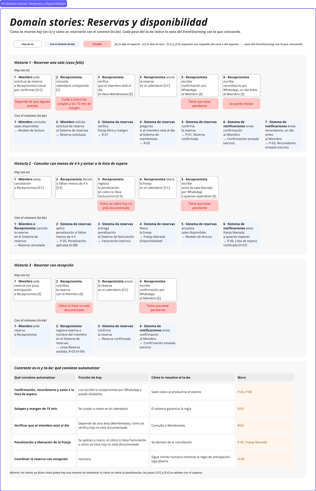

# 04 · Domain stories: Reservas y disponibilidad

> **Proyecto:** Nodo (coworking y eventos) · **Área:** Reservas y disponibilidad (core)
---

## Vista general

---

## 1. Propósito

Aquí vemos cómo se reserva hoy en Nodo (**as-is**) y cómo se reservaría con el sistema (**to-be**), con tres historias del área. Sirve para dos cosas:

- **Ver dónde duele el proceso actual:** lo manual, lo lento y lo que se olvida.
- **Mostrar cómo lo resuelve el sistema:** cada paso del to-be indica la nota del EventStorming con la que concuerda.

---

## 2. Cómo se construyó

**Notación.** Cada paso es una frase: *quién — hace — con qué objeto — para quién*, numerada en orden. Las historias muestran dos filas: lo que ocurre hoy, con sus fricciones, y lo que ocurriría con el sistema.

**Las tres historias y por qué se eligieron**

| Historia | Tipo | Por qué está |
|---|---|---|
| 1. Reservar una sala | Caso feliz | Es el flujo principal del área |
| 2. Cancelar con menos de 4 h y avisar a la lista de espera | Excepción | Es el caso del curso (cancelar 3 h antes) y concentra los avisos manuales que el experto menciona |
| 3. Reservar con recepción | Alternativa | El experto la describe como un camino distinto, coordinado por recepción |

**Qué quedó fuera.** No se hicieron historias para el bloqueo de salas, el escritorio flexible, el visitante ni la última franja disputada, porque los textos no describen cómo se manejan hoy y habría que inventar el as-is. La última franja sigue visible en el EventStorming como pregunta abierta (H-03).

**Alcance.** Cuando un paso depende de otra área, se muestra solo como un traspaso: lo que ocurre dentro de Membresías o de Facturación no forma parte de estas historias.

---

## 3. Elementos de las historias

| Elemento | Qué es |
|---|---|
| **Actores** | Miembro, Recepcionista, Sistema de reservas, Sistema de membresías, Sistema de facturación, Sistema de notificaciones |
| **Objetos de trabajo hoy** | Solicitud de reserva, reserva, calendario compartido, hoja de cálculo, mensajes de WhatsApp, penalización |
| **Fricción** | Algo manual, lento o que se olvida en el as-is |
| **Origen del paso** | **[E]** lo dijo el experto · **[C]** lo dice el caso · **[S·C]** supuesto con respaldo del caso · **[S·E]** supuesto con respaldo del experto |
| **Nota del muro** | En el to-be, «↔» indica la nota del EventStorming con la que concuerda. Los códigos R, P y H son los de `03-eventstorming.md` |

---

## 4. Las historias

### 4.1 Historia 1: Reservar una sala

**Hoy (as-is)**

| N.º | Paso | Origen | Fricción |
|---|---|---|---|
| 1 | Miembro pide solicitud de reserva a Recepcionista (canal por confirmar) | [S·C] | Depende de que alguien atienda |
| 2 | Recepcionista consulta calendario compartido | [C] | Cuida a mano los solapes y los 15 min de margen |
| 3 | Recepcionista verifica que el miembro está al día (lo lleva Membresías) | [E] | |
| 4 | Recepcionista anota la reserva en el calendario | [S·C] | |
| 5 | Recepcionista escribe confirmación por WhatsApp al Miembro | [E] | Tiene que estar pendiente |
| 6 | Recepcionista escribe recordatorio por WhatsApp, un día antes, al Miembro | [E] | Se puede olvidar |

**Con el sistema (to-be)**

| N.º | Paso | Nota del muro |
|---|---|---|
| 1 | Miembro consulta salas disponibles | Modelo de lectura |
| 2 | Miembro solicita solicitud de reserva al Sistema de reservas | Reserva solicitada |
| 3 | Sistema de reservas verifica franja libre y margen | R-01 |
| 4 | Sistema de reservas pregunta al Sistema de membresías si el miembro está al día | R-02 |
| 5 | Sistema de reservas confirma la reserva | P-01, Reserva confirmada |
| 6 | Sistema de notificaciones envía confirmación al Miembro | Confirmación enviada (vecino) |
| 7 | Sistema de notificaciones envía recordatorio, un día antes, al Miembro | P-03, Recordatorio enviado (vecino) |

### 4.2 Historia 2: Cancelar con menos de 4 h y avisar a la lista de espera

**Hoy (as-is)**

| N.º | Paso | Origen | Fricción |
|---|---|---|---|
| 1 | Miembro avisa cancelación a Recepcionista | [S·C] | |
| 2 | Recepcionista decide si faltan menos de 4 h | [S·E] | |
| 3 | Recepcionista registra la penalización (el cobro lo lleva Facturación) | [S·E] | Cómo se cobra hoy no está documentado |
| 4 | Recepcionista libera la franja en el calendario | [S·C] | |
| 5 | Recepcionista escribe aviso de sala liberada por WhatsApp a quienes esperaban | [E] | Tiene que estar pendiente |

**Con el sistema (to-be)**

| N.º | Paso | Nota del muro |
|---|---|---|
| 1 | Miembro o Recepcionista cancela la reserva en el Sistema de reservas | Reserva cancelada |
| 2 | Sistema de reservas aplica penalización si faltan menos de 4 h | P-05, Penalización aplicada (H-08) |
| 3 | Sistema de reservas entrega penalización al Sistema de facturación | Facturación (vecino) |
| 4 | Sistema de reservas libera la franja | Franja liberada (Disponibilidad) |
| 5 | Sistema de reservas actualiza salas disponibles | Modelo de lectura |
| 6 | Sistema de notificaciones avisa franja liberada a quienes esperan | P-06, Lista de espera notificada (H-07) |

### 4.3 Historia 3: Reservar con recepción

**Hoy (as-is)**

| N.º | Paso | Origen | Fricción |
|---|---|---|---|
| 1 | Miembro pide reserva con poca anticipación a Recepcionista | [E] | |
| 2 | Recepcionista coordina la reserva con el Miembro | [E] | Cómo lo hace no está documentado |
| 3 | Recepcionista anota la reserva en el calendario | [S·C] | |
| 4 | Recepcionista escribe confirmación por WhatsApp al Miembro | [E] | Tiene que estar pendiente |

**Con el sistema (to-be)**

| N.º | Paso | Nota del muro |
|---|---|---|
| 1 | Miembro pide reserva a Recepcionista | |
| 2 | Recepcionista registra reserva a nombre del miembro en el Sistema de reservas | Línea Reserva asistida, R-03 (H-09) |
| 3 | Sistema de reservas confirma la reserva | Reserva confirmada |
| 4 | Sistema de notificaciones envía confirmación al Miembro | Confirmación enviada (vecino) |

---

## 5. Contraste: qué conviene automatizar

| Qué conviene automatizar | Fricción de hoy | Cómo lo resuelve el to-be | Muro |
|---|---|---|---|
| Confirmación, recordatorio y aviso a la lista de espera | Los escribe la recepcionista por WhatsApp y puede olvidarlos | Salen solos al producirse el evento | P-03, P-06 |
| Solapes y margen de 15 min | Se cuidan a mano en el calendario | El sistema garantiza la regla | R-01 |
| Verificar que el miembro está al día | Depende de otra área (Membresías); cómo se verifica hoy no está documentado | Consulta a Membresías | R-02 |
| Penalización y liberación de la franja | Se aplican a mano; el cobro lo lleva Facturación y cómo se hace hoy no está documentado | Se derivan de la cancelación | P-05, Franja liberada |
| Coordinar la reserva con recepción | Humana | Sigue siendo humana mientras la regla de anticipación siga abierta | H-09 |

---

## 6. Supuestos del as-is

| Etiqueta | Respaldo | Pasos |
|---|---|---|
| [S·C] | El caso dice que el equipo gestiona todo con hoja de cálculo, calendario compartido y WhatsApp | Historia 1: pasos 1 y 4 · Historia 2: pasos 1 y 4 · Historia 3: paso 3 |
| [S·E] | El experto fija la regla de las 4 h y que después se cobra la franja | Historia 2: pasos 2 y 3 |

**Lo que los textos no dicen,** y por eso no se dibuja como hecho: cómo piden hoy una reserva los miembros, cómo se cobra la penalización y cómo coordina recepción una reserva con poca anticipación.
