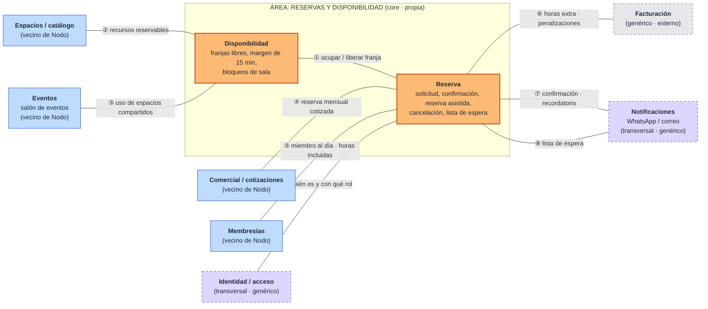

# 05 · Context map: Reservas y disponibilidad

> **Proyecto:** Nodo (coworking y eventos) · **Área:** Reservas y disponibilidad (core)
> **Alcance de esta entrega (Sesión 3):** nuestra área al centro y sus relaciones con las áreas vecinas. Las líneas son **simples, sin tipo ni dirección**: el patrón de integración con nombre (y quién manda sobre quién) se decide en la **Sesión 4**.

---

## Vista general del mapa

**Cómo leer el mapa**

| Color | Tipo de vecino | Qué significa para nosotros |
|---|---|---|
| 🟧 Naranja, borde sólido | **Propio** | Bounded contexts de nuestra área. Los modelamos nosotros (Sesiones 5 y 6). |
| 🟦 Azul | **Vecino de Nodo** | Otra área del negocio, con su propio modelo y equipo. Hay que acordar qué cruza la frontera. |
| ⬜ Gris, borde punteado | **Externo (genérico)** | No diferencia a Nodo; se integra o se compra (software de facturación). |
| 🟪 Lila, borde punteado | **Transversal** | Lo usan todas las áreas, no solo la nuestra (avisos, identidad). Ninguna área es su dueña exclusiva. |

Los números ①–⑨ de cada línea remiten a la tabla de la sección 3, donde se detalla **qué cruza** por esa relación.

---

## 1. Propósito

Este mapa sirve para:

- **Ubicar nuestra frontera:** qué decide nuestra área y qué solo consulta o dispara hacia otras.
- **Listar qué cruza cada línea** (qué pedimos y qué entregamos), que es el insumo de la Sesión 4.
- **Dejar a la vista dónde habrá que protegerse o negociar**: los hotspots de integración, marcados como **HI-xx**.

---

## 2. Nuestra área por dentro: dos contextos

La justificación de la frontera está en `decisiones/0001-por-que-esta-frontera.md`. Aquí solo se resume lo que importa para el mapa:

| Contexto | Qué decide | Pregunta que responde | Lenguaje propio |
|---|---|---|---|
| **Disponibilidad** | Si una franja de un recurso se puede ocupar | «¿Está libre la Sala B el jueves de 10:00 a 11:00?» | franja, margen, bloqueo, ocupación, franja liberada, salas disponibles |
| **Reserva** | Si una solicitud de una persona se convierte en reserva y qué pasa con ella después | «¿Puede Ana reservarla, y qué pasa si cancela?» | solicitud, reserva confirmada, reserva asistida, anticipación, cancelación, penalización, lista de espera |

**Por qué la línea ① es la más importante del mapa:** la regla sagrada («nunca dos reservas en la misma franja», R-01) vive en **Disponibilidad**, pero la reserva nace en **Reserva**. Que esas dos cosas se mantengan siempre de acuerdo es el principal desafío de integración de nuestra área (ver HI-01).

---

## 3. Qué cruza cada relación

Para cada vecino: **qué le pedimos**, **qué le entregamos**, el **dato o evento** concreto que viaja y el **hotspot de integración** que queda para la Sesión 4. Los nombres de eventos y los códigos R/P/H son los de `03-eventstorming.md`.

### ① Disponibilidad ↔ Reserva (interna, propia)

| | |
|---|---|
| **Reserva le pide a Disponibilidad** | «¿Está libre esta franja de este recurso, respetando el margen de 15 min y los bloqueos?» y, si lo está, **ocuparla** para la reserva. |
| **Disponibilidad le entrega a Reserva** | La respuesta (libre / ocupada) y el aviso **Franja liberada**, para que Reserva mire su lista de espera. |
| **Datos que cruzan** | recurso, fecha, hora de inicio, hora de fin, identificador de la reserva que la ocupa. |
| **Eventos que cruzan** | Reserva confirmada → ocupa la franja · Reserva cancelada → **Franja liberada** · **Sala bloqueada** → cambia lo que se puede reservar. |
| **Hotspots de integración** | **HI-01** (de H-03): si dos personas piden la última franja a la vez, ¿quién la «toma» primero, Disponibilidad o Reserva? Si se confirma la reserva y luego no se puede ocupar la franja, ¿se deshace? · **HI-02** (de H-02): si se bloquea una franja que ya tiene reserva, ¿Disponibilidad avisa a Reserva para que la cancele o el bloqueo se rechaza? |

### ② Espacios / catálogo ↔ Disponibilidad

| | |
|---|---|
| **Le pedimos** | El catálogo de **recursos reservables**: salas y escritorios flexibles, con su capacidad y, si existe, su horario de uso. Disponibilidad no crea salas: las recibe. |
| **Le entregamos** | Ocupación por recurso (qué tan usada está cada sala), si Espacios la necesita para decidir. |
| **Datos que cruzan** | identificador del recurso, tipo (sala / escritorio flexible / escritorio fijo), capacidad, estado (activo / dado de baja). |
| **Hotspots de integración** | **HI-03** (de H-01): ¿quién bloquea una sala por mantenimiento, Espacios o Disponibilidad? Hoy lo hace «recepción o administración». · **HI-04**: si Espacios da de baja una sala con reservas futuras, ¿qué pasa con ellas? · **HI-05**: los escritorios **fijos** vienen del mismo catálogo pero **no** se reservan por franja; Disponibilidad debe ignorarlos. |

### ③ Eventos ↔ Disponibilidad

| | |
|---|---|
| **Le pedimos** | Saber cuándo un evento usa una sala o un espacio que también se ofrece para reservas, para tratarlo como ocupado. |
| **Le entregamos** | Las franjas libres de las salas compartidas, si un evento necesita salas además del salón. |
| **Datos que cruzan** | espacio, fecha, horario del evento (incluido montaje y desmontaje, si aplica). |
| **Hotspots de integración** | **HI-06**: ¿el salón de eventos y las salas comparten algún espacio, o están separados? Si están separados, esta línea casi no tiene tráfico. · **HI-07**: si un evento y una reserva quieren la misma sala, ¿quién tiene prioridad? · **Polisemia:** para Eventos, «reserva» es la del salón para un evento (con cotización y pago); para nosotros es una franja de sala o escritorio. Y «evento» en Nodo es un acto en el salón, no un evento de dominio. |

### ④ Comercial / cotizaciones ↔ Reserva

| | |
|---|---|
| **Le pedimos** | La **cotización aceptada** que se convierte en **reserva mensual** (recurrente): recurso, días, horario, vigencia. |
| **Le entregamos** | Si esas franjas están libres (vía Disponibilidad), para que Comercial no cotice algo que no se puede cumplir. |
| **Datos que cruzan** | cliente, recurso, patrón de recurrencia (p. ej. «martes y jueves 9:00–12:00»), fecha de inicio y fin. |
| **Hotspots de integración** | **HI-08**: ¿una franja queda apartada mientras la cotización está pendiente, o solo cuando se acepta? · **HI-09**: ¿la reserva mensual cumple las mismas reglas (margen de 15 min, anticipación) que una reserva normal? · **HI-10**: si una de las fechas de la serie ya está ocupada, ¿se rechaza toda la serie o solo esa fecha? |

### ⑤ Membresías ↔ Reserva

| | |
|---|---|
| **Le pedimos** | Si el miembro **está al día** (R-02) y cuántas **horas incluidas** tiene su plan en el periodo (P-04). |
| **Le entregamos** | Las horas **consumidas**: cada **Reserva confirmada** y cada **Reserva cancelada** cambia lo que el miembro lleva usado. |
| **Datos que cruzan** | identificador del miembro, estado (al día / vencido / con deuda), plan, horas incluidas, horas usadas en el mes. |
| **Hotspots de integración** | **HI-11** (de H-05): si el plan vence entre la solicitud y la confirmación, ¿qué estado vale? ¿Y si vence entre la confirmación y el día de la reserva? · **HI-12**: ¿quién lleva la cuenta de horas usadas, Membresías o Reserva? Si las cuenta Reserva, duplica algo que «pertenece» a Membresías. · **HI-13**: si Membresías no responde, ¿se confirma igual o se espera? · **Polisemia:** «miembro» para Membresías es el titular de un plan; para Reserva es quien reserva (y puede ser un **visitante** sin membresía, H-11). |

### ⑥ Reserva ↔ Facturación

| | |
|---|---|
| **Le pedimos** | Nada para decidir. Reserva no cobra ni calcula montos. |
| **Le entregamos** | **Horas extra registradas** (P-04) y **Penalización aplicada** (P-05), para el cobro a fin de mes. |
| **Datos que cruzan** | miembro, reserva, franja, horas extra, motivo de la penalización, momento de la cancelación. |
| **Hotspots de integración** | **HI-14** (de H-08): la penalización ¿es el 10–20 % o la franja completa? ¿Quién calcula el monto: Reserva (envía el monto) o Facturación (recibe el hecho y aplica su tarifa)? · **HI-15**: si recepción cancela en nombre del miembro, ¿a quién se le cobra? · **Polisemia:** «penalización» para nosotros es un **hecho** (canceló tarde); para Facturación es un **cargo** con monto. |

### ⑦ y ⑧ Reserva ↔ Notificaciones

| | |
|---|---|
| **Le pedimos** | Que envíe el aviso por el canal del miembro (WhatsApp o correo). Nosotros no redactamos ni enviamos mensajes. |
| **Le entregamos** | ⑦ desde Reserva: **Reserva confirmada** (→ Confirmación enviada) y la fecha para el **recordatorio del día antes** (P-03). ⑧ cuando Disponibilidad avisa **Franja liberada**, Reserva revisa su lista de espera y entrega a quiénes avisar (P-06). Disponibilidad no habla con Notificaciones: no sabe quién espera. |
| **Datos que cruzan** | destinatario, tipo de aviso, recurso, fecha y hora. |
| **Hotspots de integración** | **HI-16** (de H-07): ¿se avisa a toda la lista de espera o por orden de llegada? Eso lo decide Reserva, no Notificaciones. · **HI-17**: ¿quién programa el recordatorio del día antes, Reserva (lo dispara a la hora) o Notificaciones (recibe la fecha y lo agenda)? · **HI-18**: si la reserva se cancela después de programado el recordatorio, ¿cómo se anula? |

### ⑨ Identidad / acceso ↔ Reserva

| | |
|---|---|
| **Le pedimos** | Quién hace la acción y con qué **rol**: miembro, visitante, recepción o administración. Lo necesitamos para saber si puede reservar a nombre de otro (reserva asistida) o bloquear salas. |
| **Le entregamos** | Las reservas del día, si control de ingreso necesita saber quién viene a qué sala (sobre todo visitantes). |
| **Datos que cruzan** | identificador de la persona, rol, a nombre de quién actúa. |
| **Hotspots de integración** | **HI-19** (de H-11): ¿un visitante necesita cuenta para reservar o lo registra recepción? · **HI-20**: ¿la reserva le da acceso al edificio a un visitante, o es un permiso aparte? |

---

## 4. Resumen: qué pedimos y qué entregamos

| # | Vecino | Tipo | Contexto nuestro que toca | Qué le pedimos | Qué le entregamos |
|---|---|---|---|---|---|
| ① | Disponibilidad ↔ Reserva | Propio | ambos | ocupar / liberar una franja | Franja liberada |
| ② | Espacios / catálogo | Vecino | Disponibilidad | recursos reservables | ocupación por recurso |
| ③ | Eventos | Vecino | Disponibilidad | uso de espacios compartidos | franjas libres |
| ④ | Comercial / cotizaciones | Vecino | Reserva | cotización aceptada (reserva mensual) | si las franjas están libres |
| ⑤ | Membresías | Vecino | Reserva | miembro al día, horas incluidas | horas consumidas |
| ⑥ | Facturación | Genérico | Reserva | — | horas extra, penalización |
| ⑦ | Notificaciones | Transversal | Reserva | enviar el aviso | confirmación, recordatorio |
| ⑧ | Notificaciones | Transversal | Reserva (tras Franja liberada) | enviar el aviso | a quiénes avisar de la lista de espera |
| ⑨ | Identidad / acceso | Transversal | Reserva | quién es y su rol | reservas del día |

**Por qué estas clasificaciones**

- **Membresías, Espacios, Eventos y Comercial** son **vecinos de Nodo**: tienen reglas propias del negocio (planes, catálogo, eventos, precios) y las modela otro grupo.
- **Facturación** es **genérico**: cobrar a fin de mes no diferencia a Nodo de otro coworking; se integra con un software de facturación existente en lugar de construirlo.
- **Notificaciones** e **Identidad / acceso** son **transversales**: todas las áreas mandan avisos y todas necesitan saber quién es el usuario. Además son genéricos: el canal (WhatsApp o correo) y el inicio de sesión se integran, no se construyen.

---

## 5. Lo que no tiene línea, y por qué

| Relación descartada | Por qué no se dibuja |
|---|---|
| Reserva ↔ Eventos directa | Lo único que compartimos con Eventos es el **espacio**, y eso lo resuelve Disponibilidad. Reserva no sabe nada de eventos. |
| Disponibilidad ↔ Notificaciones | La franja liberada no le importa a nadie fuera del área por sí sola; lo que se avisa es a **quienes esperaban**, y la lista de espera es de Reserva. |
| Disponibilidad ↔ Membresías | Si una franja está libre no depende de quién la pida. El estado del miembro solo le importa a Reserva. |
| Disponibilidad ↔ Facturación | Una franja no se cobra; se cobra lo que hace una persona con una reserva. |
| Reserva ↔ WhatsApp directo | Mandar mensajes no es nuestra responsabilidad. Si cada área escribiera por WhatsApp por su cuenta, se repetiría el problema de hoy (avisos a mano y olvidados). |

---

## 6. Polisemias en las fronteras

Una misma palabra con dos sentidos señala la frontera entre dos contextos. Estas son las que aparecen en el mapa:

| Palabra | En nuestra área | En el vecino | Frontera |
|---|---|---|---|
| **Reserva** | Una franja de sala o escritorio flexible para una persona | Eventos: el salón para un evento. Comercial: una reserva mensual cotizada | ③, ④ |
| **Miembro** | Quien reserva (puede ser un visitante) | Membresías: titular de un plan. Identidad: usuario con una cuenta | ⑤, ⑨ |
| **Penalización** | Hecho: «canceló con menos de 4 h» | Facturación: cargo con monto | ⑥ |
| **Bloqueo** | Una franja que no se ofrece | Espacios: sala fuera de servicio (¿o es lo mismo?) | ② |
| **Horas** | Duración de la franja reservada | Membresías: horas incluidas en el plan. Facturación: horas extra facturables | ⑤, ⑥ |
| **Evento** | (En DDD) algo que ocurrió: «Reserva confirmada» | Eventos: un acto en el salón de Nodo | ③ |
| **Cancelación** | De una reserva | Membresías: de un plan | ⑤ |

---

## 7. Preguntas para la Sesión 4

Son los hotspots de integración de la sección 3, ordenados por impacto. Se responderán al elegir el patrón de integración de cada relación.

| Prioridad | ID | Pregunta | Relación | Por qué importa |
|---|---|---|---|---|
| Alta | HI-01 | ¿Cómo se garantiza que la reserva y la ocupación de la franja nunca queden en desacuerdo, incluso si dos personas piden la última franja a la vez? | ① | Es la regla sagrada. Si falla, el core falla. |
| Alta | HI-11 | ¿Qué estado de membresía vale y en qué momento? | ⑤ | Define si R-02 es una invariante o una política. |
| Alta | HI-12 | ¿Quién lleva la cuenta de horas usadas? | ⑤ | Si los dos la llevan, se contradicen. |
| Alta | HI-14 | ¿Quién calcula el monto de la penalización? | ⑥ | Define cuánto sabe Reserva del dinero. |
| Media | HI-02 | ¿Un bloqueo puede pisar una reserva ya hecha? | ① | Choca con la regla sagrada. |
| Media | HI-03 | ¿Quién bloquea por mantenimiento? | ② | Define si Espacios escribe en Disponibilidad. |
| Media | HI-08, HI-10 | ¿Cómo entra una reserva mensual? | ④ | Una serie de reservas podría romper el margen de 15 min. |
| Media | HI-13 | ¿Qué hacer si Membresías no responde? | ⑤ | Dependemos de un vecino para confirmar. |
| Media | HI-16, HI-17, HI-18 | ¿Quién decide a quién y cuándo se avisa? | ⑦, ⑧ | Es la fricción que el sistema quiere eliminar. |
| Baja | HI-06, HI-07 | ¿Eventos y salas comparten espacio? | ③ | Si no, la línea casi desaparece. |
| Baja | HI-15, HI-19, HI-20 | Visitantes y cancelaciones hechas por recepción | ⑥, ⑨ | Casos límite; afectan pocos flujos. |

**Dónde habrá que protegerse:** en ⑤ (Membresías) y ② (Espacios). Sus modelos cambian por motivos propios (planes nuevos, salas nuevas) y no queremos que eso nos obligue a cambiar nuestras reglas.
**Dónde habrá que negociar:** en ⑥ (quién calcula montos), ④ (cómo entra una reserva mensual) y ⑦/⑧ (quién decide los avisos).
