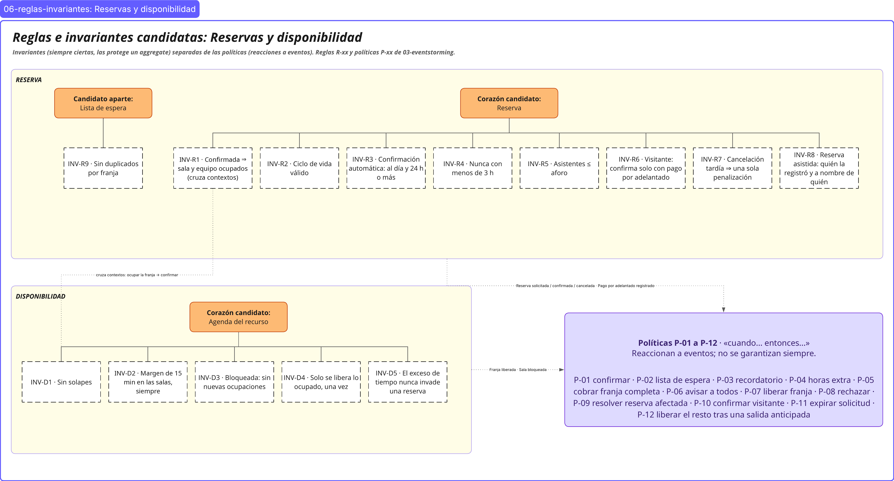

# 06 · Reglas e invariantes candidatas: Reservas y disponibilidad

> **Proyecto:** Nodo (coworking y eventos) · **Área:** Reservas y disponibilidad (core)
> **Estado:** escritas en el lenguaje del dominio y sin programar. El aggregate que protege cada una está en [08-modelo.md](08-modelo.md).

---

## Vista general

**Cómo leer el diagrama**

| Forma en el diagrama | Qué es |
|---|---|
| Recuadro amarillo claro con el nombre del contexto | Bounded context: Disponibilidad o Reserva |
| Píldora naranja | Corazón candidato del aggregate (la raíz que protege las invariantes) |
| Caja blanca con borde punteado | Invariante candidata (INV-xx) |
| Caja lila | Políticas P-01 a P-11: reacciones a eventos, no se garantizan siempre |
| Línea punteada con texto | Evento o relación que cruza entre contextos |

Las reglas R-xx, las políticas P-xx y los hotspots H-xx son los de [03-eventstorming.md](03-eventstorming.md); los términos, los de [02-glosario.md](02-glosario.md).

---

## 1. Propósito y criterio

Este documento junta **todas las reglas de negocio del área** que salieron del EventStorming, de las domain stories ([04-domain-stories.md](04-domain-stories.md)) y del context map ([05-context-map.md](05-context-map.md)). Las separa en dos tipos, porque en el modelo cada tipo se resuelve de forma distinta:

| Tipo | Definición | Prueba para reconocerla | En el modelo… |
|---|---|---|---|
| **Invariante** | Algo que el sistema debe garantizar **siempre**, en todo momento, sin excepción. | «¿Puede existir, aunque sea un instante, un estado donde esto no se cumpla?» Si la respuesta es **nunca**, es una invariante. | La protege un **aggregate**: no se puede guardar un estado que la rompa. |
| **Política** | Una **reacción** automática a un evento: «cuando ocurre X → hacer Y». | «¿Puede pasar un rato entre la causa y el efecto sin que nada esté mal?» Si **sí**, es una política. | Escucha un evento y dispara un comando, a veces en otro contexto. |

**Cómo se redactó cada invariante:** se parte de un **ejemplo concreto**, se saca la regla general y se escribe como algo que el sistema garantiza («Nunca…», «Siempre…», «Toda…»). Cada una indica de qué regla del muro sale.

---

## 2. Invariantes de Disponibilidad

**Corazón candidato del aggregate:** la **agenda del recurso** (una sala de reunión), con sus franjas ocupadas y sus bloqueos. Las invariantes se refieren a cómo se relacionan las franjas **de una misma sala** entre sí, así que se verifican juntas y de una sola vez. La agenda garantiza aislamiento transaccional cuando dos solicitudes llegan a la vez.

### INV-D1 · Nunca dos ocupaciones se solapan en la misma sala

| | |
|---|---|
| **Enunciado** | En una misma sala, dos franjas ocupadas (por reservas confirmadas, reservas provisionales de visitantes o bloqueos) **nunca** comparten ni un minuto. |
| **Ejemplo del que sale** | La Sala B está reservada el jueves de 10:00 a 11:00. Otra persona pide la Sala B de 10:30 a 11:30 → **no se puede**. |
| **Origen** | R-01; caso del curso: «solo una debería quedarse con ella». |
| **Casos límite** | **Concurrencia (H-03, HI-01):** dos personas piden 10:00–11:00 al mismo tiempo → la agenda confirma una sola; la otra se rechaza o entra en la lista de espera. · **Franjas que se tocan:** 10:00–11:00 y 11:00–12:00 no se solapan, pero las impide INV-D2. · **Salas distintas:** la Sala A y la Sala B a la misma hora no chocan. |
| **¿Corazón del aggregate?** | **Sí, es la principal.** Es la razón de ser del core. |

### INV-D2 · Siempre quedan 15 minutos de margen

| | |
|---|---|
| **Enunciado** | En una misma sala, entre el fin de una ocupación y el inicio de la siguiente (reserva o bloqueo) pasan **al menos 15 minutos**. |
| **Ejemplo del que sale** | Reserva de 10:00 a 11:00. Pedir desde las 11:10 → **no**. Pedir desde las 11:15 → **sí**. Bloquear por mantenimiento desde las 11:00 → **no**; desde las 11:15 → **sí**. |
| **Origen** | R-01; margen obligatorio de 15 min para limpiar y ventilar. |
| **Casos límite** | **Exactamente 15 min:** se permite. · **Frente a un bloqueo:** el margen también se aplica. |
| **¿Corazón del aggregate?** | **Sí.** Junto con INV-D1 define cuándo una franja está libre. |

### INV-D3 · Una franja bloqueada no admite nuevas ocupaciones

| | |
|---|---|
| **Enunciado** | Mientras una sala está bloqueada en una franja, **ninguna** reserva nueva puede ocuparla. Solo recepción, administración o dirección pueden bloquear, y solo por mantenimiento o limpieza. |
| **Ejemplo del que sale** | Administración bloquea la Sala C el viernes de 8:00 a 12:00 por mantenimiento. Un miembro pide la Sala C de 9:00 a 10:00 → **no se puede**. |
| **Origen** | R-07; evento «Sala bloqueada». |
| **Casos límite** | **Bloquear encima de una reserva confirmada (H-02):** se permite. La reserva no se elimina sin solución: se reasigna, se reprograma o se reembolsa (P-09). Mientras se resuelve, no se acepta ninguna reserva nueva en esa franja. · **Sala dada de baja con reservas futuras (HI-04):** se trata igual que un bloqueo. |
| **¿Corazón del aggregate?** | **Sí.** Un bloqueo es una ocupación más de la agenda. |

### INV-D4 · Solo se libera una franja ocupada, y una sola vez

| | |
|---|---|
| **Enunciado** | Una franja se libera **una sola vez** y solo por un hecho de la reserva que la ocupaba: su cancelación, su reasignación, su reprogramación o la expiración de una solicitud de visitante sin pago. |
| **Ejemplo del que sale** | Ana cancela su reserva de 15:00 a 16:00 → la franja queda libre. Si la cancelación llega dos veces, la segunda vez **no** se libera nada ni se vuelve a avisar a la lista de espera. |
| **Origen** | Evento «Franja liberada»; P-07 y P-11. |
| **Casos límite** | Si un aviso tardío intentara liberar una franja que **ya** volvió a ocupar otra persona, la dejaría vacía por error. Esta invariante lo impide. |
| **¿Corazón del aggregate?** | **Sí**, es la contraparte de INV-D1. |

### INV-D5 · El exceso de tiempo nunca invade una reserva confirmada

| | |
|---|---|
| **Enunciado** | Una persona solo puede seguir usando la sala después de su franja si **no** hay una reserva posterior confirmada en esa sala, respetando el margen de 15 min. |
| **Ejemplo del que sale** | Luis termina a las 12:00 y quiere seguir. Si la siguiente reserva empieza a las 12:15 → **debe desalojar**. Si la sala está libre → sigue, y se registran horas extra. |
| **Origen** | R-06. |
| **Casos límite** | El exceso se registra como horas extra y se cobra a fin de mes (Facturación y cobros). |
| **¿Corazón del aggregate?** | **Sí.** Depende de las demás ocupaciones de la agenda. |

---

## 3. Invariantes de Reserva

**Corazón candidato del aggregate:** la **reserva** misma, con su estado, su franja, su titular, quién la registró y sus asistentes. La **lista de espera** queda como candidata a aggregate aparte, porque cambia por otros motivos (llegan y se van personas que esperan) y no tiene que bloquear a la reserva.

### INV-R1 · Toda reserva confirmada tiene su franja ocupada en Disponibilidad

| | |
|---|---|
| **Enunciado** | No existe una reserva confirmada cuya franja figure como libre, ni una franja ocupada por una reserva que no está confirmada o provisional. |
| **Ejemplo del que sale** | Ana tiene confirmada la Sala B de 10:00 a 11:00 → en «Salas disponibles» esa franja **no** aparece libre. |
| **Origen** | P-01 y R-01. |
| **Casos límite** | **Es la única invariante que cruza los dos contextos.** Se garantiza así: la reserva se confirma solo después de que la agenda ocupó la franja; si la agenda no puede ocuparla, la solicitud se rechaza (P-08) o entra en la lista de espera (P-02). |
| **¿Corazón del aggregate?** | **No dentro de un solo aggregate.** Se cumple con la secuencia «ocupar la franja → confirmar la reserva». |

### INV-R2 · Una reserva solo pasa por estados válidos

| | |
|---|---|
| **Enunciado** | Una reserva sigue uno de estos caminos y ningún otro: **solicitada → confirmada → cancelada**; **solicitada → rechazada**; y, para el visitante, **solicitada → provisional → confirmada** o **provisional → expirada**. Una reserva cancelada, rechazada o expirada no vuelve a ningún estado. Reasignar o reprogramar una reserva la mantiene confirmada, con otra sala o franja; un reembolso la deja cancelada sin cobro. |
| **Ejemplo del que sale** | Ana cancela a las 9:00. A las 9:05 recepción intenta cancelarla otra vez → no ocurre nada nuevo: ni otra penalización ni otra franja liberada. |
| **Origen** | Eventos «Reserva solicitada», «Reserva confirmada», «Solicitud rechazada», «Pago por adelantado registrado», «Solicitud expirada», «Reserva cancelada», «Reserva reasignada», «Reserva reprogramada», «Reembolso solicitado». |
| **Casos límite** | **Cancelar después del inicio:** no se puede; si el titular no se presenta, se cobra la franja completa. · **Lista de espera:** quien está en espera **no** tiene una reserva; cuando la franja se libera, debe solicitarla. |
| **¿Corazón del aggregate?** | **Sí, es la principal de Reserva.** |

### INV-R3 · La confirmación automática exige miembro al día y 24 h o más de anticipación

| | |
|---|---|
| **Enunciado** | Una reserva se confirma **sin intervención de recepción** solo si, **en el momento de confirmar**, el miembro está al día y faltan **24 horas o más** para el inicio. |
| **Ejemplo del que sale** | El lunes a las 9:00, Ana (al día) pide la sala para el miércoles a las 10:00 → se confirma sola. Luis, con una factura vencida, pide para el jueves → se rechaza. |
| **Origen** | R-02. |
| **Casos límite** | **El plan vence entre la solicitud y la confirmación (H-05):** vale el estado al confirmar, así que no se confirma. · **El plan vence después de confirmar:** la reserva se mantiene; el día de la reserva, Control de acceso físico valida si el miembro está al día y, si no lo está, recepción revisa el caso. · **Membresías y planes no responde (HI-13):** la solicitud pasa a recepción, que la registra como reserva asistida. · **Exactamente 24 h:** se confirma sola. · **Sin anticipación máxima (H-04).** |
| **¿Corazón del aggregate?** | **En parte.** La anticipación la verifica la reserva sola; «al día» es un dato que viene de Membresías y planes. |

### INV-R4 · Ninguna reserva se registra con menos de 3 h de anticipación

| | |
|---|---|
| **Enunciado** | Con **menos de 3 horas** para el inicio no se registra ninguna reserva. **Entre 3 y 24 horas**, solo como reserva asistida. |
| **Ejemplo del que sale** | A las 8:00 Ana pide la sala para las 18:00 (10 h) → solo por recepción. A las 12:30 la pide para las 14:00 (1 h 30) → **no se puede**. |
| **Origen** | R-03. |
| **Casos límite** | **Exactamente 3 h:** se puede, como reserva asistida. · **Reserva mensual:** cada fecha cumple esta regla (HI-09). |
| **¿Corazón del aggregate?** | **Sí.** La reserva conoce su hora de inicio y el momento de la solicitud. |

### INV-R5 · Los asistentes nunca superan el aforo

| | |
|---|---|
| **Enunciado** | La cantidad de asistentes de una reserva **nunca** supera el aforo de la sala: no hay sobrecupo. |
| **Ejemplo del que sale** | Una reserva indica más asistentes de los que admite la sala elegida → **no se acepta**. |
| **Origen** | R-04; el aforo de cada sala lo entrega Espacios y recursos. |
| **Casos límite** | **Reasignación por bloqueo:** la sala equivalente también debe admitir a los asistentes. |
| **¿Corazón del aggregate?** | **Sí.** La reserva conoce sus asistentes; el aforo es un dato del catálogo. |

### INV-R6 · Ninguna reserva de visitante se confirma sin pago por adelantado

| | |
|---|---|
| **Enunciado** | La reserva de un visitante pasa a confirmada **solo** cuando se registra su pago por adelantado. Mientras tanto, la franja queda apartada de forma provisional con un plazo límite de pago; si vence sin pago, la solicitud expira y la franja se libera. |
| **Ejemplo del que sale** | Marta, sin membresía, pide la Sala B → la franja queda apartada. Paga dentro del plazo → se confirma. No paga → la solicitud expira y otra persona puede reservar. |
| **Origen** | R-05; P-10 y P-11. |
| **Casos límite** | **Otra persona pide la misma franja mientras el visitante paga:** la franja está ocupada de forma provisional; la otra solicitud entra en la lista de espera o se rechaza. |
| **¿Corazón del aggregate?** | **Sí.** El estado provisional y su vencimiento son parte de la reserva. |

### INV-R7 · Toda cancelación tardía genera exactamente una penalización

| | |
|---|---|
| **Enunciado** | Si una reserva confirmada se cancela cuando faltan **menos de 4 horas** para su inicio, queda registrada **una y solo una** penalización: la franja completa, a cargo del titular. Con 4 horas o más, **ninguna**. |
| **Ejemplo del que sale** | Reserva a las 15:00. Cancela a las 12:00 (faltan 3 h) → **penalización**. Cancela a las 11:00 (4 h justas) → **sin costo**. |
| **Origen** | P-05. |
| **Casos límite** | **4 h exactas:** sin costo. · **Cancela recepción a nombre del titular:** la penalización es del titular. · **Reserva a nombre de un invitado:** responde el miembro. · **Inasistencia:** se cobra la franja completa. · **Monto:** lo calcula Facturación y cobros con el precio conservado de la reserva. · **Cancelación repetida:** INV-R2 impide una segunda penalización. |
| **¿Corazón del aggregate?** | **Sí.** La reserva conoce su hora de inicio y el momento de la cancelación. El **cobro** es una política aparte (P-05 → Facturación y cobros). |

### INV-R8 · Toda reserva asistida registra quién la hizo y a nombre de quién

| | |
|---|---|
| **Enunciado** | Cuando recepción registra una reserva, la reserva **siempre** guarda el **titular** y **quién la registró**. Si es a nombre de un invitado, guarda además el nombre y los datos del invitado, y el miembro queda como responsable. |
| **Ejemplo del que sale** | La recepcionista María reserva la Sala A para un invitado de Pedro → titular: Pedro; invitado: sus datos; registrada por: María. |
| **Origen** | R-03; comando «Registrar reserva asistida». |
| **Casos límite** | Se aplica con anticipación de 3 a 24 h, a nombre de un invitado o cuando Membresías y planes no responde. |
| **¿Corazón del aggregate?** | **Sí**, es un dato que la reserva debe tener desde que nace. |

### INV-R9 · Una persona no está dos veces en la lista de espera de la misma franja

| | |
|---|---|
| **Enunciado** | En la lista de espera de una franja, cada persona aparece **como máximo una vez**. |
| **Ejemplo del que sale** | Ana pide la Sala B de 10:00 a 11:00, que está ocupada, y entra a la lista de espera. Lo vuelve a pedir → sigue apareciendo una sola vez y recibe un solo aviso cuando se libera. |
| **Origen** | P-02. |
| **Casos límite** | Cuando la franja se libera, se avisa a **todos** los de la lista (P-06); la franja la toma quien la reserve. |
| **¿Corazón del aggregate?** | **Candidata a aggregate propio** (lista de espera por franja), separado de la reserva. |

---

## 4. Políticas («cuando… entonces…»)

Las políticas **no** son invariantes: entre la causa y el efecto puede pasar un tiempo sin que el sistema quede en un estado inválido.

| ID | Política | Evento que la dispara | Resultado | Contexto que decide | ¿Cruza la frontera? |
|---|---|---|---|---|---|
| P-01 | Cuando se solicita una reserva → confirmarla si cumple INV-D1 a D3 e INV-R3 a R5 | Reserva solicitada | Reserva confirmada | Reserva (consulta a Disponibilidad y a Membresías y planes) | Sí: ① y ⑤ |
| P-02 | Cuando la franja está ocupada → añadir a la lista de espera | Reserva solicitada | Añadido a la lista de espera | Reserva | No |
| P-03 | Cuando falta un día para la reserva → recordar | Confirmación enviada | Recordatorio enviado | Notificaciones (programa y anula el recordatorio) | Sí: ⑦ |
| P-04 | Cuando se superan las horas incluidas → registrar horas extra para el cobro a fin de mes | Reserva confirmada | Horas extra registradas | Reserva (con las horas que lleva Membresías y planes) | Sí: ⑤ y ⑥ |
| P-05 | Cuando se cancela con menos de 4 h → cobrar la franja completa | Penalización aplicada (INV-R7) | Cargo en Facturación y cobros | Facturación y cobros (calcula el monto) | Sí: ⑥ |
| P-06 | Cuando se libera una franja con lista de espera → avisar a todos | Franja liberada | Lista de espera notificada | Reserva | Sí: ⑧ |
| P-07 | Cuando se cancela una reserva confirmada → liberar su franja | Reserva cancelada | Franja liberada | Disponibilidad | Sí: ① (interna) |
| P-08 | Cuando una solicitud no cumple las reglas o pierde la última franja → rechazarla y avisar | Reserva solicitada | Solicitud rechazada | Reserva | Sí: ⑦ |
| P-09 | Cuando se bloquea una franja con reserva confirmada → resolver la reserva afectada | Sala bloqueada | Reserva reasignada / reprogramada / Reembolso solicitado | Reserva (recepción u operaciones) | Sí: ① y ⑥ |
| P-10 | Cuando se registra el pago por adelantado de un visitante → confirmar su reserva | Pago por adelantado registrado | Reserva confirmada | Reserva | Sí: ⑥ |
| P-11 | Cuando vence el plazo de pago de un visitante sin pago → expirar la solicitud y liberar la franja | Plazo de pago vencido | Solicitud expirada → Franja liberada | Reserva y Disponibilidad | Sí: ① |

**Por qué P-05 se parte en dos:** **decidir que hay penalización** es una invariante de la reserva (INV-R7: siempre se cumple), mientras que **cobrarla** es una política de Facturación y cobros, que calcula el monto y puede ocurrir a fin de mes.

---

## 5. Reglas resueltas

Cada regla de este listado tiene respuesta del experto y quedó incorporada a una invariante o política:

| Regla | Respuesta | Dónde queda |
|---|---|---|
| Anticipación máxima para reservar | No hay tope máximo. | INV-R3 |
| Monto de la penalización | La franja completa; la calcula Facturación y cobros. | INV-R7, P-05 |
| Escritorio flexible por franja o por día | No se reserva: se usa según el plan de membresía. | Fuera del área |
| Cómo confirma el visitante | Con pago por adelantado; la franja queda apartada de forma provisional con un plazo límite. | INV-R6, P-10, P-11 |
| Bloquear encima de una reserva | Se permite; la reserva se reasigna, se reprograma o se reembolsa. | INV-D3, P-09 |
| Unirse a la lista de espera | Es automático cuando la franja está ocupada. | P-02 |
| A quién se avisa al liberarse una franja | A todos los de la lista de espera. | P-06, INV-R9 |
| Cancelación hecha por recepción | Se cobra al titular. | INV-R7 |
| Cancelar una reserva ya empezada o inasistencia | No se cancela; se cobra la franja completa. | INV-R2, INV-R7 |
| Plan que vence después de confirmar | La reserva se mantiene; Control de acceso físico valida el día de la reserva. | INV-R3 |
| Margen frente a un bloqueo | Se aplica siempre. | INV-D2 |
| Reembolso de una reserva afectada | La reserva queda cancelada sin cobro. | INV-R2 |

---

## 6. Trazabilidad: del ejemplo a la invariante

| Ejemplo concreto («¿qué pasa si…?») | Regla del muro | Invariante / política | Contexto |
|---|---|---|---|
| Dos personas piden la última franja a la vez | R-01, H-03 | INV-D1 (+ INV-R1) | Disponibilidad |
| Piden la sala 10 min después de que termina otra reserva | R-01 | INV-D2 | Disponibilidad |
| Piden una sala bloqueada por mantenimiento | R-07 | INV-D3 | Disponibilidad |
| Se bloquea una franja que ya tenía reserva | R-07, H-02 | INV-D3 + P-09 | Disponibilidad → Reserva |
| La cancelación llega dos veces | P-07 | INV-D4, INV-R2 | ambos |
| Alguien se queda más tiempo y hay reserva después | R-06 | INV-D5 | Disponibilidad |
| Pide con 2 días de anticipación y está al día | R-02 | INV-R3 | Reserva |
| Pide con 10 h de anticipación | R-03 | INV-R4 → reserva asistida | Reserva |
| Pide con 1 h 30 de anticipación | R-03 | INV-R4 + P-08 | Reserva |
| Pide con la membresía vencida | R-02, H-05 | INV-R3 + P-08 | Reserva |
| Indica más asistentes que el aforo | R-04 | INV-R5 + P-08 | Reserva |
| Un visitante no paga dentro del plazo | R-05 | INV-R6 + P-11 | Reserva → Disponibilidad |
| Cancela 3 h antes | P-05 | INV-R7 + P-05 | Reserva → Facturación y cobros |
| Cancela 4 h justas antes | P-05 | INV-R7 (sin costo) | Reserva |
| Recepción reserva para el invitado de Pedro | R-03 | INV-R8 | Reserva |
| Ana pide dos veces una franja ocupada | P-02 | INV-R9 | Reserva (lista de espera) |
| Se libera una franja y tres personas esperan | P-06 | P-06 | Reserva → Notificaciones |

---

## 7. Puente hacia el modelo

El detalle de cada aggregate (entidades, value objects, comandos y eventos) está en [08-modelo.md](08-modelo.md).

| Aggregate | Contexto | Invariantes que protege | Por qué juntas |
|---|---|---|---|
| **Agenda del recurso** (una sala en un día, con sus ocupaciones y bloqueos) | Disponibilidad | INV-D1, D2, D3, D4, D5 | Para decidir si una franja nueva cabe hay que mirar **todas** las demás franjas de la misma sala a la vez. |
| **Reserva** | Reserva | INV-R2, R3, R4, R5, R6, R7, R8 | Dependen de datos de la propia reserva: estado, hora de inicio, titular, asistentes, quién la registró y plazo de pago. |
| **Lista de espera** (por sala y franja) | Reserva | INV-R9 | Cambia por motivos distintos a la reserva y no debe bloquearla. |
| *(entre contextos)* | Disponibilidad ↔ Reserva | INV-R1 | Se cumple con la secuencia «ocupar la franja → confirmar la reserva». |
