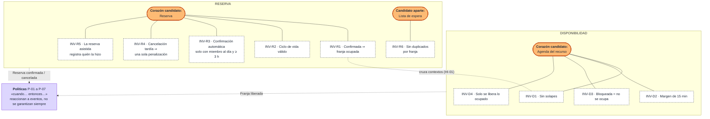

# 06 · Reglas e invariantes candidatas: Reservas y disponibilidad

> **Proyecto:** Nodo (coworking y eventos) · **Área:** Reservas y disponibilidad (core)
> **Estado:** candidatas, escritas en el lenguaje del dominio y **sin programar**. Se protegerán en código en la **Sesión 5** (aggregates).

---

## Vista general

---

## 1. Propósito y criterio

Este documento junta **todas las reglas de negocio del área** que salieron del EventStorming (`03`), de las domain stories (`04`) y del context map (`05`). Las separa en tres tipos, porque en la Sesión 5 cada tipo se resuelve de forma distinta:

| Tipo | Definición | Prueba para reconocerla | En la Sesión 5… |
|---|---|---|---|
| **Invariante** | Algo que el sistema debe garantizar **siempre**, en todo momento, sin excepción. | «¿Puede existir, aunque sea un instante, un estado donde esto no se cumpla?» Si la respuesta es **nunca**, es una invariante. | La protege un **aggregate**: no se puede guardar un estado que la rompa. |
| **Política** | Una **reacción** automática a un evento: «cuando ocurre X → hacer Y». | «¿Puede pasar un rato entre la causa y el efecto sin que nada esté mal?» Si **sí**, es una política. | Escucha un evento y dispara un comando, a veces en otro contexto. |
| **Regla por validar** | Una regla que intuimos, pero que los textos del caso o del experto no fijan. | Tiene un hotspot abierto. | Se pregunta al experto antes de programarla. |

**Cómo se redactó cada invariante:** se parte de un **ejemplo concreto**, se saca la regla general y se escribe como algo que el sistema garantiza («Nunca…», «Siempre…», «Toda…»). Cada una indica de qué nota del muro sale (R-xx, P-xx, H-xx, HI-xx).

---

## 2. Invariantes de Disponibilidad

**Corazón candidato del aggregate:** la **agenda de un recurso** (una sala o un escritorio flexible), con sus franjas ocupadas y sus bloqueos. Las cuatro invariantes se refieren a cómo se relacionan las franjas **de un mismo recurso** entre sí, así que deben verificarse juntas y de una sola vez.

### INV-D1 · Nunca dos ocupaciones se solapan en el mismo recurso

| | |
|---|---|
| **Enunciado** | En un mismo recurso, dos franjas ocupadas (por reservas o bloqueos) **nunca** comparten ni un minuto. |
| **Ejemplo del que sale** | La Sala B está reservada el jueves de 10:00 a 11:00. Otra persona pide la Sala B de 10:30 a 11:30 → **no se puede**. |
| **Origen** | R-01 («la regla sagrada»), caso: «solo una debe quedarse con ella». |
| **Casos límite** | **Concurrencia (H-03, HI-01):** dos personas piden 10:00–11:00 al mismo tiempo → exactamente una la obtiene, aunque ambas hayan visto la sala libre en «Salas disponibles». · **Franjas que se tocan:** 10:00–11:00 y 11:00–12:00 no se solapan, pero las prohíbe INV-D2. · **Recursos distintos:** la Sala A y la Sala B a la misma hora no chocan. |
| **¿Corazón del aggregate?** | **Sí, es la principal.** Es la razón de ser del core. |

### INV-D2 · Entre dos reservas del mismo recurso hay siempre al menos 15 minutos

| | |
|---|---|
| **Enunciado** | Entre el fin de una reserva y el inicio de la siguiente, en el mismo recurso, pasan **al menos 15 minutos**. |
| **Ejemplo del que sale** | Reserva de 10:00 a 11:00. Pedir desde las 11:10 → **no**. Pedir desde las 11:15 → **sí**. |
| **Origen** | R-01, glosario (margen), fricción de la historia 1 («cuida a mano los solapes y los 15 min de margen»). |
| **Casos límite** | **Exactamente 15 min:** se toma como permitido (el margen es «al menos»). Hay que confirmarlo con el experto. · **¿Margen también frente a un bloqueo?** (p. ej. limpieza antes de mantenimiento): **por validar**. · **¿Aplica al escritorio flexible?** Si se reserva por día (H-10), el margen no tiene sentido. |
| **¿Corazón del aggregate?** | **Sí.** Junto con INV-D1 define cuándo una franja está libre. |

### INV-D3 · Una franja bloqueada no se puede ocupar

| | |
|---|---|
| **Enunciado** | Mientras una sala está bloqueada en una franja, **ninguna** reserva puede ocupar esa franja. |
| **Ejemplo del que sale** | Administración bloquea la Sala C el viernes de 8:00 a 12:00 por mantenimiento. Un miembro pide la Sala C de 9:00 a 10:00 → **no se puede**. |
| **Origen** | «Sala bloqueada», modelo de lectura «Salas disponibles… con bloqueos», H-01. |
| **Casos límite** | **Bloquear encima de una reserva ya hecha (H-02, HI-02):** o el bloqueo se rechaza, o la reserva se cancela. Las dos no pueden convivir: si convivieran, se rompería INV-D1. **Queda abierto qué opción se toma**, pero cualquiera de las dos mantiene la invariante. |
| **¿Corazón del aggregate?** | **Sí.** Un bloqueo es una ocupación más de la agenda. |

### INV-D4 · Solo se libera una franja que estaba ocupada, y por quien la ocupaba

| | |
|---|---|
| **Enunciado** | Una franja se libera **una sola vez** y solo por la cancelación de la reserva que la ocupaba. |
| **Ejemplo del que sale** | Ana cancela su reserva de 15:00 a 16:00 → la franja queda libre. Si el mensaje de cancelación llega dos veces, la segunda vez **no** se libera nada (y no se vuelve a avisar a la lista de espera). |
| **Origen** | Evento «Franja liberada», decisión del muro: «cancelar es una acción sobre la reserva; liberar le ocurre a la franja». |
| **Casos límite** | Si una cancelación tardía liberara una franja que **ya** volvió a ocupar otra persona de la lista de espera, la dejaría vacía por error. Esta invariante lo impide. |
| **¿Corazón del aggregate?** | **Sí**, es la contraparte de INV-D1. |

---

## 3. Invariantes de Reserva

**Corazón candidato del aggregate:** la **reserva** misma, con su estado (solicitada → confirmada → cancelada), su franja, su titular y quién la registró. La **lista de espera** queda como candidata a aggregate aparte, porque cambia por otros motivos (llegan y se van personas que esperan) y no tiene que bloquear a la reserva.

### INV-R1 · Toda reserva confirmada tiene su franja ocupada en Disponibilidad

| | |
|---|---|
| **Enunciado** | No existe una reserva confirmada cuya franja figure como libre, ni una franja ocupada por una reserva que no está confirmada. |
| **Ejemplo del que sale** | Ana tiene confirmada la Sala B de 10:00 a 11:00 → en «Salas disponibles» esa franja **no** aparece libre. |
| **Origen** | P-01 + R-01, modelo de lectura que se actualiza al confirmar. |
| **Casos límite** | **Es la única invariante que cruza los dos contextos.** Reserva y Disponibilidad son contextos distintos y podrían quedar en desacuerdo un instante. **Pregunta para la Sesión 4/5 (HI-01):** ¿se exige que sea cierta *siempre* (y entonces ocupar la franja y confirmar van juntos) o *al final* (y entonces hace falta deshacer si la franja ya no estaba libre)? |
| **¿Corazón del aggregate?** | **No dentro de un solo aggregate.** Es la decisión de integración más importante del área. |

### INV-R2 · Una reserva solo pasa por estados válidos

| | |
|---|---|
| **Enunciado** | Una reserva sigue el camino **solicitada → confirmada → cancelada**, y no hay otro. Una reserva cancelada **no** vuelve a confirmarse ni se cancela de nuevo. |
| **Ejemplo del que sale** | Ana cancela a las 9:00. A las 9:05 recepción intenta cancelarla otra vez → no ocurre nada nuevo: ni otra penalización, ni otra franja liberada. |
| **Origen** | Eventos «Reserva solicitada», «Reserva confirmada», «Reserva cancelada». |
| **Casos límite** | **Rechazo (H-12):** si no se cumplen las reglas, ¿la solicitud queda «rechazada» (un estado más) o simplemente no se crea? No se inventa el estado mientras no se valide. · **Cancelar después de empezar:** ¿se puede cancelar una reserva de 10:00 a las 10:30? ¿O eso es una inasistencia? **Por validar** (nuevo hotspot H-13). · **Lista de espera:** quien está en espera **no** tiene una reserva; si se libera la franja, debe solicitar o confirmar (H-06, H-07). |
| **¿Corazón del aggregate?** | **Sí, es la principal de Reserva.** |

### INV-R3 · La confirmación automática exige miembro al día y al menos 3 h de anticipación

| | |
|---|---|
| **Enunciado** | Una reserva se confirma **sin intervención de recepción** solo si, **en el momento de confirmar**, el miembro está al día y faltan **3 horas o más** para el inicio. |
| **Ejemplo del que sale** | A las 8:00, Ana (al día) pide la sala para las 14:00 → se confirma sola. A las 12:30 pide la sala para las 14:00 (1 h 30 de anticipación) → **no** se confirma sola: pasa por recepción (R-03). Luis, con la membresía vencida, pide para mañana → no se confirma. |
| **Origen** | R-02, glosario («de 3 a 24 h o más»), sistema externo Membresías. |
| **Casos límite** | **El plan vence entre la solicitud y la confirmación (H-05, HI-11):** vale el estado **al confirmar**. Es la redacción más segura, pero hay que validarla. · **El plan vence después de confirmar y antes del día de la reserva:** **no** está cubierto por esta invariante. ¿Debería cancelarse? **Por validar.** · **Anticipación máxima (H-04):** no hay. · **Exactamente 3 h:** se toma como permitido («de 3 h o más»). · **Visitante (H-11):** no tiene membresía, así que «al día» no aplica. Su condición está por definir. |
| **¿Corazón del aggregate?** | **En parte.** La anticipación (el reloj contra la hora de inicio) la puede verificar la reserva sola. «Al día» es un dato que viene de **Membresías**: la reserva lo recibe, no lo decide. |

### INV-R4 · Toda cancelación con menos de 4 h de anticipación genera exactamente una penalización

| | |
|---|---|
| **Enunciado** | Si una reserva confirmada se cancela cuando faltan **menos de 4 horas** para su inicio, queda registrada **una y solo una** penalización. Con 4 horas o más, **ninguna**. |
| **Ejemplo del que sale** | Reserva a las 15:00. Cancela a las 12:00 (faltan 3 h) → **penalización**. Cancela a las 11:00 (faltan 4 h justas) → **sin costo**. Cancela a las 10:00 → sin costo. |
| **Origen** | P-05, entrevista («hasta cuatro horas antes» sin cobro), historia 2. |
| **Casos límite** | **4 h exactas:** sin costo (el límite es inclusivo según la entrevista). · **Monto (H-08, HI-14):** la invariante dice **que** hay penalización, no **cuánto** cobrar. Si es el 10–20 % o la franja completa, lo resuelve Facturación. · **Recepción cancela en nombre del miembro (HI-15):** ¿se penaliza igual? **Por validar.** · **Cancelación repetida:** INV-R2 impide una segunda penalización. |
| **¿Corazón del aggregate?** | **Sí.** La reserva conoce su hora de inicio y el momento de la cancelación, así que puede decidirlo sola. El **cobro** es una política aparte (P-05 → Facturación). |

### INV-R5 · Toda reserva asistida registra quién la hizo y a nombre de quién

| | |
|---|---|
| **Enunciado** | Cuando recepción reserva para otra persona, la reserva **siempre** guarda dos personas distintas: el **titular** (quien usará la sala) y **quien la registró**. |
| **Ejemplo del que sale** | La recepcionista María reserva la Sala A para Pedro → titular: Pedro; registrada por: María. Si Pedro cancela tarde, la penalización es de Pedro (a validar, HI-15). |
| **Origen** | Línea «Reserva asistida», comando «Reservar a nombre de otro», R-03. |
| **Casos límite** | **Anticipación de la reserva asistida (H-09):** si recepción también debe respetar las 3 h o puede confirmar con menos, sigue abierto. Por eso R-03 queda como **regla por validar**, no como invariante. |
| **¿Corazón del aggregate?** | **Sí**, es un dato que la reserva debe tener desde que nace. |

### INV-R6 · Una persona no está dos veces en la lista de espera de la misma franja

| | |
|---|---|
| **Enunciado** | En la lista de espera de una franja, cada persona aparece **como máximo una vez**. |
| **Ejemplo del que sale** | Ana pide la Sala B de 10:00 a 11:00, que está ocupada, y entra a la lista de espera. Lo vuelve a pedir → sigue apareciendo una sola vez, y no recibe dos avisos cuando se libera. |
| **Origen** | P-02, «Añadido a la lista de espera». |
| **Casos límite** | **Orden (H-07):** si el aviso es por orden de llegada, la lista debe conservar el orden y esto se vuelve una invariante más («el orden de llegada no cambia»). · **¿Se sale de la lista al conseguir otra sala?** **Por validar.** |
| **¿Corazón del aggregate?** | **Candidata a aggregate propio** (Lista de espera por franja), separado de la reserva. |

---

## 4. Políticas («cuando… entonces…»)

Las políticas **no** son invariantes: entre la causa y el efecto puede pasar un tiempo sin que el sistema quede en un estado inválido. Por ejemplo, si el recordatorio sale con un minuto de retraso, no se rompe nada.

| ID | Política | Evento que la dispara | Resultado | Contexto que decide | ¿Cruza la frontera? |
|---|---|---|---|---|---|
| P-01 | Cuando se solicita una reserva → confirmarla si cumple INV-D1 a D3 e INV-R3 | Reserva solicitada | Reserva confirmada | Reserva (consulta a Disponibilidad y Membresías) | Sí: ① y ⑤ |
| P-02 | Cuando la franja está ocupada → añadir a la lista de espera | Reserva solicitada | Añadido a la lista de espera | Reserva | No |
| P-03 | Cuando falta un día para la reserva → recordar | Confirmación enviada | Recordatorio enviado | Reserva | Sí: ⑦ Notificaciones |
| P-04 | Cuando se superan las horas incluidas → guardar para cobro a fin de mes | Reserva confirmada | Horas extra registradas | Reserva (con las horas que entrega Membresías) | Sí: ⑤ y ⑥ |
| P-05 | Cuando se cancela con menos de 4 h → cobrar la penalización | Penalización aplicada (INV-R4) | Cargo en Facturación | Facturación | Sí: ⑥ |
| P-06 | Cuando se libera una franja y alguien la espera → avisar | Franja liberada | Lista de espera notificada | Reserva | Sí: ⑧ Notificaciones |
| P-07 *(nueva)* | Cuando se cancela una reserva confirmada → liberar su franja | Reserva cancelada | Franja liberada | Disponibilidad | Sí: ① (interna) |

**Por qué P-05 se partió en dos:** en el muro, P-05 era «cuando cancela con menos de 4 h → cobrar penalización». Al separar invariantes de políticas aparecen dos cosas distintas: **decidir que hay penalización** es una invariante de la reserva (INV-R4: siempre se cumple), mientras que **cobrarla** es una política que vive en Facturación y puede ocurrir a fin de mes.

**Por qué aparece P-07:** en el muro, «liberar franja» estaba como una flecha entre «Reserva cancelada» y «Franja liberada». Es una reacción automática que va de un contexto al otro, así que es una política, y la escribimos como tal.

---

## 5. Reglas por validar con el experto

No se convierten en invariantes hasta resolver su hotspot. Mientras tanto se trabaja con el supuesto indicado.

| ID | Regla | Hotspot | Supuesto de trabajo | Si se confirma, pasa a… |
|---|---|---|---|---|
| R-03 | La reserva asistida se usa para invitados o con menos de 3 h de anticipación | H-09 | Recepción puede confirmar con menos de 3 h | Excepción explícita dentro de INV-R3 |
| RV-01 | Anticipación máxima para reservar | H-04 | No hay límite | Invariante de Reserva (junto a INV-R3) |
| RV-02 | Monto de la penalización: 10–20 % o franja completa | H-08, HI-14 | Franja completa | Regla de Facturación, no nuestra |
| RV-03 | El escritorio flexible se reserva por día, no por franja | H-10 | Sin definir | Cambia INV-D1 y D2 para ese tipo de recurso |
| RV-04 | Cómo confirma el visitante (sin membresía) | H-11, HI-19 | Solo con recepción | Variante de INV-R3 |
| RV-05 | Bloquear encima de una reserva: se rechaza el bloqueo o se cancela la reserva | H-02, HI-02 | Se rechaza el bloqueo | Detalle de INV-D3 |
| RV-06 | Unirse a la lista de espera es automático o lo elige el miembro | H-06 | Automático | Cambia P-02 (actor y comando) |
| RV-07 | A quién se avisa: a todos los de la lista o por orden de llegada | H-07, HI-16 | Sin definir | Nueva invariante de orden en la lista de espera |
| RV-08 | Cancelación hecha por recepción: ¿quién paga la penalización? | HI-15 | El titular | Detalle de INV-R4 |
| RV-09 | Cancelar una reserva ya empezada / no presentarse | H-13 *(nuevo)* | No se permite cancelar después del inicio | Nuevo estado en INV-R2 |
| RV-10 | Una reserva confirmada cuyo plan vence antes de la fecha | HI-11 | La reserva se mantiene | Política nueva (Membresías → Reserva) |
| RV-11 | El margen de 15 min también se aplica frente a un bloqueo | — *(nuevo)* | No | Detalle de INV-D2 |

**Hotspot nuevo que agrega este documento:**
- **H-13:** ¿se puede cancelar una reserva que ya empezó? ¿Qué pasa si el miembro no se presenta? El muro no cubre la inasistencia.

---

## 6. Trazabilidad: del ejemplo a la invariante

| Ejemplo concreto («¿qué pasa si…?») | Regla del muro | Invariante / política | Contexto |
|---|---|---|---|
| Dos personas piden la última franja a la vez | R-01, H-03 | INV-D1 (+ INV-R1) | Disponibilidad |
| Piden la sala 10 min después de que termina otra reserva | R-01 | INV-D2 | Disponibilidad |
| Piden una sala en mantenimiento | Sala bloqueada | INV-D3 | Disponibilidad |
| La cancelación llega dos veces | Franja liberada | INV-D4, INV-R2 | ambos |
| Pide con 1 h 30 de anticipación | R-02, R-03 | INV-R3 → reserva asistida | Reserva |
| Pide con la membresía vencida | R-02, H-05 | INV-R3 | Reserva |
| Cancela 3 h antes | P-05 | INV-R4 + P-05 | Reserva → Facturación |
| Cancela 4 h justas antes | P-05 | INV-R4 (sin costo) | Reserva |
| Recepción reserva para Pedro | R-03 | INV-R5 | Reserva |
| Ana pide dos veces una franja ocupada | P-02 | INV-R6 | Reserva (lista de espera) |
| Se libera una franja y tres personas esperan | P-06, H-07 | P-06 (+ RV-07) | Reserva → Notificaciones |

---

## 7. Puente hacia la Sesión 5

| Aggregate candidato | Contexto | Invariantes que protege | Por qué juntas |
|---|---|---|---|
| **Agenda del recurso** (un recurso, su calendario de ocupaciones y bloqueos) | Disponibilidad | INV-D1, D2, D3, D4 | Para decidir si una franja nueva cabe hay que mirar **todas** las demás franjas del mismo recurso a la vez. |
| **Reserva** | Reserva | INV-R2, R3 (anticipación), R4, R5 | Todas dependen solo de datos de la propia reserva: estado, hora de inicio, titular, quién la registró. |
| **Lista de espera** (por recurso y franja) | Reserva | INV-R6 (y el orden, si se confirma RV-07) | Cambia por motivos distintos a la reserva y no debe bloquearla. |
| *(ninguno)* | entre contextos | **INV-R1** | Cruza dos contextos: se resuelve con integración (Sesión 4), no dentro de un aggregate. |

**Preguntas que llevamos a la Sesión 5:**
1. ¿La agenda del recurso se agrupa por **recurso** o por **recurso y día**? Por día es más pequeña, pero ¿qué pasa con una reserva que cruza la medianoche, o con una reserva mensual (HI-10)?
2. Si INV-R1 se acepta como «se cumple al final» y no «siempre», ¿qué evento deshace una reserva confirmada cuya franja ya no estaba libre?
3. «Miembro al día» llega de Membresías: ¿la reserva lo guarda como un dato del momento en que se confirmó, para dejar constancia de por qué se confirmó?
