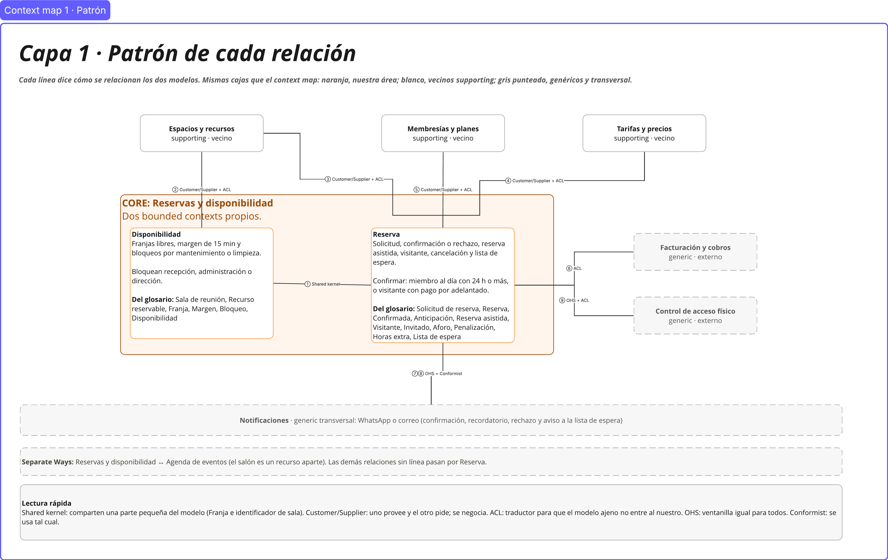
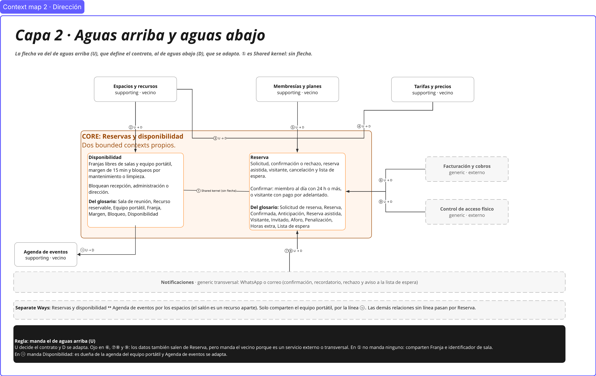
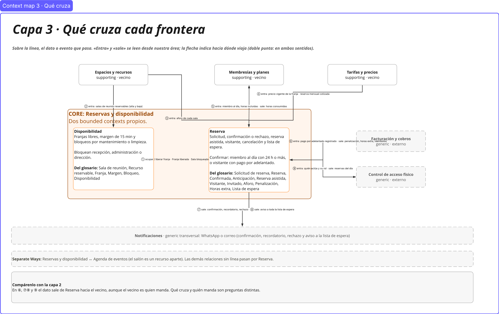
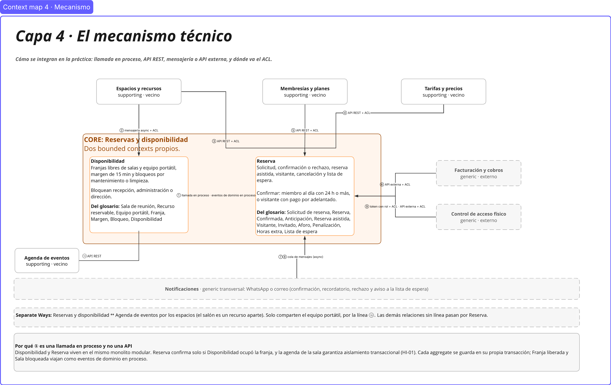
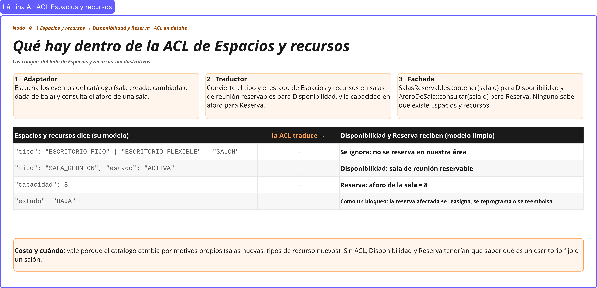
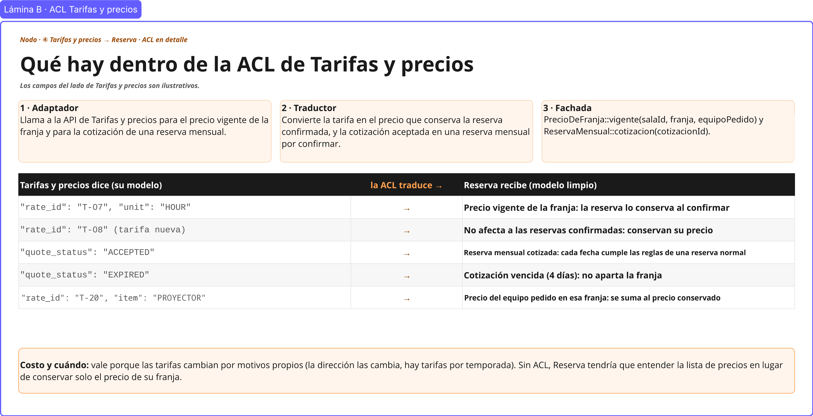
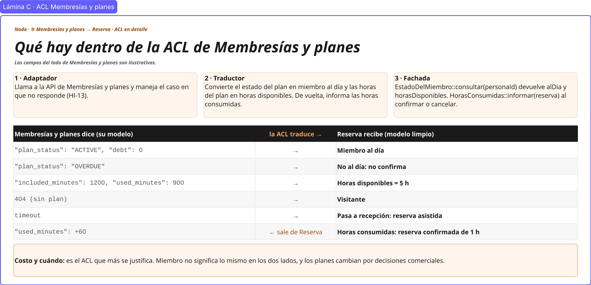
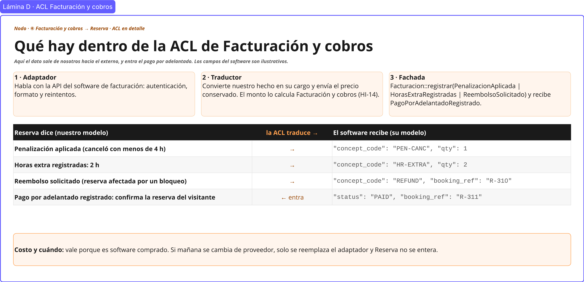
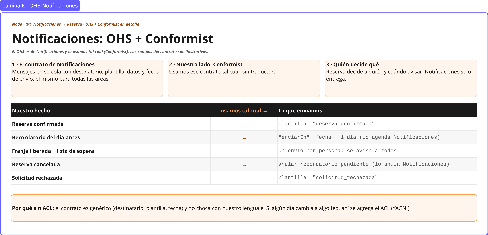
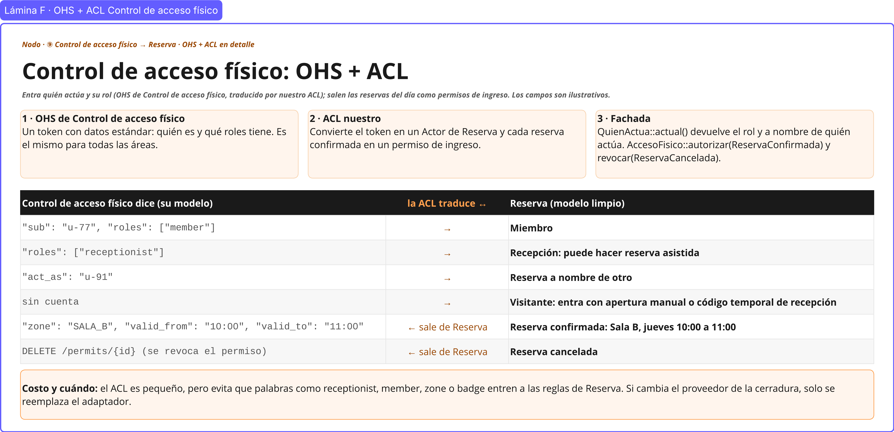

# 07 · Integración: patrones, dirección, qué cruza y mecanismo

> **Proyecto:** Nodo (coworking y eventos) · **Área:** Reservas y disponibilidad (core)
> **Alcance:** cómo se integra nuestra área con cada vecino del [context map](05-context-map.md). Se usa **el mismo mapa** (mismas cajas, posiciones y líneas ①–⑩) en cuatro capas; cada capa agrega una sola pregunta.

---

## Cómo leer las cuatro capas

| Capa | Pregunta que responde | Qué hay sobre cada línea |
|---|---|---|
| **1 · Patrón** | ¿Cómo se relacionan los dos modelos? | Shared kernel, Customer/Supplier, ACL, OHS, Conformist |
| **2 · Dirección** | ¿Quién define el contrato? | Flecha del de aguas arriba (U) al de aguas abajo (D) |
| **3 · Qué cruza** | ¿Qué dato o evento pasa? | «Entra» y «sale», leído desde nuestra área |
| **4 · Mecanismo** | ¿Cómo se integra en la práctica? | Llamada en proceso, API REST, mensajería, cola o API externa, y dónde va el ACL |

Las formas son las del [context map](05-context-map.md#vista-general-del-mapa): recuadro naranja, nuestra área; cajas blancas con borde gris, vecinos supporting; cajas grises punteadas, genéricos; franja gris al pie, Notificaciones (transversal).

---

## 1. Capa 1 · Patrón de cada relación

| # | Relación | Patrón | ¿Cooperan? | ¿Quién controla el modelo? |
|---|---|---|---|---|
| ① | Disponibilidad ↔ Reserva | **Shared kernel** | Sí: mismo equipo, misma área core | Los dos. Comparten solo **Franja** e **identificador de sala** |
| ② | Espacios y recursos → Disponibilidad | **Customer/Supplier + ACL** | Sí: se negocia qué salas se publican | Espacios y recursos (catálogo) |
| ③ | Espacios y recursos → Reserva | **Customer/Supplier + ACL** | Sí: se negocia el aforo de cada sala | Espacios y recursos |
| ④ | Tarifas y precios → Reserva | **Customer/Supplier + ACL** | Sí: se negocia el precio vigente y la cotización mensual | Tarifas y precios |
| ⑤ | Membresías y planes → Reserva | **Customer/Supplier + ACL** | Sí: se negocia «al día» y las horas | Membresías y planes |
| ⑥ | Facturación y cobros → Reserva | **ACL** | No: es software externo | Facturación y cobros |
| ⑦ ⑧ | Notificaciones → Reserva | **OHS + Conformist** | No: un mismo contrato para todas las áreas | Notificaciones |
| ⑨ | Control de acceso físico → Reserva | **OHS + ACL** | No: es una solución externa | Control de acceso físico |
| ⑩ | Disponibilidad → Agenda de eventos | **Customer/Supplier** | Sí: se negocia cómo pide equipo Agenda de eventos | Disponibilidad (agenda del equipo portátil) |

**Separate Ways:** Reservas y disponibilidad ↔ Agenda de eventos **por los espacios**. El salón es un recurso aparte y se alquila por horas o jornadas; salas y salón no se integran. Lo único compartido es el equipo portátil, y eso va por la línea ⑩. Las demás relaciones sin línea (Disponibilidad con Membresías y planes, Facturación y cobros o Notificaciones) pasan por Reserva ([context map, sección 5](05-context-map.md#5-lo-que-no-tiene-línea-y-por-qué)).

**Por qué ACL en ②–⑤:** sus modelos cambian por motivos propios (salas nuevas, planes nuevos, tarifas por temporada) y no queremos que eso nos obligue a cambiar nuestras reglas ([context map, «Dónde protegerse»](05-context-map.md#7-hotspots-de-integración-resueltos)).

---

## 2. Capa 2 · Dirección (aguas arriba y aguas abajo)

| # | Aguas arriba (U) | Aguas abajo (D) |
|---|---|---|
| ① | — (Shared kernel, sin flecha) | — |
| ② | Espacios y recursos | Disponibilidad |
| ③ | Espacios y recursos | Reserva |
| ④ | Tarifas y precios | Reserva |
| ⑤ | Membresías y planes | Reserva |
| ⑥ | Facturación y cobros | Reserva |
| ⑦ ⑧ | Notificaciones | Reserva |
| ⑨ | Control de acceso físico | Reserva |
| ⑩ | Disponibilidad | Agenda de eventos |

**Regla:** manda el de aguas arriba; define el contrato y el de aguas abajo se adapta. En ⑥, ⑦⑧ y ⑨ los datos también salen de Reserva, pero manda el vecino porque es un servicio externo o transversal. En ⑩ mandamos nosotros: Disponibilidad es dueña de la agenda del equipo y Agenda de eventos se adapta a su contrato.

---

## 3. Capa 3 · Qué cruza cada frontera

| # | Entra a nuestra área | Sale de nuestra área |
|---|---|---|
| ① | Disponibilidad → Reserva: **Franja liberada**, **Sala bloqueada** | Reserva → Disponibilidad: ocupar o liberar la franja |
| ② | Salas reservables y unidades de equipo portátil (alta y baja) | — |
| ③ | Aforo de cada sala | — |
| ④ | Precio vigente de la franja · reserva mensual cotizada | — |
| ⑤ | Miembro al día · horas incluidas | Horas consumidas (reserva confirmada o cancelada) |
| ⑥ | **Pago por adelantado registrado** | **Penalización aplicada**, **Horas extra registradas**, **Reembolso solicitado** |
| ⑦ ⑧ | — | ⑦ Confirmación, recordatorio y **Solicitud rechazada** · ⑧ aviso a toda la lista de espera |
| ⑨ | Quién actúa y su rol | Reservas del día (permiso de ingreso) |
| ⑩ | Pedido de ocupar o liberar una unidad de equipo para un evento | Equipo asignado o no disponible |

Los nombres de los eventos son los de [03-eventstorming.md](03-eventstorming.md). El detalle de cada línea está en el [context map](05-context-map.md#3-qué-cruza-cada-relación).

---

## 4. Capa 4 · Mecanismo técnico

| # | Mecanismo | Por qué |
|---|---|---|
| ① | **Llamada en proceso** · eventos de dominio en proceso | Disponibilidad y Reserva viven en el mismo monolito modular. Reserva confirma solo si Disponibilidad ocupó la franja, y la agenda de la sala garantiza aislamiento transaccional (HI-01). Cada aggregate se guarda en su propia transacción. |
| ② | Mensajería async + ACL | El catálogo avisa cuando una sala se crea, cambia o se da de baja; Disponibilidad no tiene que preguntar. |
| ③ | API REST + ACL | Reserva consulta el aforo al registrar la solicitud. |
| ④ | API REST + ACL | Reserva consulta el precio vigente al confirmar y la cotización mensual cuando el cliente la acepta. |
| ⑤ | API REST + ACL | Reserva necesita saber «al día» en el momento de confirmar (R-02). Si no responde, la solicitud pasa a recepción (HI-13). |
| ⑥ | API externa + ACL | Software de facturación y pasarela de pago de terceros. |
| ⑦ ⑧ | Cola de mensajes (async) | Si Notificaciones no está disponible, la reserva igual se confirma; el aviso sale después. |
| ⑨ | Token con rol + ACL · API externa + ACL | El rol llega en el token; las reservas del día se envían a la solución de la cerradura. |
| ⑩ | API REST (la publica Disponibilidad) | Agenda de eventos necesita saber en el momento si consiguió el equipo para confirmar su evento. Tiene un solo consumidor: no se justifica un OHS. |

### Por qué algunas líneas combinan dos patrones o dos mecanismos

Cada combinación responde a un lado distinto de la relación o a un sentido distinto del flujo; no son dos alternativas para lo mismo.

| Línea | Combinación | Justificación |
|---|---|---|
| ②–⑤ | **Customer/Supplier + ACL** | Customer/Supplier describe la relación **entre los equipos**: el vecino atiende lo que le pedimos y avisa sus cambios. El ACL es lo que hacemos **de nuestro lado** para que su modelo no entre al nuestro. |
| ⑦⑧ | **OHS + Conformist** | El OHS es el lado de Notificaciones (un contrato publicado para todos); Conformist es el nuestro (lo usamos tal cual, sin traducir). |
| ⑨ | **OHS + ACL** | El OHS es el lado de Control de acceso físico (un token igual para todas las áreas); el ACL es el nuestro, porque su vocabulario (*receptionist*, *zone*, *act_as*) sí choca con el de Reserva. |
| ① | **Llamada en proceso + eventos de dominio en proceso** | Ocupar la franja necesita una respuesta **inmediata** para poder confirmar (INV-R1): es una llamada. Liberar la franja y avisar a la lista de espera son **reacciones** a algo que ya pasó: son eventos. |
| ② y ③ | **Mensajería async** (②) y **API REST** (③) con el mismo vecino | Responden a momentos distintos. El catálogo cambia pocas veces y avisa cuando cambia (②). El aforo se necesita en el instante de registrar la solicitud (③). |
| ⑨ | **Token con rol** y **API externa** | Son los dos sentidos de la línea: el token **entra** con cada operación; los permisos de ingreso **salen** hacia la cerradura. |

---

## 5. Detalle de cada ACL y OHS

Un **ACL** (capa anticorrupción) es la frontera que traduce el modelo del vecino al nuestro, para que sus palabras y sus cambios no entren a nuestras reglas. Tiene tres piezas:

| Pieza | Qué hace | Si el vecino cambia… |
|---|---|---|
| **Adaptador** | Habla con el vecino: API, eventos, autenticación, formato, reintentos y fallas. | Se cambia el adaptador. |
| **Traductor** | Convierte su modelo al nuestro (y al revés cuando el dato sale). | Se cambia la traducción. |
| **Fachada** | Es lo único que ve nuestro dominio, con nombres de nuestro glosario. | No cambia: el dominio no se entera. |

Un **OHS** (servicio de host abierto) es lo contrario: el vecino publica un contrato igual para todos sus consumidores. Si ese contrato no choca con nuestro lenguaje, lo usamos tal cual (**Conformist**); si choca, ponemos un ACL encima.

Cada ACL u OHS tiene su lámina en Miro. Cada lámina muestra arriba las tres piezas, en el medio una tabla «el vecino dice → nosotros recibimos» con casos concretos, y abajo **costo y cuándo**: por qué vale la pena el ACL. Los campos del lado del vecino son **ilustrativos**.

| Lámina | Relación | Patrón |
|---|---|---|
| A | ② ③ Espacios y recursos | ACL |
| B | ④ Tarifas y precios | ACL |
| C | ⑤ Membresías y planes | ACL |
| D | ⑥ Facturación y cobros | ACL |
| E | ⑦ ⑧ Notificaciones | OHS + Conformist |
| F | ⑨ Control de acceso físico | OHS + ACL |

### ② ③ ACL de Espacios y recursos

**Para qué sirve:** Espacios y recursos mantiene el catálogo completo de Nodo (escritorios, salas y salón). A nuestra área solo le interesan las salas que se reservan por franja (las de reunión y la de capacitación) y las unidades de equipo portátil: Disponibilidad necesita saber cuáles se pueden reservar y Reserva necesita el aforo de cada sala. El ACL filtra lo que no es nuestro y entrega cada dato al contexto que lo usa.

**Cuándo actúa:** cuando el catálogo avisa que una sala o una unidad de equipo se creó, cambió o se dio de baja (mensajería async), y cuando Reserva consulta el aforo al registrar una solicitud (API REST).

| Pieza | Qué hace |
|---|---|
| Adaptador | Escucha los eventos del catálogo (sala o equipo creado, cambiado o dado de baja) y consulta el aforo de una sala. |
| Traductor | Convierte el tipo y el estado en salas reservables y unidades de equipo portátil para Disponibilidad, y la capacidad en aforo para Reserva. |
| Fachada | `SalasReservables::obtener(salaId)` y `EquipoPortatil::unidades(tipo)` para Disponibilidad, y `AforoDeSala::consultar(salaId)` para Reserva. |

| Espacios y recursos dice | Disponibilidad y Reserva reciben |
|---|---|
| `"tipo": "ESCRITORIO_FIJO" \| "ESCRITORIO_FLEXIBLE" \| "SALON"` | Se ignora: no se reserva en nuestra área |
| `"tipo": "SALA_REUNION", "estado": "ACTIVA"` | Disponibilidad: sala de reunión reservable |
| `"capacidad": 8` | Reserva: aforo de la sala = 8 |
| `"estado": "BAJA"` | Como un bloqueo: la reserva afectada se reasigna, se reprograma o se reembolsa (HI-04) |
| `"tipo": "SALA_CAPACITACION", "capacidad": 40` | Disponibilidad: sala reservable · Reserva: aforo = 40 |
| `"tipo": "EQUIPO_PORTATIL", "subtipo": "PROYECTOR", "unidades": 1` | Disponibilidad: una unidad reservable, *Proyector 1*, con su propia agenda |
| `"equipamiento": ["TV"]` en una sala | Equipo de la sala: solo informativo en «Salas disponibles» |

**Costo y cuándo:** vale porque el catálogo cambia por motivos propios (salas nuevas, tipos de recurso nuevos). Sin ACL, Disponibilidad y Reserva tendrían que saber qué es un escritorio fijo o un salón.

### ④ ACL de Tarifas y precios

**Para qué sirve:** Tarifas y precios maneja la lista de precios de Nodo. Reserva no necesita la lista: solo el precio de **su** franja (sala y equipo pedido) en el momento de confirmar, que conserva aunque la tarifa cambie después. También recibe la cotización de una reserva mensual cuando el cliente la acepta.

**Cuándo actúa:** al confirmar una reserva (precio vigente) y al aceptar una cotización mensual (API REST).

| Pieza | Qué hace |
|---|---|
| Adaptador | Llama a la API de Tarifas y precios para el precio vigente de la franja y la cotización de una reserva mensual. |
| Traductor | Convierte la tarifa en el precio que conserva la reserva confirmada, y la cotización aceptada en una reserva mensual por confirmar. |
| Fachada | `PrecioDeFranja::vigente(salaId, franja, equipoPedido)` y `ReservaMensual::cotizacion(cotizacionId)`. |

| Tarifas y precios dice | Reserva recibe |
|---|---|
| `"rate_id": "T-07", "unit": "HOUR"` | Precio vigente de la franja: la reserva lo conserva al confirmar |
| `"rate_id": "T-08"` (tarifa nueva) | No afecta a las reservas confirmadas: conservan su precio |
| `"quote_status": "ACCEPTED"` | Reserva mensual cotizada: cada fecha cumple las reglas de una reserva normal (HI-09) |
| `"quote_status": "EXPIRED"` | Cotización vencida (4 días): no aparta la franja (HI-08) |
| `"rate_id": "T-20", "item": "PROYECTOR"` | Precio del equipo pedido en esa franja: se suma al precio conservado de la reserva |

**Costo y cuándo:** vale porque las tarifas cambian por motivos propios (la dirección las cambia y hay tarifas por temporada). Sin ACL, Reserva tendría que entender la lista de precios en lugar de conservar solo el precio de su franja.

### ⑤ ACL de Membresías y planes

**Para qué sirve:** para Membresías y planes, un miembro es el titular de un plan con su estado de pago y sus minutos; para Reserva, es alguien que está al día o no y que tiene horas disponibles. El ACL convierte una cosa en la otra, distingue al visitante (no tiene plan) y devuelve las horas consumidas, porque la cuenta la lleva Membresías y planes (HI-12).

**Cuándo actúa:** al confirmar una solicitud (consulta del estado, R-02) y al confirmar o cancelar una reserva (horas consumidas). Si Membresías y planes no responde, el adaptador no rechaza la solicitud: la pasa a recepción.

| Pieza | Qué hace |
|---|---|
| Adaptador | Llama a la API de Membresías y planes y maneja el caso en que no responde. |
| Traductor | Convierte el estado del plan en miembro al día y las horas del plan en horas disponibles. De vuelta, informa las horas consumidas. |
| Fachada | `EstadoDelMiembro::consultar(personaId)` devuelve `alDia` y `horasDisponibles`; `HorasConsumidas::informar(reserva)` al confirmar o cancelar. |

| Membresías y planes dice | Reserva recibe |
|---|---|
| `"plan_status": "ACTIVE", "debt": 0` | Miembro al día |
| `"plan_status": "OVERDUE"` | No al día: no confirma |
| `"included_minutes": 1200, "used_minutes": 900` | Horas disponibles = 5 h |
| `404` (sin plan) | Visitante |
| sin respuesta (timeout) | Pasa a recepción: reserva asistida (HI-13) |
| `"used_minutes": +60` ← sale de Reserva | Horas consumidas: reserva confirmada de 1 h (HI-12) |

**Costo y cuándo:** es el ACL que más se justifica. «Miembro» no significa lo mismo en los dos lados, y los planes cambian por decisiones comerciales.

### ⑥ ACL de Facturación y cobros

**Para qué sirve:** Reserva sabe **qué pasó** (canceló tarde, usó horas extra, la sala se bloqueó y hay que devolver); Facturación y cobros sabe **cuánto cobrar** y cómo emitir el cargo. El ACL convierte nuestros hechos en cargos del software, con el precio conservado, y trae de vuelta el pago por adelantado del visitante, que confirma su reserva.

**Cuándo actúa:** cuando ocurre *Penalización aplicada*, *Horas extra registradas* o *Reembolso solicitado* (sale), y cuando el software registra el pago del visitante (entra).

| Pieza | Qué hace |
|---|---|
| Adaptador | Habla con la API del software de facturación: autenticación, formato y reintentos. |
| Traductor | Convierte nuestro hecho en su cargo y envía el precio conservado. El monto lo calcula Facturación y cobros (HI-14). |
| Fachada | `Facturacion::registrar(PenalizacionAplicada \| HorasExtraRegistradas \| ReembolsoSolicitado)` y recibe `PagoPorAdelantadoRegistrado`. |

| Reserva dice | El software recibe |
|---|---|
| Penalización aplicada (canceló con menos de 4 h) | `"concept_code": "PEN-CANC", "qty": 1` |
| Horas extra registradas: 2 h | `"concept_code": "HR-EXTRA", "qty": 2` |
| Reembolso solicitado (reserva afectada por un bloqueo) | `"concept_code": "REFUND", "booking_ref": "R-310"` |
| Pago por adelantado registrado ← entra: confirma la reserva del visitante (P-10) | `"status": "PAID", "booking_ref": "R-311"` |

**Costo y cuándo:** vale porque es software comprado. Si mañana se cambia de proveedor, solo se reemplaza el adaptador y Reserva no se entera.

### ⑦ ⑧ OHS de Notificaciones (nosotros: Conformist)

**Para qué sirve:** Notificaciones envía los avisos por WhatsApp o correo para todas las áreas de Nodo con un único contrato. Reserva decide **a quién y cuándo** avisar; Notificaciones solo entrega, programa el recordatorio y lo anula si se lo piden.

**Cuándo actúa:** al confirmar, al rechazar, el día antes de la reserva, al cancelar (anular el recordatorio) y cuando se libera una franja con lista de espera.

| Pieza | Qué hace |
|---|---|
| Contrato de Notificaciones | Mensajes en su cola con destinatario, plantilla, datos y fecha de envío; el mismo para todas las áreas. |
| Nuestro lado | Usamos ese contrato tal cual, sin traductor. |
| Quién decide qué | Reserva decide a quién y cuándo avisar. Notificaciones solo entrega, programa y anula. |

| Nuestro hecho | Lo que enviamos |
|---|---|
| Reserva confirmada | plantilla `"reserva_confirmada"` |
| Recordatorio del día antes | `"enviarEn"`: fecha − 1 día (lo programa Notificaciones, HI-17) |
| Franja liberada + lista de espera | un envío por persona: se avisa a todos (P-06) |
| Reserva cancelada | anular el recordatorio pendiente (lo anula Notificaciones, HI-18) |
| Solicitud rechazada | plantilla `"solicitud_rechazada"` (P-08) |

**Por qué sin ACL:** el contrato es genérico (destinatario, plantilla, fecha) y no choca con nuestro lenguaje. Si algún día cambia a algo que sí choque, ahí se agrega un ACL.

### ⑨ OHS + ACL de Control de acceso físico

**Para qué sirve:** tiene dos sentidos. **Entra** quién actúa y con qué rol: Control de acceso físico lo publica en un token igual para todas las áreas (OHS), y nuestro ACL lo convierte en miembro, visitante o recepción, y en «a nombre de quién» para la reserva asistida. **Salen** las reservas del día: para la cerradura, una reserva confirmada es un permiso de ingreso a una sala en una ventana de tiempo, que se revoca si la reserva se cancela.

**Cuándo actúa:** en cada operación (para saber quién actúa), al confirmar una reserva (autorizar el ingreso) y al cancelarla (revocarlo).

| Pieza | Qué hace |
|---|---|
| OHS de Control de acceso físico | Un token con datos estándar: quién es y qué roles tiene. Es el mismo para todas las áreas. |
| ACL nuestro | Convierte el token en un actor de Reserva y cada reserva confirmada en un permiso de ingreso. |
| Fachada | `QuienActua::actual()` devuelve el rol y a nombre de quién actúa; `AccesoFisico::autorizar(ReservaConfirmada)` y `revocar(ReservaCancelada)`. |

| Control de acceso físico dice | Reserva |
|---|---|
| `"sub": "u-77", "roles": ["member"]` | Miembro |
| `"roles": ["receptionist"]` | Recepción: puede hacer reserva asistida |
| `"act_as": "u-91"` | Reserva a nombre de otro |
| sin cuenta | Visitante: entra con apertura manual o código temporal de recepción (HI-20) |
| `"zone": "SALA_B", "valid_from": "10:00", "valid_to": "11:00"` ← sale | Reserva confirmada: Sala B, jueves 10:00 a 11:00 |
| `DELETE /permits/{id}` ← sale | Reserva cancelada |

**Costo y cuándo:** el ACL es pequeño, pero evita que palabras como *receptionist*, *member*, *zone* o *badge* entren a las reglas de Reserva. Si cambia el proveedor de la cerradura, solo se reemplaza el adaptador.

---

## 6. Decisiones de esta etapa

La justificación completa está en [decisiones/0003-patrones-de-integracion.md](../decisiones/0003-patrones-de-integracion.md).

| Tema | Decisión |
|---|---|
| ① Disponibilidad ↔ Reserva | Shared kernel acotado (Franja e identificador de sala), llamada en proceso, un aggregate por transacción. |
| ②–⑤ vecinos supporting | Customer/Supplier + ACL. |
| ⑥ Facturación y cobros | ACL frente al externo. |
| ⑦⑧ Notificaciones | OHS + Conformist por cola de mensajes; Reserva pide programar y anular el recordatorio. |
| ⑨ Control de acceso físico | OHS + ACL: entra el rol, salen las reservas del día. |
| Agenda de eventos | Separate Ways por los espacios; Customer/Supplier (⑩) por el equipo portátil compartido, con Disponibilidad aguas arriba. |
