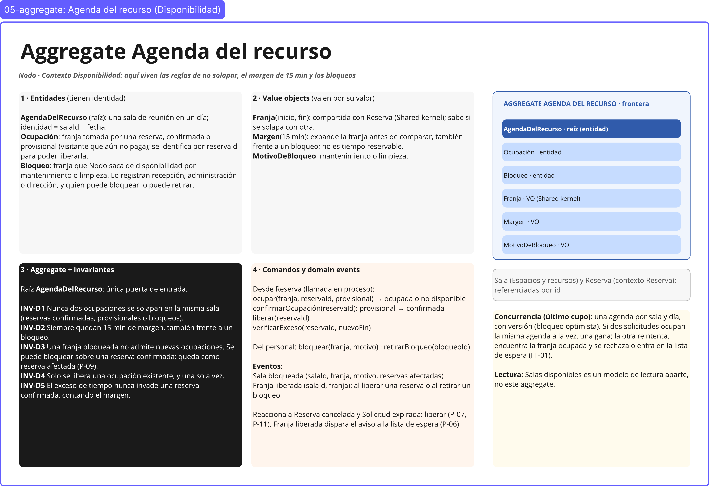
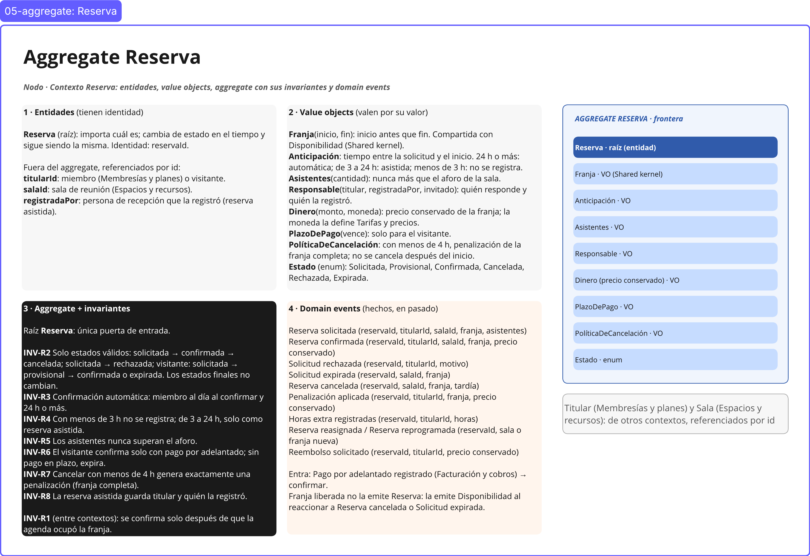
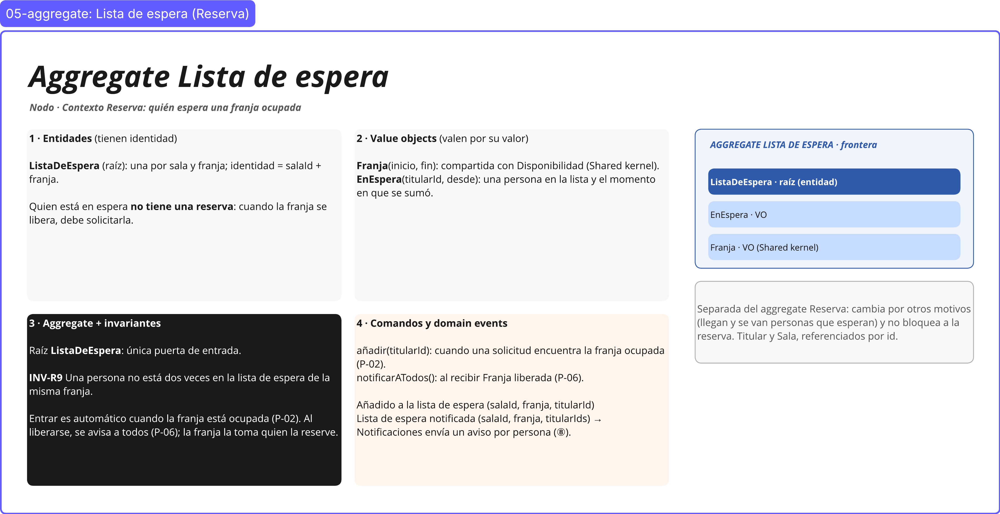

# 08 · Modelo: entidades, value objects, aggregates y domain events

> **Proyecto:** Nodo (coworking y eventos) · **Área:** Reservas y disponibilidad (core)
> **Alcance:** el modelo de cada bounded context. Cada invariante candidata de [06-reglas-invariantes.md](06-reglas-invariantes.md) queda protegida por un aggregate, y cada evento de [03-eventstorming.md](03-eventstorming.md) tiene quién lo emite y qué datos lleva.

---

## Cómo leer los frames

Cada aggregate tiene un frame en Miro con la misma estructura:

| Forma en el frame | Qué es |
|---|---|
| Caja gris claro «1 · Entidades» | Lo que tiene identidad: importa cuál es, aunque cambie de estado |
| Caja gris claro «2 · Value objects» | Lo que vale por su valor: se compara por contenido y no cambia |
| Caja negra «3 · Aggregate + invariantes» | La raíz y las invariantes (INV-xx) que protege |
| Caja naranja claro «4 · Domain events» | Hechos en pasado que emite, con su payload, y los comandos que recibe |
| Panel azul «frontera» | Lo que está **dentro** del aggregate: la raíz (azul oscuro) y sus partes (azul claro) |
| Caja gris con borde | Lo que queda **fuera** y se referencia por id |

| Aggregate | Contexto | Invariantes | Frame en Miro |
|---|---|---|---|
| **Agenda del recurso** | Disponibilidad | INV-D1 a INV-D5 | 05-aggregate: Agenda del recurso (Disponibilidad) |
| **Reserva** | Reserva | INV-R2 a INV-R8 | 05-aggregate: Reserva |
| **Lista de espera** | Reserva | INV-R9 | 05-aggregate: Lista de espera (Reserva) |
| *(entre contextos)* | Disponibilidad ↔ Reserva | INV-R1 | Secuencia «ocupar la franja → confirmar la reserva» ([sección 5](#5-cómo-colaboran-los-aggregates)) |

---

## 1. Lo que comparten los dos contextos

**Franja**(inicio, fin) es el único value object compartido (Shared kernel, [07-integracion.md](07-integracion.md#1-capa-1--patrón-de-cada-relación)). Garantiza que el inicio sea anterior al fin y sabe si se solapa con otra franja. Junto con el **identificador de sala**, es lo único que Disponibilidad y Reserva definen en común.

---

## 2. Aggregate Agenda del recurso (Disponibilidad)

### Entidades

| Entidad | Identidad | Qué es |
|---|---|---|
| **AgendaDelRecurso** (raíz) | salaId + fecha | Una sala de reunión en un día, con sus ocupaciones y bloqueos. |
| **Ocupación** | reservaId | Franja tomada por una reserva, **confirmada** o **provisional** (visitante que aún no paga). Se identifica por la reserva para poder liberarla. |
| **Bloqueo** | bloqueoId | Franja que Nodo saca de disponibilidad por mantenimiento o limpieza. Lo registran recepción, administración o dirección, y quien puede bloquear lo puede retirar. |

La sala (Espacios y recursos) y la reserva (contexto Reserva) quedan fuera y se referencian por id.

### Value objects

| Value object | Regla que encierra |
|---|---|
| **Franja**(inicio, fin) | Compartida con Reserva; sabe si se solapa con otra. |
| **Margen**(15 min) | Expande la franja antes de comparar, también frente a un bloqueo. No es tiempo reservable. |
| **MotivoDeBloqueo** | Mantenimiento o limpieza. |

### Invariantes que protege

| ID | Invariante |
|---|---|
| INV-D1 | Nunca dos ocupaciones se solapan en la misma sala (reservas confirmadas, provisionales o bloqueos). |
| INV-D2 | Siempre quedan 15 min de margen, también frente a un bloqueo. |
| INV-D3 | Una franja bloqueada no admite nuevas ocupaciones. Se puede bloquear sobre una reserva confirmada: queda como reserva afectada (P-09). |
| INV-D4 | Solo se libera una ocupación existente, y una sola vez. |
| INV-D5 | El exceso de tiempo nunca invade una reserva confirmada, contando el margen. |

### Comandos y domain events

| Comando | Quién lo pide | Resultado |
|---|---|---|
| `ocupar(franja, reservaId, provisional)` | Reserva (llamada en proceso) | Ocupada o no disponible |
| `confirmarOcupación(reservaId)` | Reserva, al registrarse el pago del visitante | La ocupación provisional pasa a confirmada |
| `liberar(reservaId)` | Reserva cancelada o Solicitud expirada (P-07, P-11) | **Franja liberada** |
| `verificarExceso(reservaId, nuevoFin)` | Recepción, al registrar exceso de tiempo (R-06) | Puede seguir o debe desalojar |
| `bloquear(franja, motivo)` | Recepción, administración o dirección | **Sala bloqueada** |
| `retirarBloqueo(bloqueoId)` | Quien puede bloquear | **Franja liberada** |

| Evento | Payload |
|---|---|
| **Sala bloqueada** | salaId, franja, motivo, reservas afectadas |
| **Franja liberada** | salaId, franja |

### Concurrencia: el último cupo

Hay una agenda **por sala y por día**, con versión (bloqueo optimista). Si dos solicitudes ocupan la misma agenda a la vez, una gana; la otra reintenta, encuentra la franja ocupada y se rechaza o entra en la lista de espera (HI-01). La agenda es pequeña, así que solo compiten quienes piden la misma sala el mismo día.

**Salas disponibles** es un modelo de lectura aparte, que se actualiza con los eventos de la agenda; no es este aggregate.

---

## 3. Aggregate Reserva

### Entidades

| Entidad | Identidad | Qué es |
|---|---|---|
| **Reserva** (raíz) | reservaId | Lo que pide una persona sobre una franja de una sala. Cambia de estado y sigue siendo la misma. |

Fuera del aggregate, referenciados por id: **titularId** (miembro de Membresías y planes, o visitante), **salaId** (Espacios y recursos) y **registradaPor** (persona de recepción, en una reserva asistida).

### Value objects

| Value object | Regla que encierra |
|---|---|
| **Franja**(inicio, fin) | Compartida con Disponibilidad. |
| **Anticipación** | Tiempo entre la solicitud y el inicio. 24 h o más: automática; de 3 a 24 h: asistida; menos de 3 h: no se registra. |
| **Asistentes**(cantidad) | Nunca más que el aforo de la sala. |
| **Responsable**(titular, registradaPor, invitado) | Quién responde por la reserva y quién la registró. |
| **Dinero**(monto, moneda) | Precio conservado de la franja; la moneda la define Tarifas y precios. |
| **PlazoDePago**(vence) | Solo para el visitante. |
| **PolíticaDeCancelación** | Con menos de 4 h, penalización de la franja completa; no se cancela después del inicio. |
| **Estado** | Solicitada, Provisional, Confirmada, Cancelada, Rechazada, Expirada. |

### Estados

| Desde | Hacia | Cuándo |
|---|---|---|
| Solicitada | Confirmada | La agenda ocupó la franja y se cumplen INV-R3 a R5, o la registra recepción (reserva asistida) |
| Solicitada | Provisional | Es un visitante: la franja queda apartada hasta el plazo de pago |
| Solicitada | Rechazada | No está al día, supera el aforo, menos de 3 h o pierde la última franja (P-08) |
| Provisional | Confirmada | Pago por adelantado registrado (P-10) |
| Provisional | Expirada | Vence el plazo sin pago (P-11) |
| Confirmada | Cancelada | La cancela el titular o recepción antes del inicio; o se reembolsa por un bloqueo (cancelada sin cobro) |
| Confirmada | Confirmada | Reasignada a otra sala o reprogramada a otra franja (P-09) |

Cancelada, Rechazada y Expirada son estados finales.

### Invariantes que protege

| ID | Invariante |
|---|---|
| INV-R2 | Solo pasa por estados válidos (tabla anterior). |
| INV-R3 | La confirmación automática exige miembro al día al confirmar y 24 h o más de anticipación. |
| INV-R4 | Con menos de 3 h no se registra; de 3 a 24 h, solo como reserva asistida. |
| INV-R5 | Los asistentes nunca superan el aforo. |
| INV-R6 | El visitante confirma solo con pago por adelantado; sin pago en plazo, expira. |
| INV-R7 | Cancelar con menos de 4 h genera exactamente una penalización (la franja completa). |
| INV-R8 | La reserva asistida guarda el titular y quién la registró. |

### Domain events

| Evento | Payload | Lo escucha |
|---|---|---|
| **Reserva solicitada** | reservaId, titularId, salaId, franja, asistentes | Lista de espera (si la franja está ocupada) |
| **Reserva confirmada** | reservaId, titularId, salaId, franja, precio conservado | Notificaciones, Membresías y planes, Control de acceso físico |
| **Solicitud rechazada** | reservaId, titularId, motivo | Notificaciones |
| **Solicitud expirada** | reservaId, salaId, franja | Disponibilidad (liberar) |
| **Reserva cancelada** | reservaId, salaId, franja, tardía | Disponibilidad (liberar), Membresías y planes, Notificaciones, Control de acceso físico |
| **Penalización aplicada** | reservaId, titularId, franja, precio conservado | Facturación y cobros |
| **Horas extra registradas** | reservaId, titularId, horas | Facturación y cobros |
| **Reserva reasignada** / **Reserva reprogramada** | reservaId, sala o franja nueva | Notificaciones, Control de acceso físico |
| **Reembolso solicitado** | reservaId, titularId, precio conservado | Facturación y cobros |

**Entra desde Facturación y cobros:** *Pago por adelantado registrado* → confirmar la reserva del visitante.

*Franja liberada* no la emite Reserva: la emite Disponibilidad al reaccionar a *Reserva cancelada* o *Solicitud expirada*.

---

## 4. Aggregate Lista de espera (Reserva)

| Parte | Contenido |
|---|---|
| **Raíz** | **ListaDeEspera**: una por sala y franja; identidad = salaId + franja. |
| **Value objects** | **Franja** (compartida) y **EnEspera**(titularId, desde): una persona en la lista y el momento en que se sumó. |
| **Invariante** | **INV-R9:** una persona no está dos veces en la lista de espera de la misma franja. |
| **Comandos** | `añadir(titularId)`: cuando una solicitud encuentra la franja ocupada (P-02). `notificarATodos()`: al recibir *Franja liberada* (P-06). |
| **Eventos** | **Añadido a la lista de espera** (salaId, franja, titularId) · **Lista de espera notificada** (salaId, franja, titularIds) → Notificaciones envía un aviso por persona. |

Quien está en espera **no tiene una reserva**: cuando la franja se libera, debe solicitarla. Es un aggregate aparte porque cambia por otros motivos (llegan y se van personas que esperan) y no debe bloquear a la reserva.

---

## 5. Cómo colaboran los aggregates

Cada aggregate se guarda en su propia transacción. Entre aggregates viajan llamadas en proceso (Reserva → Agenda del recurso) y domain events.

| Caso | Secuencia |
|---|---|
| **Miembro reserva (24 h o más)** | Reserva solicitada → Reserva pide `ocupar` a la agenda → si quedó ocupada y el miembro está al día: **Reserva confirmada** (INV-R1). Si no quedó ocupada: Lista de espera `añadir` o **Solicitud rechazada**. |
| **Visitante reserva** | Reserva solicitada → `ocupar(provisional)` → estado Provisional → *Pago por adelantado registrado* → `confirmarOcupación` → **Reserva confirmada**. Sin pago: **Solicitud expirada** → `liberar` → **Franja liberada**. |
| **Cancelación** | Reserva cancelada (con **Penalización aplicada** si faltan menos de 4 h) → `liberar` → **Franja liberada** → Lista de espera `notificarATodos` → **Lista de espera notificada**. |
| **Bloqueo sobre una reserva** | `bloquear` → **Sala bloqueada** (con reservas afectadas) → recepción u operaciones resuelve: **Reserva reasignada**, **Reserva reprogramada** o **Reembolso solicitado** (P-09). |
| **Exceso de tiempo** | Recepción registra el exceso → `verificarExceso` → si no invade la siguiente reserva: **Horas extra registradas**; si la invade, debe desalojar (INV-D5). |

---

## 6. Trazabilidad

| Invariante | Aggregate | Evento que la evidencia | Regla o política de origen |
|---|---|---|---|
| INV-D1, INV-D2 | Agenda del recurso | (ocupar devuelve ocupada o no disponible) | R-01 |
| INV-D3 | Agenda del recurso | Sala bloqueada | R-07, H-02 |
| INV-D4 | Agenda del recurso | Franja liberada | P-07, P-11 |
| INV-D5 | Agenda del recurso | Horas extra registradas | R-06 |
| INV-R1 | Entre contextos | Reserva confirmada | P-01 |
| INV-R2 | Reserva | Todos los de Reserva | — |
| INV-R3 | Reserva | Reserva confirmada · Solicitud rechazada | R-02 |
| INV-R4 | Reserva | Solicitud rechazada | R-03 |
| INV-R5 | Reserva | Solicitud rechazada | R-04 |
| INV-R6 | Reserva | Reserva confirmada · Solicitud expirada | R-05, P-10, P-11 |
| INV-R7 | Reserva | Penalización aplicada | P-05 |
| INV-R8 | Reserva | Reserva confirmada (asistida) | R-03 |
| INV-R9 | Lista de espera | Añadido a la lista de espera | P-02, P-06 |

---

## 7. Decisiones de esta etapa

| ID | Decisión |
|---|---|
| D-53 | Un bloqueo se puede retirar antes de su fin, solo por quien puede bloquear; al retirarlo se emite *Franja liberada*. |
| D-54 | Dinero(monto, moneda) sin fijar la moneda en el modelo: la define Tarifas y precios. |
| D-55 | Una agenda por sala y por día (salaId + fecha), con versión para la concurrencia. |
| D-56 | Lista de espera es un aggregate propio, por sala y franja, que protege INV-R9. |
