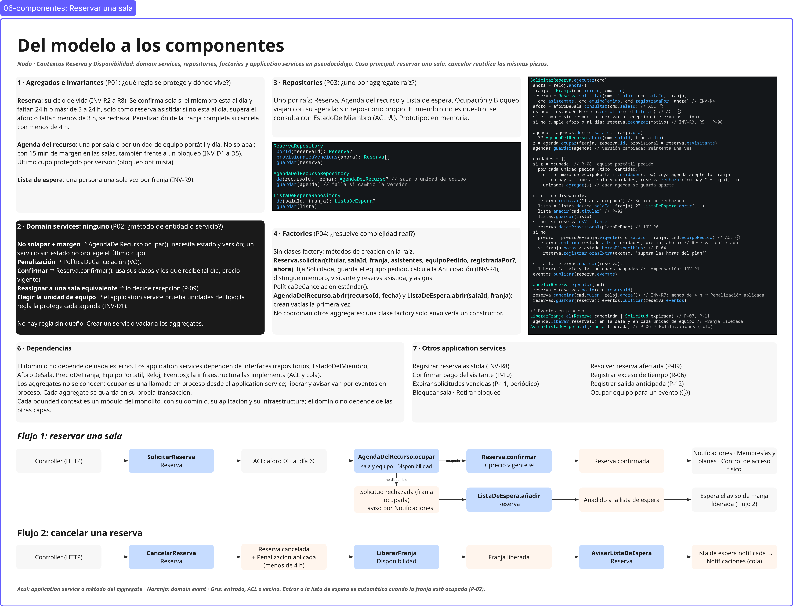

# 09 · Componentes: del modelo al código

> **Proyecto:** Nodo (coworking y eventos) · **Área:** Reservas y disponibilidad (core)
> **Alcance:** qué piezas necesita el modelo de [08-modelo.md](08-modelo.md) para funcionar: domain services, repositories, factories, application services y dependencias. Todo en **pseudocódigo neutro**: el lenguaje se define en el prototipo. Caso principal: **reservar una sala**; cancelar reutiliza las mismas piezas.

---

## Vista general



**Cómo leer el frame**

| Forma en el frame | Qué es |
|---|---|
| Recuadros 1 a 7 | Una pregunta de diseño por recuadro (P01–P05) y su respuesta |
| Recuadros de código | Pseudocódigo: interfaces de repositorios y application services |
| Caja azul (flujos) | Application service o método de un aggregate |
| Caja naranja (flujos) | Domain event |
| Caja gris (flujos) | Entrada, ACL o vecino |

---

## 1. Aggregates e invariantes (P01: ¿qué regla se protege y dónde vive?)

| Aggregate | Contexto | Invariantes | Detalle |
|---|---|---|---|
| **Reserva** | Reserva | INV-R2 a INV-R8 | [08-modelo.md](08-modelo.md#3-aggregate-reserva) |
| **Agenda del recurso** | Disponibilidad | INV-D1 a INV-D5 | [08-modelo.md](08-modelo.md#2-aggregate-agenda-del-recurso-disponibilidad) |
| **Lista de espera** | Reserva | INV-R9 | [08-modelo.md](08-modelo.md#4-aggregate-lista-de-espera-reserva) |

INV-R1 (toda reserva confirmada tiene su franja ocupada) cruza los dos contextos: la cumple el application service con la secuencia «ocupar la franja → confirmar la reserva».

---

## 2. Domain services (P02: ¿método de entidad o servicio?)

**Ninguno.** Cada regla tiene un dueño dentro de un aggregate:

| Regla | Dónde vive | Por qué no es un domain service |
|---|---|---|
| No solapar, con 15 min de margen | `AgendaDelRecurso.ocupar()` | Necesita el estado de la agenda y su versión; un servicio sin estado no protege el último cupo. |
| Penalización por cancelación tardía | `PolíticaDeCancelación` (value object) | Solo depende de la reserva y de su política. |
| Confirmar | `Reserva.confirmar()` | Usa sus propios datos y los que recibe (al día, precio vigente). |
| Reasignar a una sala equivalente | Recepción (P-09) | Es una decisión de una persona, no una regla automática. |
<<<<<<< HEAD
=======
| Elegir qué unidad de equipo asignar | Application service: prueba las unidades del tipo pedido hasta que una agenda acepta la franja | No hay una regla de negocio para elegir entre unidades iguales; la regla «sin solapes» la protege cada agenda (INV-D1). |
>>>>>>> 736506b707297628417a878d849e4947bc782029

Crear un servicio para estas reglas vaciaría los aggregates (modelo anémico).

---

## 3. Repositories (P03: ¿uno por aggregate raíz?)

Uno por raíz. **Ocupación** y **Bloqueo** viajan con su agenda: no tienen repositorio propio. El miembro no es nuestro: se consulta con la fachada `EstadoDelMiembro` del ACL de Membresías y planes ([07-integracion.md](07-integracion.md), sección 5). En el prototipo, los repositorios son **en memoria**.

```text
ReservaRepository
  porId(reservaId): Reserva?
  provisionalesVencidas(ahora): Reserva[]
  guardar(reserva)

AgendaDelRecursoRepository
<<<<<<< HEAD
  de(salaId, fecha): AgendaDelRecurso?
=======
  de(recursoId, fecha): AgendaDelRecurso?     // una sala o una unidad de equipo
>>>>>>> 736506b707297628417a878d849e4947bc782029
  guardar(agenda)            // falla si cambió la versión (bloqueo optimista)

ListaDeEsperaRepository
  de(salaId, franja): ListaDeEspera?
  guardar(lista)
```

---

## 4. Factories (P04: ¿resuelve complejidad real?)

**Sin clases factory:** métodos de creación en la raíz.

| Método | Qué hace |
|---|---|
<<<<<<< HEAD
| `Reserva.solicitar(titular, salaId, franja, asistentes, registradaPor?, ahora)` | Fija el estado Solicitada, calcula la Anticipación (INV-R4), distingue miembro, visitante y reserva asistida, y asigna `PolíticaDeCancelación.estándar()`. |
| `AgendaDelRecurso.abrir(salaId, fecha)` | Crea la agenda vacía la primera vez que se pide esa sala ese día. |
=======
| `Reserva.solicitar(titular, salaId, franja, asistentes, equipoPedido, registradaPor?, ahora)` | Fija el estado Solicitada, guarda el equipo pedido, calcula la Anticipación (INV-R4), distingue miembro, visitante y reserva asistida, y asigna `PolíticaDeCancelación.estándar()`. |
| `AgendaDelRecurso.abrir(recursoId, fecha)` | Crea la agenda vacía la primera vez que se pide ese recurso (una sala o una unidad de equipo) ese día. |
>>>>>>> 736506b707297628417a878d849e4947bc782029
| `ListaDeEspera.abrir(salaId, franja)` | Crea la lista vacía la primera vez que alguien espera esa franja. |

Ninguno coordina otros aggregates: una clase factory solo envolvería un constructor.

---

## 5. Application services (P05: coordinan, no deciden)

### Reservar una sala

```text
SolicitarReserva.ejecutar(cmd)
  ahora   = reloj.ahora()
  franja  = Franja(cmd.inicio, cmd.fin)
  reserva = Reserva.solicitar(cmd.titular, cmd.salaId, franja,
<<<<<<< HEAD
              cmd.asistentes, cmd.registradaPor, ahora)   // INV-R4
  aforo   = aforoDeSala.consultar(cmd.salaId)             // ACL ③
  estado  = estadoDelMiembro.consultar(cmd.titular)       // ACL ⑤
  si estado = sin respuesta: derivar a recepción (reserva asistida)   // HI-13
  si no cumple aforo o al día: reserva.rechazar(motivo)   // INV-R3, INV-R5
=======
              cmd.asistentes, cmd.equipoPedido, cmd.registradaPor, ahora)   // INV-R4
  aforo   = aforoDeSala.consultar(cmd.salaId)             // ACL ③
  estado  = estadoDelMiembro.consultar(cmd.titular)       // ACL ⑤
  si estado = sin respuesta: derivar a recepción (reserva asistida)   // HI-13
  si no cumple aforo o al día: reserva.rechazar(motivo)   // INV-R3, INV-R5 · P-08
>>>>>>> 736506b707297628417a878d849e4947bc782029

  agenda = agendas.de(cmd.salaId, franja.dia)
           ?? AgendaDelRecurso.abrir(cmd.salaId, franja.dia)
  r = agenda.ocupar(franja, reserva.id, provisional = reserva.esVisitante)
  agendas.guardar(agenda)       // versión cambiada: reintenta una vez

<<<<<<< HEAD
=======
  unidades = []
  si r = ocupada:                                         // R-08: equipo portátil pedido
    para cada (tipo, cantidad) en cmd.equipoPedido:
      repetir cantidad veces:
        u = primera unidad de equipoPortatil.unidades(tipo) cuya agenda acepte
              ocupar(franja, reserva.id, provisional = reserva.esVisitante)   // cada agenda se guarda aparte
        si no hay u:
          liberar la sala y las unidades ya ocupadas      // no se confirma una parte del pedido
          reserva.rechazar("no hay " + tipo + " libre")   // Solicitud rechazada
          guardar, publicar y terminar
        unidades.agregar(u)

>>>>>>> 736506b707297628417a878d849e4947bc782029
  si r = no disponible:
    reserva.rechazar("franja ocupada")                    // Solicitud rechazada
    lista = listas.de(cmd.salaId, franja) ?? ListaDeEspera.abrir(cmd.salaId, franja)
    lista.añadir(cmd.titular)                             // P-02
    listas.guardar(lista)
  si no, si reserva.esVisitante:
    reserva.dejarProvisional(plazoDePago)                 // INV-R6
  si no:
<<<<<<< HEAD
    precio = precioDeFranja.vigente(cmd.salaId, franja)   // ACL ④
    reserva.confirmar(estado.alDia, precio, ahora)        // Reserva confirmada

  si falla reservas.guardar(reserva):
    agenda.liberar(reserva.id); agendas.guardar(agenda)   // compensación: INV-R1
=======
    precio = precioDeFranja.vigente(cmd.salaId, franja, cmd.equipoPedido)   // ACL ④
    reserva.confirmar(estado.alDia, unidades, precio, ahora)   // Reserva confirmada (P-01)
    si franja.horas > estado.horasDisponibles:              // P-04
      reserva.registrarHorasExtra(franja.horas - estado.horasDisponibles,
                                  "supera las horas del plan")  // Horas extra registradas

  si falla reservas.guardar(reserva):
    liberar la sala y las unidades ocupadas              // compensación: INV-R1
>>>>>>> 736506b707297628417a878d849e4947bc782029
  eventos.publicar(reserva.eventos)
  devolver reserva.id
```

**Por qué así:**
- El application service **coordina** (pide datos, llama a los aggregates, guarda y publica); las reglas las deciden `Reserva` y `AgendaDelRecurso`.
- **Ocupar antes de confirmar** cumple INV-R1 sin modificar dos aggregates en la misma transacción. Si guardar la reserva falla, se libera la franja.
- Si la franja está ocupada, la solicitud queda **rechazada** y la persona se **añade a la lista de espera** (D-57): quien espera no tiene reserva.
<<<<<<< HEAD
=======
- El equipo se ocupa **después** de la sala y con la misma franja: si falta una unidad, se deshace todo y se rechaza (D-62). No hay lista de espera por equipo: la persona puede volver a pedir la sala sin él.
>>>>>>> 736506b707297628417a878d849e4947bc782029

### Cancelar una reserva

```text
CancelarReserva.ejecutar(cmd)
  reserva = reservas.porId(cmd.reservaId)
  reserva.cancelar(cmd.quien, reloj.ahora())   // INV-R7: menos de 4 h → Penalización aplicada
  reservas.guardar(reserva)
  eventos.publicar(reserva.eventos)            // Reserva cancelada

// Eventos en proceso
LiberarFranja.al(Reserva cancelada | Solicitud expirada)    // Disponibilidad, P-07 y P-11
<<<<<<< HEAD
  agenda.liberar(e.reservaId)                               // Franja liberada
=======
  para la sala y cada unidad de equipo de la reserva:
    agenda.liberar(e.reservaId)                             // Franja liberada
>>>>>>> 736506b707297628417a878d849e4947bc782029
AvisarListaDeEspera.al(Franja liberada)                     // Reserva, P-06
  lista.notificarATodos()                                   // Lista de espera notificada → Notificaciones (cola)
```

### Otros application services

| Application service | Qué coordina | Origen |
|---|---|---|
| Registrar reserva asistida | Igual que `SolicitarReserva`, con `registradaPor` y, si corresponde, los datos del invitado | INV-R8, R-03 |
| Confirmar pago del visitante | Al recibir *Pago por adelantado registrado*: `agenda.confirmarOcupación` y `reserva.confirmar` | P-10 |
| Expirar solicitudes vencidas | Periódico: `reloj` y `provisionalesVencidas(ahora)` → *Solicitud expirada* → *Franja liberada* | P-11, D-60 |
| Bloquear sala · Retirar bloqueo | `agenda.bloquear` → *Sala bloqueada* · `agenda.retirarBloqueo` → *Franja liberada* | R-07, D-53 |
| Resolver reserva afectada | Recepción u operaciones elige reasignar, reprogramar o reembolsar | P-09 |
<<<<<<< HEAD
| Registrar exceso de tiempo | `agenda.verificarExceso` → *Horas extra registradas* o desalojar | R-06, INV-D5 |
=======
| Registrar exceso de tiempo | `agenda.verificarExceso` → `reserva.registrarHorasExtra` → *Horas extra registradas*, o desalojar | R-06, INV-D5 |
| Registrar salida anticipada | Recepción: `agenda.liberarResto(reservaId, ahora)` en la sala y en cada equipo asignado → *Franja liberada* → aviso a la lista de espera | P-12, INV-D4, H-13 |
| Ocupar equipo para un evento | Lo pide Agenda de eventos por la API de ⑩: `agenda.ocupar(franja, eventoId)` en una unidad libre del tipo; y `liberar` si el evento se cae | R-08, ⑩ |

### Dónde se cumple cada política

Cada política del EventStorming tiene un componente que la ejecuta: un application service, un manejador de eventos en proceso o el vecino que la recibe por su contrato.

| Política | Evento que la dispara | Quién reacciona | Componente |
|---|---|---|---|
| P-01 confirmar | Reserva solicitada | Reserva | `SolicitarReserva` → `reserva.confirmar` |
| P-02 lista de espera | Franja ocupada al solicitar | Reserva | `SolicitarReserva` → `ListaDeEspera.añadir` |
| P-03 recordatorio | Reserva confirmada | Notificaciones (vecino) | Reserva envía la fecha del recordatorio por la cola ⑦; Notificaciones lo programa (HI-17) |
| P-04 horas sobre el plan | Reserva confirmada | Reserva | `SolicitarReserva` → `reserva.registrarHorasExtra` → Facturación y cobros (ACL ⑥) |
| P-05 cobrar la penalización | Penalización aplicada | Facturación y cobros (vecino) | `Facturacion::registrar` (ACL ⑥); el monto lo calcula el vecino (HI-14) |
| P-06 avisar a la lista | Franja liberada | Reserva | `AvisarListaDeEspera` → `lista.notificarATodos` → Notificaciones (cola ⑧) |
| P-07 liberar al cancelar | Reserva cancelada | Disponibilidad | `LiberarFranja` → `agenda.liberar` |
| P-08 rechazar y avisar | Solicitud que no cumple o pierde la franja | Reserva | `SolicitarReserva` → `reserva.rechazar` → Notificaciones (cola ⑦) |
| P-09 resolver reserva afectada | Sala bloqueada | Recepción u operaciones | `Resolver reserva afectada` (reasignar, reprogramar o reembolsar) |
| P-10 confirmar al visitante | Pago por adelantado registrado | Reserva | `Confirmar pago del visitante` |
| P-11 expirar | Plazo de pago vencido | Reserva y Disponibilidad | `Expirar solicitudes vencidas` → `LiberarFranja` |
| P-12 salida anticipada | Recepción registra la salida | Disponibilidad | `Registrar salida anticipada` → `agenda.liberarResto` |
>>>>>>> 736506b707297628417a878d849e4947bc782029

---

## 6. Dependencias

- El **dominio** no depende de nada externo.
<<<<<<< HEAD
- Los **application services** dependen de interfaces: repositorios, `EstadoDelMiembro`, `AforoDeSala`, `PrecioDeFranja`, `Reloj` y el publicador de eventos. La **infraestructura** las implementa (ACL y cola hacia Notificaciones, [07-integracion.md](07-integracion.md)).
=======
- Los **application services** dependen de interfaces: repositorios, `EstadoDelMiembro`, `AforoDeSala`, `PrecioDeFranja`, `EquipoPortatil`, `Reloj` y el publicador de eventos. La **infraestructura** las implementa (ACL y cola hacia Notificaciones, [07-integracion.md](07-integracion.md)).
>>>>>>> 736506b707297628417a878d849e4947bc782029
- Los aggregates **no se conocen**: ocupar es una llamada en proceso desde el application service; liberar y avisar a la lista de espera van por eventos en proceso. Cada aggregate se guarda en su propia transacción.
- Cada bounded context es un **módulo del monolito**, con su dominio, su aplicación y su infraestructura; el dominio no depende de las otras capas.

---

## 7. Flujos

| Flujo | Secuencia |
|---|---|
<<<<<<< HEAD
| **1 · Reservar una sala** | Controller → **SolicitarReserva** → ACL (aforo ③, al día ⑤) → **AgendaDelRecurso.ocupar** (Disponibilidad). Ocupada → **Reserva.confirmar** (+ precio vigente ④) → *Reserva confirmada* → Notificaciones, Membresías y planes, Control de acceso físico. No disponible → *Solicitud rechazada* (aviso por Notificaciones) → **ListaDeEspera.añadir** → *Añadido a la lista de espera*. |
=======
| **1 · Reservar una sala** | Controller → **SolicitarReserva** → ACL (aforo ③, al día ⑤) → **AgendaDelRecurso.ocupar** (Disponibilidad: la sala y, si se pidió, una unidad de cada equipo). Ocupada → **Reserva.confirmar** (+ precio vigente ④) → *Reserva confirmada* → Notificaciones, Membresías y planes, Control de acceso físico. No disponible → *Solicitud rechazada* (aviso por Notificaciones) → **ListaDeEspera.añadir** → *Añadido a la lista de espera*. |
>>>>>>> 736506b707297628417a878d849e4947bc782029
| **2 · Cancelar una reserva** | Controller → **CancelarReserva** → *Reserva cancelada* (+ *Penalización aplicada* si faltan menos de 4 h) → **LiberarFranja** (Disponibilidad) → *Franja liberada* → **AvisarListaDeEspera** (Reserva) → *Lista de espera notificada* → Notificaciones (cola). |

---

<<<<<<< HEAD
## 8. Decisiones de esta etapa
=======
## 8. Lectura, módulos y lo que no se crea

**Modelo de lectura «Salas disponibles»: CQRS ligero, justificado.** Escribir necesita el aggregate con sus reglas (`AgendaDelRecurso.ocupar`); mostrar qué está libre solo necesita datos planos de todas las salas y equipos de un día. Por eso «Salas disponibles» es una consulta aparte que devuelve una vista sin reglas y nunca decide si una franja cabe: eso lo decide la agenda cuando alguien intenta ocuparla. No se separa el almacenamiento (CQRS completo) porque lectura y escritura todavía no divergen tanto como para pagar dos modelos (sesión 6).

**Módulos por concepto, no por capa técnica.** Cada bounded context es un módulo del monolito con el nombre del glosario (Disponibilidad, Reserva); dentro, su dominio, su aplicación y su infraestructura. Los nombres de clases y métodos son los del glosario: `AgendaDelRecurso.ocupar`, `Reserva.cancelar`, `ListaDeEspera.añadir`.

**Lo que se decidió no crear** (sesión 6: «diseñar también es decidir qué no crear»):

| No se crea | Por qué |
|---|---|
| Domain services | Cada regla tiene dueño (sección 2). |
| Clases factory | La creación es simple: métodos en la raíz (sección 4). |
| Repositorios de Ocupación, Bloqueo o EnEspera | Viajan con su raíz. |
| Repositorio de miembros | El miembro no es nuestro: lo da el ACL ⑤. |
| Un aggregate aparte para el equipo | Un equipo portátil es un recurso más con su agenda: la misma Agenda del recurso, sin margen (D-62). |
| Un evento «Franja ocupada» | No está en el muro; el hecho visible es *Reserva confirmada* (D-61). |

---

## 9. Decisiones de esta etapa
>>>>>>> 736506b707297628417a878d849e4947bc782029

| ID | Decisión |
|---|---|
| D-57 | Franja ocupada al solicitar: la solicitud se rechaza y la persona se añade a la lista de espera. |
| D-58 | Componentes en pseudocódigo neutro; lenguaje y estructura de carpetas pendientes hasta el prototipo; repositorios en memoria. |
| D-59 | Ningún domain service: cada regla tiene dueño. |
| D-60 | Expirar solicitudes vencidas: application service periódico, solo en la tabla. |
<<<<<<< HEAD
=======
| D-65 | «Salas disponibles» es una consulta de solo lectura (CQRS ligero), no un aggregate. |
| D-66 | Elegir la unidad de equipo es coordinación del application service, no un domain service. |
>>>>>>> 736506b707297628417a878d849e4947bc782029
